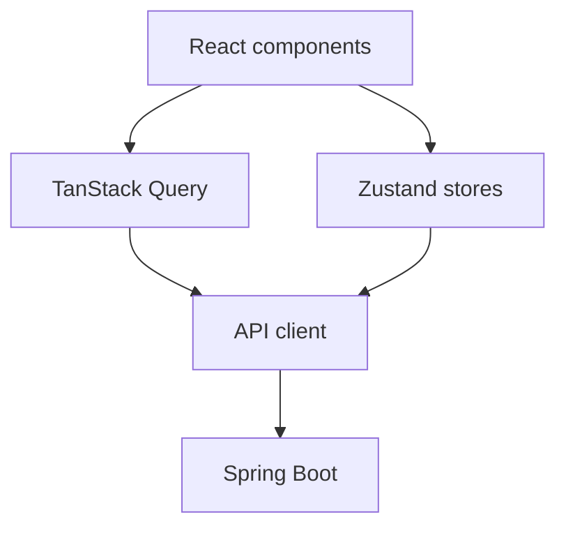
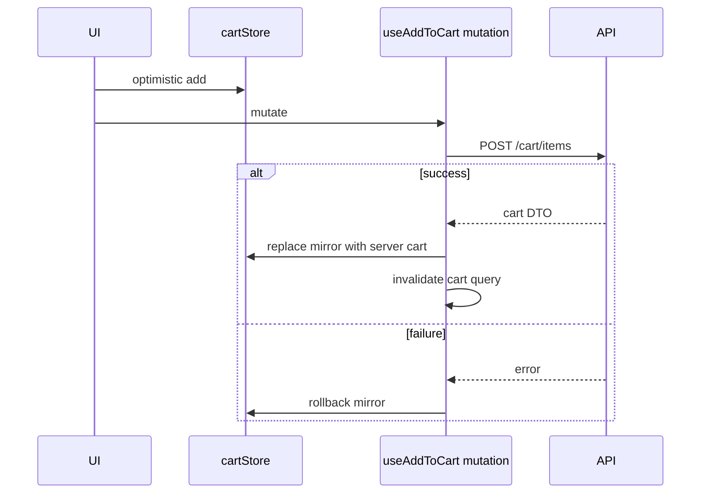
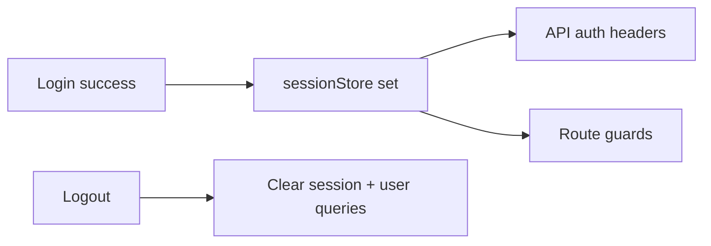

# 52 — Frontend State Management

## Purpose

Define how Neurolinx frontends manage state: **Zustand** for UI/cart/session client state, **TanStack Query** for server state, and auth/session handling across public and admin apps.

## Related documents

- [50_REACT_ARCHITECTURE.md](./50_REACT_ARCHITECTURE.md)
- [51_FRONTEND_FOLDER_STRUCTURE.md](./51_FRONTEND_FOLDER_STRUCTURE.md)
- [53_FRONTEND_API_INTEGRATION.md](./53_FRONTEND_API_INTEGRATION.md)
- [41_CART.md](./41_CART.md)
- [63_AUTHENTICATION.md](./63_AUTHENTICATION.md)

---

## Requirements

1. Clear separation between client state and server state.
2. Cart UX feels instant while remaining server-authoritative.
3. Auth session is available to route guards and API headers.
4. Cache invalidation after mutations is predictable.
5. Admin and web may share patterns but not necessarily the same store instances.

---

## Technical decisions

| State kind | Tool | Examples |
| --- | --- | --- |
| Server/cache | TanStack Query | Products, orders, profile, shipping quotes |
| Client/UI | Zustand | Mobile nav open, cursor mode, modal stack, theme |
| Cart mirror | Zustand + Query mutations | Optimistic lines; reconcile with API |
| Auth/session | Zustand session store + secure token strategy | Access token memory; refresh **TBD** |
| URL state | React Router search params | Filters, pagination, checkout step |

**Rule:** If the source of truth is the backend, prefer Query. If it is ephemeral UI, use Zustand. Cart is hybrid: Zustand for UX mirror, API/Query for truth.

---

## Zustand stores

### Recommended stores (`apps/web`)

| Store | Responsibility |
| --- | --- |
| `uiStore` | Nav, overlays, reduced-motion override flag, toast queue pointers |
| `cartStore` | Local cart lines mirror, pending flags, last error |
| `sessionStore` | Auth status, user summary, roles/claims needed by UI |
| `cursorStore` | Custom cursor mode (`DEFAULT`, `LINK`, `3D`, …) |
| `checkoutUiStore` (optional) | Step UI only — not totals |

### Cart hybrid pattern

Guest cart token storage strategy: **TBD** (prefer HttpOnly cookie set by API; if localStorage used, document threat model).

---

## TanStack Query

| Concern | Guidance |
| --- | --- |
| Query keys | Hierarchical factories, e.g. `['products', id]`, `['cart']`, `['orders', filters]` |
| Stale times | Short for cart/inventory; longer for static content — exact values **TBD** |
| Mutations | Always invalidate related keys |
| Prefetch | PDP and critical nav targets where beneficial |
| Errors | Map via shared error helper — [53_FRONTEND_API_INTEGRATION.md](./53_FRONTEND_API_INTEGRATION.md) |
| SSR | Not assumed initially |

Server state examples: product detail, search results, account profile, order list, quote list, approved reviews, shipping options.

---

## Auth state

| Topic | Guidance |
| --- | --- |
| Logged-in flag | Derived from session store + validated profile query |
| Tokens | Access token handling per [63_AUTHENTICATION.md](./63_AUTHENTICATION.md); do not invent JWT claims |
| Route guards | Redirect unauthenticated users from `/account/*` and checkout if guest disallowed |
| Logout | Clear session store, Query cache (at least user-scoped), reset cart mirror per merge rules |
| Admin | Separate session context in `apps/admin` |

Refresh transport: **locked** — access JWT in memory; refresh in HttpOnly cookie per [63_AUTHENTICATION.md](./63_AUTHENTICATION.md) and [ADR-006-AUTHENTICATION.md](./ADR/ADR-006-AUTHENTICATION.md). Frontend must use `credentials: 'include'` on auth/refresh calls.

---

## Functional requirements

| ID | Requirement |
| --- | --- |
| FR-ST-01 | Use TanStack Query for remote read/write caching. |
| FR-ST-02 | Use Zustand for UI chrome and cart/session mirrors. |
| FR-ST-03 | Cart mutations reconcile optimistic state with server DTOs. |
| FR-ST-04 | Auth session drives guards and API authorization headers. |
| FR-ST-05 | Logout clears sensitive client state. |
| FR-ST-06 | Filter/sort commerce listing state can live in URL params. |

## Non-functional requirements

| ID | Requirement |
| --- | --- |
| NFR-ST-01 | Avoid duplicating large server lists in Zustand. |
| NFR-ST-02 | Stores remain serializable where persistence is used. |
| NFR-ST-03 | No PII beyond necessity in persisted local storage. |
| NFR-ST-04 | Query Devtools enabled in development only. |

## Dependencies

- `@tanstack/react-query`
- `zustand`
- API client
- React Router

## Constraints

1. Do not store raw card data in any store.
2. Do not treat Zustand cart as checkout authority.
3. Do not share admin session store with the public app.

## Open questions (TBD)

- Persist middlewares for UI preferences
- Exact token storage mechanism
- Global vs feature-local stores preference enforcement in lint rules

## Acceptance criteria

- [ ] Zustand vs Query responsibilities are unambiguous.
- [ ] Cart hybrid flow is documented with Mermaid.
- [ ] Auth/session interaction with guards and headers is specified.
- [ ] Cross-refs to API and auth docs exist.
