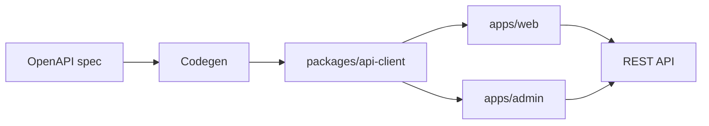
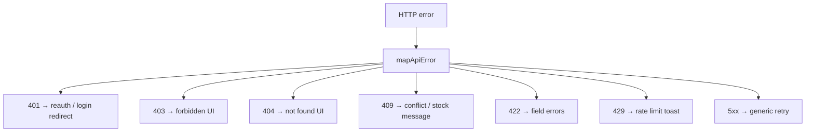

# 53 — Frontend API Integration

## Purpose

Define how Neurolinx React apps communicate with the Spring Boot backend: API client shape, auth headers, error/loading UX, and OpenAPI alignment.

## Related documents

- [50_REACT_ARCHITECTURE.md](./50_REACT_ARCHITECTURE.md)
- [52_FRONTEND_STATE_MANAGEMENT.md](./52_FRONTEND_STATE_MANAGEMENT.md)
- [62_API_ARCHITECTURE.md](./62_API_ARCHITECTURE.md)
- [63_AUTHENTICATION.md](./63_AUTHENTICATION.md)
- [91_API_SECURITY.md](./91_API_SECURITY.md)
- [40_ECOMMERCE_ARCHITECTURE.md](./40_ECOMMERCE_ARCHITECTURE.md)

---

## Requirements

1. All remote calls go through a shared HTTP client abstraction (`packages/api-client` and/or app `services/http`).
2. Client types align with backend OpenAPI contracts.
3. Auth credentials attach consistently; unauthenticated calls remain possible for public endpoints.
4. Errors and loading states have consistent UX patterns.
5. Idempotent commerce mutations send idempotency keys where required.

---

## Technical decisions

| Decision | Choice | Rationale |
| --- | --- | --- |
| Contract source | OpenAPI from Spring Boot | Single source of truth |
| Client generation | Prefer generated types/SDK (**tool TBD**: openapi-generator / orval / hey-api) | Reduces drift |
| Transport | `fetch` wrapper or thin axios-like client **TBD** | Keep swappable |
| Base URL | Env `VITE_API_BASE_URL` | Per-environment config |
| Versioning | Follow API versioning in [62_API_ARCHITECTURE.md](./62_API_ARCHITECTURE.md) | |

Until codegen is wired, hand-written DTOs must match the published OpenAPI; drift is a defect.

---

## API client responsibilities

1. Compose absolute URL from base + path.
2. Set JSON headers; attach `Authorization` when session present.
3. Attach guest cart token header/cookie as required by cart API.
4. Parse problem+json / standard error envelope (**exact envelope TBD** in API docs).
5. Surface typed results to TanStack Query hooks.
6. Support abort signals for unmount/cancel.

### Auth headers

| Mode | Behavior |
| --- | --- |
| Anonymous | No bearer; may send cart guest token |
| Authenticated | `Authorization: Bearer <accessToken>` **or** cookie session per auth decision |
| Admin | Admin token/session only from `apps/admin` |

Token refresh on `401`: **TBD** (single-flight refresh queue recommended once auth design is fixed).

---

## Error handling

| Requirement | Detail |
| --- | --- |
| User messaging | Prefer server `code` + safe message; never dump stack traces |
| Field errors | Bind to form fields on checkout/auth |
| Commerce conflicts | Map stock/coupon conflicts to actionable UI |
| Logging | Client logs without secrets/PII beyond need |
| Boundary | React error boundaries for render failures (separate from HTTP) |

---

## Loading states

| Pattern | When |
| --- | --- |
| Route-level suspense / page skeleton | Primary page data |
| Section skeleton | Secondary widgets (reviews, related) |
| Button pending | Mutations (add to cart, place order) |
| Optimistic UI | Cart qty where rollback is defined |
| Prefetch indicators | Subtle; avoid layout jump |

Never allow double-submit on payment confirmation — disable CTA while mutation in flight + server idempotency.

---

## OpenAPI alignment checklist

- [ ] CI fails or warns on breaking client/spec drift (**process TBD**)
- [ ] Enum names match backend
- [ ] Pagination shape shared
- [ ] Error model documented and mapped
- [ ] File upload endpoints use agreed multipart rules

---

## Functional requirements

| ID | Requirement |
| --- | --- |
| FR-API-FE-01 | Central client handles base URL, headers, parsing. |
| FR-API-FE-02 | Feature hooks wrap client calls via TanStack Query. |
| FR-API-FE-03 | Auth and guest cart credentials attach automatically when present. |
| FR-API-FE-04 | Errors map to stable UI behaviors by status/code. |
| FR-API-FE-05 | Loading/pending states prevent duplicate critical submissions. |
| FR-API-FE-06 | Client DTOs track OpenAPI. |

## Non-functional requirements

| ID | Requirement |
| --- | --- |
| NFR-API-FE-01 | Timeouts configured for slow networks (**values TBD**). |
| NFR-API-FE-02 | Abort in-flight requests on navigation where appropriate. |
| NFR-API-FE-03 | No secrets in frontend env beyond public base URL / public gateway keys. |
| NFR-API-FE-04 | HTTPS only in staging/production. |

## Dependencies

- Backend OpenAPI publish path
- Auth module
- Query provider
- Env configuration per deployment docs

## Constraints

1. Do not call third-party payment APIs with secret keys from the browser.
2. Do not bypass the client to scatter raw `fetch` calls without headers/error mapping (exceptions: rare low-level cases documented).
3. Do not invent API fields not present in OpenAPI.

## Open questions (TBD)

- Codegen tool
- Exact error envelope (`problem+json` vs custom)
- Cookie vs bearer auth on web
- Public CDN for media vs API streaming

## Acceptance criteria

- [ ] Client responsibilities and auth header rules are documented.
- [ ] Error and loading patterns are specified.
- [ ] OpenAPI alignment approach is clear.
- [ ] Cross-refs to API/auth/security docs exist.
