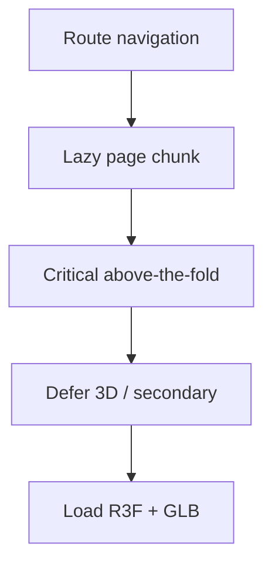
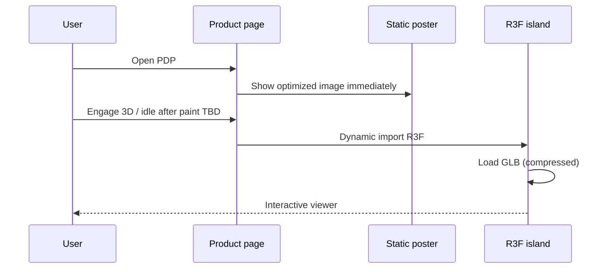

# 54 — Frontend Performance

## Purpose

Define performance standards for Neurolinx React frontends: code splitting, image/3D lazy loading, Core Web Vitals targets, and bundle budgets. Complements [102_PERFORMANCE_STANDARDS.md](./102_PERFORMANCE_STANDARDS.md) with frontend-specific guidance.

## Related documents

- [50_REACT_ARCHITECTURE.md](./50_REACT_ARCHITECTURE.md)
- [51_FRONTEND_FOLDER_STRUCTURE.md](./51_FRONTEND_FOLDER_STRUCTURE.md)
- [55_RESPONSIVE_DESIGN.md](./55_RESPONSIVE_DESIGN.md)
- [80_3D_ARCHITECTURE.md](./80_3D_ARCHITECTURE.md)
- [84_3D_PERFORMANCE.md](./84_3D_PERFORMANCE.md)
- [100_SEO_STRATEGY.md](./100_SEO_STRATEGY.md)
- [102_PERFORMANCE_STANDARDS.md](./102_PERFORMANCE_STANDARDS.md)

---

## Requirements

1. Premium motion and 3D must not prevent a fast first experience.
2. Routes and heavy libraries load on demand.
3. Images and 3D assets use lazy loading and modern formats.
4. Core Web Vitals are measured and gated in CI/monitoring where feasible.
5. Bundle budgets prevent silent regressions.

---

## Technical decisions

| Decision | Choice |
| --- | --- |
| Splitting | React Router lazy route modules + `import()` for R3F/GSAP islands |
| Images | Responsive `srcset`, WebP/AVIF, width/height or aspect-ratio to limit CLS |
| 3D | Lazy island; static image poster first |
| Smooth scroll (Lenis) | Load when not reduced-motion / not low-end (**heuristic TBD**) |
| Measurement | Lighthouse CI / Web Vitals RUM **TBD** tooling |



---

## Code splitting

| Split point | Mandatory |
| --- | --- |
| Each major route group (corporate, shop, product, checkout, account, admin sections) | Yes |
| Three.js / R3F / Drei | Yes — never in the initial web shell unless homepage absolutely requires it |
| GSAP plugins | Yes — import with the feature timeline |
| Admin charts/analytics libs | Yes — admin-only chunks |
| Large MD/blog renderers | On blog routes only |

Avoid barrel files that re-export heavy modules into the critical path.

---

## Image and 3D lazy load

### Images

- Use lazy loading below the fold (`loading="lazy"` or equivalent).
- Serve appropriately sized derivatives; do not ship 4K into mobile listings.
- Prefer WebP/AVIF with fallbacks.
- Reserve space to protect CLS.
- Hero/LCP image: high priority (`fetchpriority="high"`) and optimized.

### 3D



| Rule | Detail |
| --- | --- |
| Poster first | Always have 2D fallback |
| Draco/meshopt | Prefer compressed GLB — see [82_3D_MODEL_GUIDELINES.md](./82_3D_MODEL_GUIDELINES.md) |
| Mobile | Lower DPR / simpler materials / disable 3D **TBD** thresholds |
| Intersection | Load when viewer enters viewport |

---

## Core Web Vitals

Targets (align with [102_PERFORMANCE_STANDARDS.md](./102_PERFORMANCE_STANDARDS.md); if conflict, performance standards doc wins once filled):

| Metric | Target (recommended starting point) | Status |
| --- | --- | --- |
| LCP | ≤ 2.5s (good) on reference broadband mobile | Confirm in 102 |
| INP | ≤ 200ms | Confirm in 102 |
| CLS | ≤ 0.1 | Confirm in 102 |
| TTFB | **TBD** by hosting | |

Reference devices/networks for lab tests: **TBD**.

Special risks for Neurolinx:

- Custom cursor + Lenis + GSAP competing on main thread → schedule carefully; honor `prefers-reduced-motion`.
- WebGL can tank INP/battery → pause loops when offscreen.
- Font loading → use curated fonts with `font-display` strategy per design system (**TBD**).

---

## Bundle budgets

Initial budgets (adjust after first real build baseline):

| Bundle | Budget (gzipped, starting proposal) | Notes |
| --- | --- | --- |
| `apps/web` initial JS | **TBD** — propose ≤ 200 KB gz as aspirational gate | Measure first |
| Route async chunk | **TBD** — propose ≤ 150 KB gz typical | |
| R3F viewer chunk | Separate; may exceed typical route budget | Must not block LCP |
| `apps/admin` initial JS | Looser than public **TBD** | Still split by section |

CI should fail or warn on budget regressions once baselines exist.

```text
Tooling candidates: rollup-plugin-visualizer, Vite bundle analyze, size-limit, Lighthouse CI
Exact choice: TBD
```

---

## Functional requirements

| ID | Requirement |
| --- | --- |
| FR-PERF-01 | Major routes are lazy-loaded. |
| FR-PERF-02 | R3F/Three are dynamically imported behind posters/fallbacks. |
| FR-PERF-03 | Listing/PDP images use responsive modern formats. |
| FR-PERF-04 | Motion respects reduced-motion preferences. |
| FR-PERF-05 | Performance budgets are defined and monitored after baseline. |

## Non-functional requirements

| ID | Requirement |
| --- | --- |
| NFR-PERF-01 | WebGL canvases pause when not visible. |
| NFR-PERF-02 | No unbounded animation loops on static pages. |
| NFR-PERF-03 | Third-party scripts (analytics) load deferred — [103_ANALYTICS.md](./103_ANALYTICS.md). |
| NFR-PERF-04 | Public LCP path excludes admin and heavy editor deps. |

## Dependencies

- Vite build
- CDN/media pipeline
- 3D guidelines
- Monitoring/RUM (**TBD**)

## Constraints

1. Do not ship uncompressed hero videos/GLBs on first paint.
2. Do not block checkout on 3D availability.
3. Do not invent exact numeric budgets as permanent law before measuring — mark proposals TBD until baselined.

## Open questions (TBD)

- Final CWV gates in CI
- Low-end device detection heuristic
- Homepage 3D: on by default or opt-in
- Font hosting strategy

## Acceptance criteria

- [ ] Code splitting and lazy 3D/image rules are documented.
- [ ] CWV metrics are listed with pointer to platform performance standards.
- [ ] Bundle budget approach exists with TBD baselines.
- [ ] Mermaid shows poster-first 3D loading.
- [ ] Cross-refs to 3D and performance docs exist.
