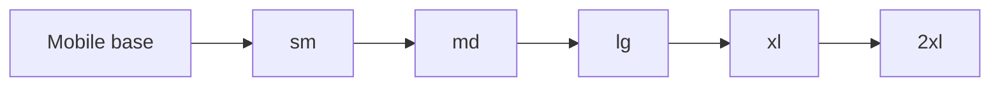
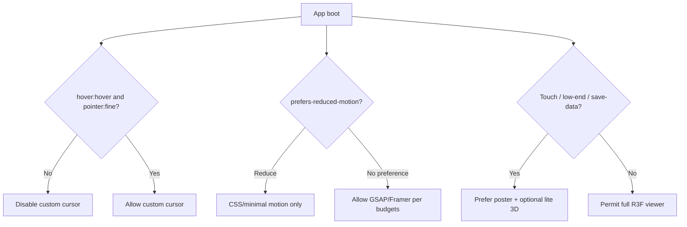

# 55 — Responsive Design

## Purpose

Define responsive behavior for Neurolinx React frontends: breakpoint system, mobile-first layout rules, and fallbacks for 3D / custom cursor experiences on touch and reduced-capability devices.

## Related documents

- [50_REACT_ARCHITECTURE.md](./50_REACT_ARCHITECTURE.md)
- [54_FRONTEND_PERFORMANCE.md](./54_FRONTEND_PERFORMANCE.md)
- [80_3D_ARCHITECTURE.md](./80_3D_ARCHITECTURE.md)
- [101_ACCESSIBILITY.md](./101_ACCESSIBILITY.md)
- [40_ECOMMERCE_ARCHITECTURE.md](./40_ECOMMERCE_ARCHITECTURE.md)

---

## Requirements

1. Interfaces are designed **mobile-first**, then enhanced for larger viewports.
2. Breakpoints are consistent via Tailwind theme tokens.
3. Touch devices get usable commerce and corporate flows without relying on hover-only affordances.
4. Custom cursor and heavy 3D degrade or disable appropriately.
5. Checkout and account flows remain usable on small screens.

---

## Technical decisions

| Decision | Choice |
| --- | --- |
| Approach | Mobile-first Tailwind utilities (`sm:`, `md:`, …) |
| Breakpoint source | Single Tailwind theme config in `packages/config` / app config |
| Pointer modes | Feature-detect hover/fine pointer; do not assume desktop from width alone |
| Cursor system | Off by default on touch / coarse pointer |
| 3D | Progressive enhancement with 2D fallback |

---

## Breakpoints

Starting Tailwind-aligned scale (adjust only via design system tokens):

| Token | Min width | Typical use |
| --- | --- | --- |
| default | 0 | Mobile base |
| `sm` | 640px | Large phones / small tablets |
| `md` | 768px | Tablets |
| `lg` | 1024px | Laptops |
| `xl` | 1280px | Desktops |
| `2xl` | 1536px | Large desktops |

Container max widths and grid columns: follow design system (**TBD** exact values). Do not invent marketing grid gimmicks that break cart/checkout readability.

---

## Mobile-first rules

1. Define base styles for single-column layouts; add columns at `md`/`lg`.
2. Primary CTAs (Add to Cart, Request Quote) remain visible without horizontal scroll.
3. Navigation collapses to an accessible disclosure/pattern on small screens.
4. Tables (specs, order lines) transform to stacked cards or horizontal scroll with affordance.
5. Sticky checkout summaries must not obscure CTAs; test with on-screen keyboards.
6. Tap targets meet accessibility minimums ([101_ACCESSIBILITY.md](./101_ACCESSIBILITY.md)).

### Commerce-specific

| Surface | Mobile expectation |
| --- | --- |
| Listing filters | Drawer / bottom sheet |
| PDP gallery | Swipeable; 3D behind explicit control |
| Cart | Full page; line qty steppers thumb-friendly |
| Checkout | One column; steps stacked |
| Account | Section nav as select or stacked links |

---

## 3D and cursor fallbacks on touch

| Feature | Desktop (fine pointer) | Touch / coarse pointer |
| --- | --- | --- |
| Custom cursor | Allowed | **Disabled**; native cursor |
| Hover mega-menus | OK with focus equivalents | Tap to open; click-outside/ESC to close |
| Magnetic buttons | Optional | Disabled |
| 3D rotate/drag | Mouse drag | Touch drag if 3D enabled; else static/orbit buttons |
| Lenis smooth scroll | Optional | Often disable on iOS issues **TBD**; never break scroll chaining |
| Parallax | Subtle | Prefer reduced / off |

Detection notes:

- Use CSS media (`(hover: hover) and (pointer: fine)`) plus runtime checks.
- Width alone is insufficient (tablets with pens, foldables, desktop touchscreens).
- Honor `prefers-reduced-motion: reduce` by disabling non-essential animation and autoplaying WebGL flourishes.
- `Save-Data` / low memory heuristics: **TBD**; when implemented, force 2D posters.

---

## Functional requirements

| ID | Requirement |
| --- | --- |
| FR-RESP-01 | Shared breakpoint tokens used across web (and admin where applicable). |
| FR-RESP-02 | Mobile-first styles are the default. |
| FR-RESP-03 | Custom cursor does not activate on touch/coarse pointers. |
| FR-RESP-04 | Every 3D experience has a non-3D fallback. |
| FR-RESP-05 | Hover-only actions have keyboard/touch equivalents. |
| FR-RESP-06 | Checkout completes on a reference mobile viewport without horizontal page scroll. |

## Non-functional requirements

| ID | Requirement |
| --- | --- |
| NFR-RESP-01 | Layout shift from responsive images/fonts remains within CLS targets. |
| NFR-RESP-02 | Touch scrolling remains native-feeling when Lenis is disabled. |
| NFR-RESP-03 | Responsive behavior is covered in testing strategy ([111_FRONTEND_TESTING.md](./111_FRONTEND_TESTING.md)). |
| NFR-RESP-04 | Text remains readable without zoom hacks at base mobile size. |

## Dependencies

- Tailwind theme
- Cursor feature module
- 3D viewer feature
- Accessibility standards

## Constraints

1. Do not ship a desktop-only custom cursor that blocks taps.
2. Do not require WebGL for purchasing or submitting a quote.
3. Do not invent device-specific business rules (e.g. “hide prices on mobile”).

## Open questions (TBD)

- Exact container widths / type scale per breakpoint
- Whether Lenis is enabled on any mobile browsers
- Lite 3D quality profile parameters
- Admin responsive priority (desktop-first admin **TBD** vs also mobile)

## Acceptance criteria

- [ ] Breakpoint table documented.
- [ ] Mobile-first and commerce mobile patterns specified.
- [ ] Cursor/3D fallback decision tree documented with Mermaid.
- [ ] Pointer media queries preferred over width-only assumptions.
- [ ] Cross-refs to performance, 3D, and accessibility docs exist.
