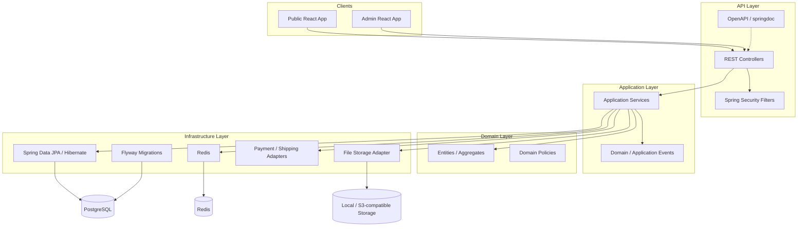
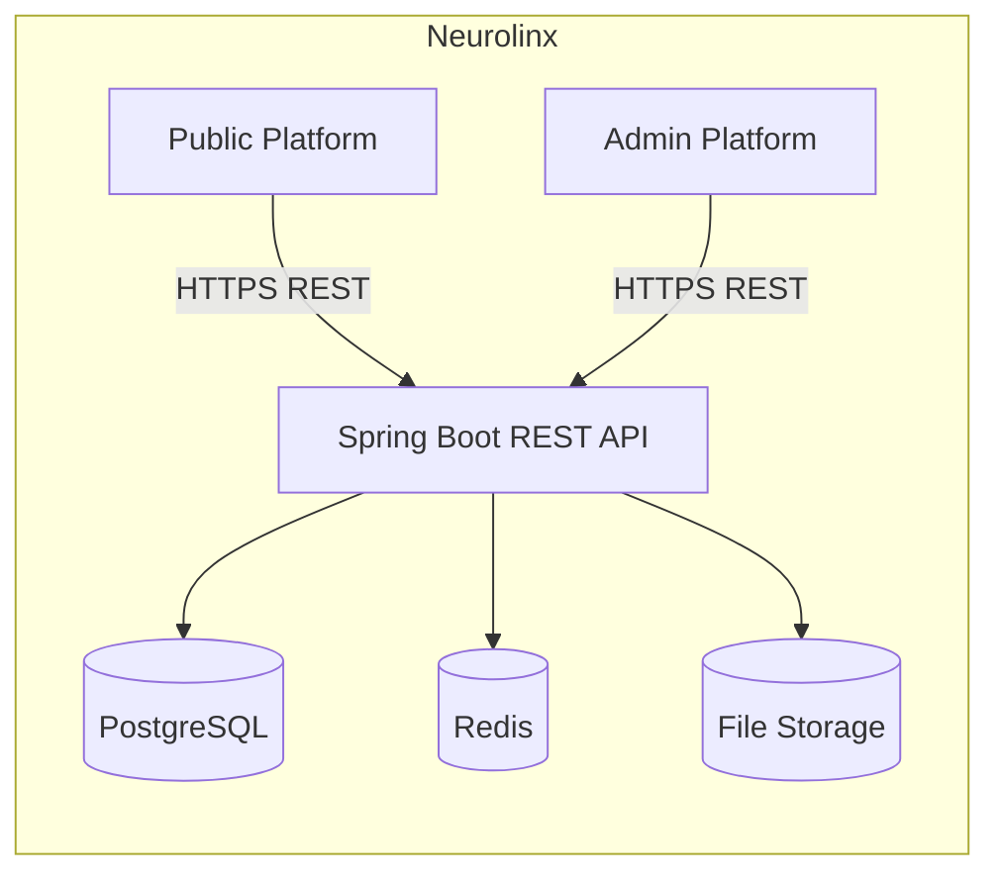

# 60 — Spring Boot Architecture

## Purpose

Define the Neurolinx backend as a **clean, modular Spring Boot application** that serves both the public React platform and the admin React platform through a single REST API surface.

This document is the entry point for backend design. Implementation details for APIs, auth, database, Redis, and files live in sibling docs.

---

## Requirements

| ID | Requirement |
|----|-------------|
| BR-BE-01 | Backend must support public e-commerce, B2B enquiry/quotation, corporate content, and admin operations. |
| BR-BE-02 | Frontend and backend remain cleanly separated; no server-side rendering of the public/admin UIs in Spring Boot. |
| BR-BE-03 | Architecture must allow future integrations (payment gateways, shipping providers, ERP/CRM, IoT) without tight coupling. |
| BR-BE-04 | Security must be considered for every backend feature. |

Derived from the master project specification and [00_PROJECT_VISION.md](./00_PROJECT_VISION.md), [02_BUSINESS_REQUIREMENTS.md](./02_BUSINESS_REQUIREMENTS.md), [03_PRODUCT_REQUIREMENTS.md](./03_PRODUCT_REQUIREMENTS.md).

---

## Technical Decisions

| Decision | Choice | Rationale |
|----------|--------|-----------|
| Language / runtime | Java 21+ | LTS features, virtual threads readiness, matches stack mandate |
| Framework | Spring Boot (current stable 3.x line at implementation time) | Convention, ecosystem, Spring Security / Data / OpenAPI |
| Persistence | Spring Data JPA + Hibernate + PostgreSQL | Relational domain fit (orders, inventory, RBAC) |
| Migrations | Flyway | Versioned, repeatable schema changes |
| Cache / ephemeral state | Redis | Caching, token blacklist, rate limiting |
| API style | Versioned REST + OpenAPI | Clear contracts for public and admin clients |
| Packaging | Modular packages by domain (modular monolith) | Clear boundaries without premature microservices |
| Deployment unit | Single deployable (Docker) initially | Simpler ops; extract modules later if needed |

**Out of scope for v1 architecture:** microservices mesh, GraphQL, reactive WebFlux as primary stack — **TBD** if later required.

---

## Modular Domain Modules

| Module | Responsibility |
|--------|----------------|
| **Auth** | Login, logout, refresh, password flows, token issuance/validation |
| **Users** | Platform user accounts, profiles, credentials linkage |
| **Customers** | Customer / B2B account data, addresses, company context |
| **Products** | Product catalog, variants, specs, media links, 3D asset refs |
| **Categories** | Category tree / taxonomy for shop and discovery |
| **Inventory** | Stock levels, reservations, low-stock signals |
| **Cart** | Guest and authenticated carts, line items, validation |
| **Orders** | Order lifecycle, status, fulfillment hooks |
| **Payments** | Payment intents/results abstraction; gateway adapters |
| **Shipping** | Shipping options / tracking abstraction; provider adapters |
| **Reviews** | Product reviews and moderation hooks |
| **Coupons** | Discount codes and eligibility rules |
| **Enquiries** | B2B quote / contact sales / product enquiry workflows |
| **Projects** | Case studies / project showcase content entities |
| **Content** | CMS pages, blog, corporate content |
| **Media** | Media metadata, storage references, attachment linking |
| **Notifications** | Email / in-app notification orchestration (**channels TBD**) |
| **Administration** | Admin-facing aggregations, settings, audit access points |
| **Analytics** | Metrics collection / reporting APIs (**metric definitions TBD**) |

Cross-module rules:

- Modules communicate via **application services / domain events**, not by reaching into another module’s repositories.
- Shared kernel limited to: IDs, common exceptions, security principals, pagination DTOs, OpenAPI annotations.

---

## Layering

Each module follows a consistent vertical slice:

```text
api (controllers, DTOs, OpenAPI)
        ↓
application (use cases / services, transactions)
        ↓
domain (entities, value objects, domain services)
        ↓
infrastructure (JPA repos, Redis, file storage, external clients)
```



---

## Platform Context Diagram



Aligns with master architecture principle in the project specification and [50_REACT_ARCHITECTURE.md](./50_REACT_ARCHITECTURE.md), [70_ADMIN_ARCHITECTURE.md](./70_ADMIN_ARCHITECTURE.md).

---

## Functional Requirements

| ID | Requirement |
|----|-------------|
| FR-BE-01 | Expose versioned REST APIs for catalog, cart, checkout, orders, enquiries, content, media, and admin operations. |
| FR-BE-02 | Enforce authentication and RBAC on protected endpoints. |
| FR-BE-03 | Persist domain data in PostgreSQL via JPA; evolve schema with Flyway. |
| FR-BE-04 | Support B2C purchase flows and B2B enquiry/quotation flows as first-class modules. |
| FR-BE-05 | Provide health and readiness endpoints for deployment (**exact Actuator exposure TBD**). |
| FR-BE-06 | Publish OpenAPI documentation for API consumers. |

---

## Non-Functional Requirements

| ID | Requirement |
|----|-------------|
| NFR-BE-01 | Stateless API nodes behind reverse proxy; session/token state in JWT/Redis as documented. |
| NFR-BE-02 | Horizontal scale of API instances without sticky sessions (**load balancer config TBD**). |
| NFR-BE-03 | Structured logging and correlation IDs (**format TBD**). |
| NFR-BE-04 | Fail securely: deny by default for admin and mutating customer endpoints. |
| NFR-BE-05 | Timeouts and circuit-breaking for external payment/shipping calls (**library TBD**). |

---

## Dependencies

| Depends on | Document |
|------------|----------|
| API conventions | [62_API_ARCHITECTURE.md](./62_API_ARCHITECTURE.md) |
| AuthN | [63_AUTHENTICATION.md](./63_AUTHENTICATION.md) |
| AuthZ | [64_AUTHORIZATION_RBAC.md](./64_AUTHORIZATION_RBAC.md) |
| DB | [65_DATABASE_ARCHITECTURE.md](./65_DATABASE_ARCHITECTURE.md), [66_DATABASE_SCHEMA.md](./66_DATABASE_SCHEMA.md) |
| Redis | [67_REDIS_ARCHITECTURE.md](./67_REDIS_ARCHITECTURE.md) |
| Files | [68_FILE_STORAGE.md](./68_FILE_STORAGE.md) |
| Security | [90_SECURITY_ARCHITECTURE.md](./90_SECURITY_ARCHITECTURE.md), [91_API_SECURITY.md](./91_API_SECURITY.md) |
| Commerce domain | [40_ECOMMERCE_ARCHITECTURE.md](./40_ECOMMERCE_ARCHITECTURE.md) |
| Packaging | [61_BACKEND_FOLDER_STRUCTURE.md](./61_BACKEND_FOLDER_STRUCTURE.md) |
| Deploy | [120_DEPLOYMENT_ARCHITECTURE.md](./120_DEPLOYMENT_ARCHITECTURE.md) |

---

## Constraints

- Must use the mandated stack: Java 21+, Spring Boot, Spring Security, Spring Data JPA, Hibernate, PostgreSQL, Redis, Flyway, REST, OpenAPI, Docker.
- No invented payment provider, shipping carrier, tax rules, or pricing rules — mark **TBD** until business confirms.
- Do not couple domain modules to a specific admin UI framework; admin is a separate React client.
- Multi-tenancy model is **TBD** — see [65_DATABASE_ARCHITECTURE.md](./65_DATABASE_ARCHITECTURE.md).

---

## Acceptance Criteria

- [ ] Module list matches this document and maps to packages in [61_BACKEND_FOLDER_STRUCTURE.md](./61_BACKEND_FOLDER_STRUCTURE.md).
- [ ] Layering diagram is followed in code reviews (no controller → repository shortcuts bypassing application services for write paths).
- [ ] Public and admin clients consume the same API host/versioning scheme.
- [ ] Future gateway/ERP integrations are isolatable behind adapter interfaces.
- [ ] Unknown business rules remain marked TBD (no silent inventions).

---

## Open Questions (TBD)

| Topic | Status |
|-------|--------|
| Exact Spring Boot minor version / BOM | TBD |
| Event bus (Spring ApplicationEvents vs message broker) | TBD |
| Multi-tenancy / org isolation | TBD |
| Soft-delete vs hard-delete policy per entity | TBD |
| Idempotency key strategy for payments | TBD |
