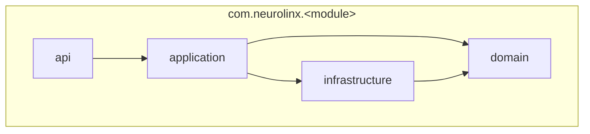

# 61 — Backend Folder Structure

## Purpose

Define the **package and repository layout** for the Neurolinx Spring Boot modular monolith so teams can locate code consistently and preserve module boundaries.

---

## Requirements

| ID | Requirement |
|----|-------------|
| BR-FS-01 | Structure must reflect domain modules from [60_SPRING_BOOT_ARCHITECTURE.md](./60_SPRING_BOOT_ARCHITECTURE.md). |
| BR-FS-02 | Shared code must be minimal and intentional. |
| BR-FS-03 | Migrations, config, and Docker assets must live in predictable locations. |

---

## Technical Decisions

| Decision | Choice |
|----------|--------|
| Build tool | **TBD** — Maven or Gradle (both acceptable; pick one before scaffold) |
| Root artifact | Single Spring Boot application module initially |
| Base package | `com.neurolinx` (**final reverse-DNS TBD** if different) |
| Module layout | Package-by-feature with internal layer packages |
| Tests | Mirror main packages under `src/test/java` |

---

## Repository Layout

```text
backend/                          # Suggested root name — TBD if monorepo uses /apps/api
├── Dockerfile
├── docker-compose.yml            # Or shared at repo root — see deployment docs
├── pom.xml | build.gradle.kts
├── src/
│   ├── main/
│   │   ├── java/com/neurolinx/
│   │   │   ├── NeurolinxApplication.java
│   │   │   ├── common/           # Shared kernel only
│   │   │   ├── config/           # Security, Redis, OpenAPI, Jackson, CORS
│   │   │   ├── auth/
│   │   │   ├── users/
│   │   │   ├── customers/
│   │   │   ├── products/
│   │   │   ├── categories/
│   │   │   ├── inventory/
│   │   │   ├── cart/
│   │   │   ├── orders/
│   │   │   ├── payments/
│   │   │   ├── shipping/
│   │   │   ├── reviews/
│   │   │   ├── coupons/
│   │   │   ├── enquiries/
│   │   │   ├── projects/
│   │   │   ├── content/
│   │   │   ├── media/
│   │   │   ├── notifications/
│   │   │   ├── administration/
│   │   │   └── analytics/
│   │   └── resources/
│   │       ├── application.yml
│   │       ├── application-dev.yml
│   │       ├── application-prod.yml
│   │       ├── db/migration/     # Flyway
│   │       └── static/           # Prefer empty; files via storage abstraction
│   └── test/
│       └── java/com/neurolinx/
│           └── ...               # Mirror modules
└── README.md
```

---

## Per-Module Package Pattern

Example for `products` (apply the same shape to every domain module):

```text
com.neurolinx.products/
├── api/
│   ├── ProductController.java
│   ├── AdminProductController.java   # Optional split by audience
│   ├── dto/
│   │   ├── ProductResponse.java
│   │   ├── ProductCreateRequest.java
│   │   └── ProductUpdateRequest.java
│   └── mapper/                       # MapStruct or manual — TBD
├── application/
│   ├── ProductService.java
│   └── ProductQueryService.java
├── domain/
│   ├── Product.java
│   ├── ProductVariant.java
│   ├── ProductStatus.java            # Enum values TBD with business
│   └── ProductRepository.java        # Interface (port)
└── infrastructure/
    ├── ProductJpaEntity.java         # Or map domain entity directly — TBD
    ├── ProductJpaRepository.java
    └── ProductRepositoryAdapter.java
```



---

## Shared Kernel (`common`)

Allowed contents:

- API error model / problem details types
- Pagination request/response wrappers
- Security principal accessors
- Clock / ID generation abstractions
- Cross-cutting annotations (e.g., `@CurrentUser`)
- Exception hierarchy base types

**Not allowed:** business rules for products, orders, payments, or CMS.

---

## Config Package

| Class / area | Responsibility |
|--------------|----------------|
| `SecurityConfig` | Filter chain, endpoint rules (details in auth docs) |
| `RedisConfig` | Redis connection / templates |
| `OpenApiConfig` | springdoc / OpenAPI metadata |
| `CorsConfig` | Allowed origins for public + admin apps (**origins TBD**) |
| `JacksonConfig` | JSON naming, dates |
| `StorageConfig` | Local vs S3-compatible beans |

---

## Flyway Location

```text
src/main/resources/db/migration/
  V1__baseline.sql
  V2__users_and_roles.sql
  ...
```

Naming and rules: [65_DATABASE_ARCHITECTURE.md](./65_DATABASE_ARCHITECTURE.md).

---

## Functional Requirements

| ID | Requirement |
|----|-------------|
| FR-FS-01 | Every domain module listed in architecture has a corresponding package. |
| FR-FS-02 | Controllers live only under `api`. |
| FR-FS-03 | Persistence adapters live only under `infrastructure`. |
| FR-FS-04 | Application YAML profiles separate local/dev/prod secrets references. |

---

## Non-Functional Requirements

| ID | Requirement |
|----|-------------|
| NFR-FS-01 | New developers can locate a feature from URL → controller → service → repository within minutes. |
| NFR-FS-02 | Module packages avoid cyclic dependencies (enforced by review; ArchUnit **TBD**). |

---

## Dependencies

- [60_SPRING_BOOT_ARCHITECTURE.md](./60_SPRING_BOOT_ARCHITECTURE.md)
- [62_API_ARCHITECTURE.md](./62_API_ARCHITECTURE.md)
- [65_DATABASE_ARCHITECTURE.md](./65_DATABASE_ARCHITECTURE.md)
- [110_TESTING_STRATEGY.md](./110_TESTING_STRATEGY.md)
- [120_DEPLOYMENT_ARCHITECTURE.md](./120_DEPLOYMENT_ARCHITECTURE.md)

---

## Constraints

- Do not place business logic in `config` or controllers beyond request mapping/validation wiring.
- Do not create a second parallel “utils dump” package for domain logic.
- Monorepo vs separate backend repo: **TBD**.

---

## Acceptance Criteria

- [ ] Scaffold matches this layout (or an approved documented deviation).
- [ ] Each module uses the api / application / domain / infrastructure split.
- [ ] Flyway scripts live under `db/migration`.
- [ ] Cross-module imports of another module’s `infrastructure` types are disallowed.

---

## Open Questions (TBD)

| Topic | Status |
|-------|--------|
| Maven vs Gradle | TBD |
| Multi-module Maven/Gradle build vs single module | TBD |
| MapStruct vs manual DTO mapping | TBD |
| ArchUnit dependency rules in CI | TBD |
