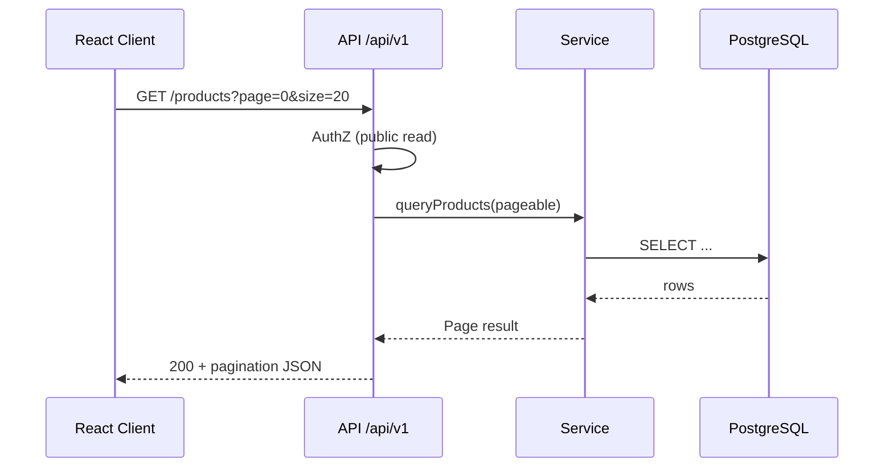

# 62 — API Architecture

## Purpose

Define REST conventions for the Neurolinx Spring Boot API consumed by the **public** and **admin** React applications: versioning, resources, errors, pagination, and OpenAPI.

---

## Requirements

| ID | Requirement |
|----|-------------|
| BR-API-01 | Single REST API serves public platform and admin platform. |
| BR-API-02 | Contracts must be documented via OpenAPI. |
| BR-API-03 | Errors must be machine-readable and consistent. |
| BR-API-04 | List endpoints must support pagination for large collections. |

---

## Technical Decisions

| Decision | Choice | Notes |
|----------|--------|-------|
| Style | Resource-oriented REST over HTTPS | No GraphQL in v1 |
| Versioning | URI prefix `/api/v1` | Breaking changes → `/api/v2` |
| Format | JSON (`application/json`) | Multipart for uploads |
| Docs | OpenAPI 3 via springdoc-openapi | Served in non-prod; prod exposure **TBD** |
| Time | ISO-8601 UTC in JSON | |
| IDs | Opaque string or UUID in APIs | Internal PK strategy in DB docs |
| Auth header | `Authorization: Bearer <access_token>` | See [63_AUTHENTICATION.md](./63_AUTHENTICATION.md) |

---

## Base URL Shape

```text
https://{api-host}/api/v1/{resource}
```

| Audience | Path convention | Example |
|----------|-----------------|---------|
| Public / customer | Unprefixed resources or `/store/...` | `GET /api/v1/products` |
| Admin | `/admin/...` | `GET /api/v1/admin/orders` |

**Decision:** Prefer an `/admin` path prefix for admin-only operations so security rules and OpenAPI tags stay clear. Exact resource inventory: **TBD** as features are specified in e-commerce/admin docs.

---

## REST Conventions

| Action | Method | Path pattern | Success |
|--------|--------|--------------|---------|
| List | `GET` | `/resources` | `200` + page |
| Get one | `GET` | `/resources/{id}` | `200` |
| Create | `POST` | `/resources` | `201` + body or `Location` |
| Replace/Update | `PUT` / `PATCH` | `/resources/{id}` | `200` |
| Delete | `DELETE` | `/resources/{id}` | `204` or `200` |

Additional:

- Use nouns, plural resource names.
- Prefer `PATCH` for partial updates.
- Nested resources only when ownership is strong (e.g., `/orders/{id}/items`).
- Actions that are not CRUD may use verb suffixes sparingly (e.g., `POST /orders/{id}/cancel`) — catalog of actions **TBD**.

---

## Pagination

**Query parameters (default convention):**

| Param | Meaning | Default |
|-------|---------|---------|
| `page` | Zero-based page index | `0` |
| `size` | Page size | **TBD** (suggested 20) |
| `sort` | `field,asc\|desc` | Resource-specific |

**Response envelope (suggested):**

```json
{
  "content": [],
  "page": 0,
  "size": 20,
  "totalElements": 0,
  "totalPages": 0
}
```

Cursor-based pagination for infinite scroll feeds: **TBD** if required by frontend.

---

## Filtering & Search

| Concern | Convention | Status |
|---------|------------|--------|
| Simple filters | Query params (`categoryId`, `status`) | Adopt |
| Full-text search | `q` or `search` | **TBD** engine (DB vs search service) |
| Multi-value | Repeat param or comma-separated | **TBD** pick one and document in OpenAPI |

---

## Error Format

Use a consistent problem payload (RFC 7807-inspired). Exact field set:

```json
{
  "type": "https://neurolinx.example/problems/validation-error",
  "title": "Validation Failed",
  "status": 400,
  "detail": "One or more fields are invalid.",
  "instance": "/api/v1/products",
  "code": "VALIDATION_ERROR",
  "errors": [
    { "field": "sku", "message": "must not be blank" }
  ],
  "traceId": "TBD"
}
```

| HTTP | Typical use |
|------|-------------|
| `400` | Validation / malformed |
| `401` | Missing/invalid auth |
| `403` | Authenticated but not permitted |
| `404` | Resource not found |
| `409` | Conflict (e.g., stock, duplicate) |
| `429` | Rate limited |
| `500` | Unexpected server error |

Do not leak stack traces or SQL to clients.

### Exception handling & DTOs

| Concern | Standard |
|---------|----------|
| Controllers | Thin; accept/return DTOs only — never expose JPA entities |
| Validation | Jakarta Bean Validation (`@Valid`, `@NotNull`, …) on request DTOs |
| Mapping | MapStruct or explicit mappers — **TBD** preference; consistency required |
| Global handler | `@ControllerAdvice` / `@RestControllerAdvice` maps domain and validation exceptions to the problem payload above |
| Logging | Unexpected exceptions logged with `traceId`; sanitized message to client |
| Business errors | Typed domain exceptions → stable `code` values (e.g., `INSUFFICIENT_STOCK`) |

Source of truth for API errors: this document. Auth failures: [63_AUTHENTICATION.md](./63_AUTHENTICATION.md). Security headers/CORS: [91_API_SECURITY.md](./91_API_SECURITY.md).

---

## OpenAPI

| Requirement | Detail |
|-------------|--------|
| Generation | Annotations / springdoc from controllers |
| Grouping | Tags per module (`Products`, `Orders`, `AdminOrders`, …) |
| Security schemes | Bearer JWT documented |
| Environments | Enabled in local/dev; production exposure **TBD** |

Cross-ref: [53_FRONTEND_API_INTEGRATION.md](./53_FRONTEND_API_INTEGRATION.md), [91_API_SECURITY.md](./91_API_SECURITY.md).

---

## Idempotency & Concurrency

| Topic | Decision |
|-------|----------|
| Payment / order create idempotency | **TBD** — likely `Idempotency-Key` header |
| Optimistic locking | Prefer version columns on contested aggregates (orders, inventory) — see schema |
| ETags | **TBD** for CMS content caching |

---

## Functional Requirements

| ID | Requirement |
|----|-------------|
| FR-API-01 | All public and admin HTTP APIs follow `/api/v1` versioning. |
| FR-API-02 | List endpoints return the pagination envelope (or documented exception). |
| FR-API-03 | Errors use the shared problem format. |
| FR-API-04 | OpenAPI spec is generated and kept current with controllers. |
| FR-API-05 | Admin routes are under `/api/v1/admin/**` unless explicitly exempted. |

---

## Non-Functional Requirements

| ID | Requirement |
|----|-------------|
| NFR-API-01 | JSON payloads validate against documented schemas. |
| NFR-API-02 | Breaking changes require a new major API version. |
| NFR-API-03 | Correlation / trace id present on error responses (**propagation TBD**). |

---

## Dependencies

- [60_SPRING_BOOT_ARCHITECTURE.md](./60_SPRING_BOOT_ARCHITECTURE.md)
- [63_AUTHENTICATION.md](./63_AUTHENTICATION.md)
- [64_AUTHORIZATION_RBAC.md](./64_AUTHORIZATION_RBAC.md)
- [53_FRONTEND_API_INTEGRATION.md](./53_FRONTEND_API_INTEGRATION.md)
- [70_ADMIN_ARCHITECTURE.md](./70_ADMIN_ARCHITECTURE.md)
- [91_API_SECURITY.md](./91_API_SECURITY.md)

---

## Constraints

- Do not invent business field names beyond those established in product/e-commerce docs; mark new fields TBD.
- Do not expose internal Hibernate entities directly as API DTOs.
- File upload endpoints must also follow [68_FILE_STORAGE.md](./68_FILE_STORAGE.md) and [93_FILE_UPLOAD_SECURITY.md](./93_FILE_UPLOAD_SECURITY.md).

---

## Acceptance Criteria

- [ ] Controllers use versioned base path.
- [ ] Shared exception handler emits the problem format.
- [ ] Pagination documented in OpenAPI for list operations.
- [ ] Admin vs public route prefixes are enforceable in Spring Security.
- [ ] Unknowns (search engine, default page size, prod OpenAPI) remain TBD.

---

## Example Flow


