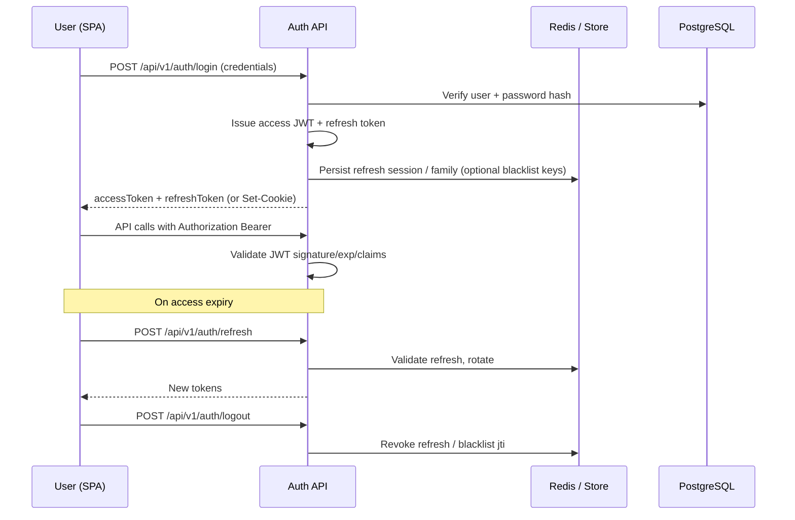

# 63 — Authentication

## Purpose

Specify how Neurolinx authenticates users for the public and admin React clients using **JWT access tokens**, **refresh tokens**, password security, and session-related considerations on a stateless Spring Boot API.

---

## Requirements

| ID | Requirement |
|----|-------------|
| BR-AUTH-01 | Customers and staff/admin users must authenticate to access protected features. |
| BR-AUTH-02 | Guests may use limited commerce features (e.g., cart) without login — exact guest capabilities **TBD** / see [41_CART.md](./41_CART.md). |
| BR-AUTH-03 | Passwords must be stored hashed, never plaintext. |
| BR-AUTH-04 | Stolen or revoked tokens must be mitigable (short-lived access + refresh rotation / blacklist). |

Roles and permission catalogs: [04_USER_ROLES.md](./04_USER_ROLES.md), [64_AUTHORIZATION_RBAC.md](./64_AUTHORIZATION_RBAC.md).

---

## Technical Decisions

| Decision | Choice | Notes |
|----------|--------|-------|
| AuthN mechanism | JWT Bearer access tokens | Stateless API nodes |
| Refresh tokens | Opaque or JWT refresh; stored server-side or hashed in DB/Redis | Prefer rotatable refresh tokens |
| Password hashing | Argon2id or BCrypt via Spring Security `PasswordEncoder` | Algorithm final pick **TBD** (Argon2 preferred if ops support) |
| Transport | HTTPS only in non-local envs | |
| Token transport to SPA | **Access JWT in memory**; **refresh token in HttpOnly Secure SameSite cookie** | Locked — see [ADR-006-AUTHENTICATION.md](./ADR/ADR-006-AUTHENTICATION.md) |
| MFA | **TBD** for admin accounts | Recommended for admins; not mandated by master spec yet |

---

## Token Model

### Access token (JWT)

Suggested claims (exact set **TBD**):

| Claim | Purpose |
|-------|---------|
| `sub` | User id |
| `roles` / `authorities` | RBAC authorities |
| `typ` | `access` |
| `iat` / `exp` | Issued / expiry |
| `jti` | Token id for blacklist |

**TTL:** short-lived — suggested 5–15 minutes; exact value **TBD**.

### Refresh token

| Property | Decision |
|----------|----------|
| Lifetime | Longer than access — exact **TBD** |
| Rotation | On each refresh, invalidate previous |
| Storage | Server-side record (DB and/or Redis) with hash of token |
| Binding | User id + device/session id (**device model TBD**) |

---

## Password Security

| Control | Requirement |
|---------|-------------|
| Hashing | One-way adaptive hash (Argon2id or BCrypt) |
| Policy | Min length / complexity **TBD** (do not invent corporate policy) |
| Reset | Time-limited reset token via email (**email provider TBD**) |
| Change | Require current password when authenticated |
| Lockout | Brute-force lockout / backoff **TBD** — coordinate with Redis rate limiting |

Never log passwords, tokens, or reset secrets.

---

## Session Considerations (SPA + Stateless API)

Neurolinx uses **token-based auth**, not classic server HttpSession for API authorization.

| Topic | Guidance |
|-------|----------|
| “Session” meaning | Refresh-token session / login session record |
| CSRF | If refresh stored in httpOnly cookie, apply CSRF protections; if Authorization header only, CSRF risk is lower for pure Bearer APIs |
| XSS | Prefer not storing access tokens in `localStorage` if avoidable; harden CSP on SPAs |
| Logout | Client discards access token; server revokes refresh; optional access `jti` blacklist until exp |
| Concurrent sessions | Max sessions per user **TBD** |
| Admin vs customer | Same mechanism; stricter policies for admin (**MFA TBD**, shorter refresh **TBD**) |

Cross-ref: [67_REDIS_ARCHITECTURE.md](./67_REDIS_ARCHITECTURE.md), [90_SECURITY_ARCHITECTURE.md](./90_SECURITY_ARCHITECTURE.md), [92_DATA_SECURITY.md](./92_DATA_SECURITY.md).

---

## Auth Endpoints (Indicative)

| Method | Path | Purpose |
|--------|------|---------|
| `POST` | `/api/v1/auth/register` | Customer self-registration (**enabled? TBD**) |
| `POST` | `/api/v1/auth/login` | Issue tokens |
| `POST` | `/api/v1/auth/refresh` | Rotate tokens |
| `POST` | `/api/v1/auth/logout` | Revoke session |
| `POST` | `/api/v1/auth/password/forgot` | Start reset |
| `POST` | `/api/v1/auth/password/reset` | Complete reset |

Exact DTO fields and registration rules: **TBD** / [45_CUSTOMER_ACCOUNT.md](./45_CUSTOMER_ACCOUNT.md).

---

## Functional Requirements

| ID | Requirement |
|----|-------------|
| FR-AUTH-01 | Valid credentials yield access + refresh credentials. |
| FR-AUTH-02 | Protected endpoints reject missing/invalid/expired access tokens with `401`. |
| FR-AUTH-03 | Refresh rotates and invalidates the previous refresh token. |
| FR-AUTH-04 | Logout revokes server-side refresh session. |
| FR-AUTH-05 | Passwords are verified only against stored hashes. |

---

## Non-Functional Requirements

| ID | Requirement |
|----|-------------|
| NFR-AUTH-01 | Token validation is efficient (local JWT verify; Redis only for blacklist/refresh as needed). |
| NFR-AUTH-02 | Secrets (JWT signing keys) come from environment/secret store, not source control. |
| NFR-AUTH-03 | Auth endpoints are rate-limited. |

---

## Dependencies

- [04_USER_ROLES.md](./04_USER_ROLES.md)
- [62_API_ARCHITECTURE.md](./62_API_ARCHITECTURE.md)
- [64_AUTHORIZATION_RBAC.md](./64_AUTHORIZATION_RBAC.md)
- [67_REDIS_ARCHITECTURE.md](./67_REDIS_ARCHITECTURE.md)
- [90_SECURITY_ARCHITECTURE.md](./90_SECURITY_ARCHITECTURE.md)
- [91_API_SECURITY.md](./91_API_SECURITY.md)

---

## Constraints

- Do not invent MFA, SSO, or social login requirements until specified.
- Do not use shared admin passwords or default credentials in any environment.
- Payment card data must never pass through custom auth storage — see [94_PAYMENT_SECURITY.md](./94_PAYMENT_SECURITY.md).

---

## Acceptance Criteria

- [ ] Login / refresh / logout flows implemented per this model.
- [ ] Password hashing uses Spring Security encoder (Argon2 or BCrypt).
- [ ] Access tokens are short-lived; refresh tokens are rotatable and revocable.
- [ ] SPA token transport follows locked decision: access in memory; refresh in HttpOnly cookie ([ADR-006-AUTHENTICATION.md](./ADR/ADR-006-AUTHENTICATION.md)).
- [ ] Alignment with roles in [04_USER_ROLES.md](./04_USER_ROLES.md).

---

## Open Questions (TBD)

| Topic | Status |
|-------|--------|
| Access TTL / refresh TTL | TBD (suggested access ≤ 15m; refresh days-range TBD) |
| Refresh transport | **Resolved** — HttpOnly Secure SameSite cookie ([ADR-006](./ADR/ADR-006-AUTHENTICATION.md)) |
| Customer self-registration enabled | TBD |
| Admin MFA | TBD |
| SSO / OIDC for staff | TBD (future; not v1 requirement) |
| Password complexity policy | TBD |
| Password hashing algorithm params | Argon2id preferred; BCrypt acceptable — final params TBD |
