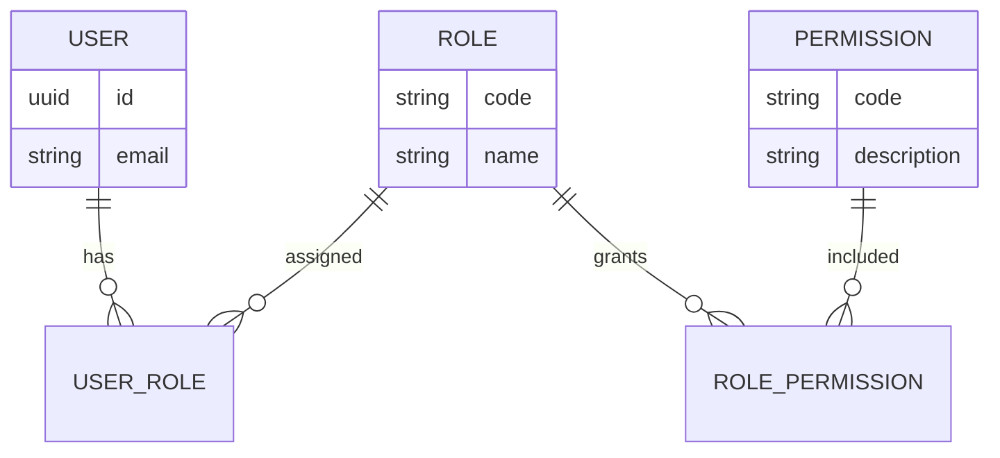
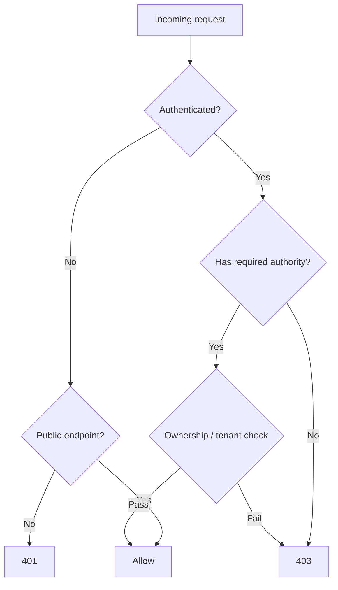

# 64 — Authorization (RBAC)

## Purpose

Define **role-based access control (RBAC)** for the Neurolinx API so public, customer, B2B, and admin operations are authorized consistently. Role definitions are owned by [04_USER_ROLES.md](./04_USER_ROLES.md); this document describes enforcement architecture and permission mapping patterns.

---

## Requirements

| ID | Requirement |
|----|-------------|
| BR-RBAC-01 | Authorization must align with documented user roles. |
| BR-RBAC-02 | Admin platform features are available only to authorized staff roles. |
| BR-RBAC-03 | Customers may only access their own account, orders, cart, and related data unless a role grants broader access. |
| BR-RBAC-04 | Deny by default for protected resources. |

---

## Source of Truth for Roles

**Canonical role catalog:** [04_USER_ROLES.md](./04_USER_ROLES.md).

Until that document is finalized, treat the following as **illustrative alignment placeholders** — not invented business truth. Replace names/permissions with the exact set from `04_USER_ROLES.md`.

| Placeholder role group | Typical API surface | Status |
|------------------------|---------------------|--------|
| Anonymous / Guest | Public catalog, content reads; limited cart | Confirm in `04` |
| Customer (B2C) | Own profile, cart, checkout, orders, reviews | Confirm in `04` |
| B2B / Company user | Enquiries, quotes, company context | Confirm in `04` |
| Staff / Admin roles | `/api/v1/admin/**`, CMS, inventory, fulfillment | Confirm in `04` |
| Fine-grained staff (sales, content editor, etc.) | Subset of admin modules | **TBD** in `04` |

Do **not** hard-code role strings in multiple places without a shared authority enum/constants module.

---

## Technical Decisions

| Decision | Choice |
|----------|--------|
| Model | RBAC (roles → permissions/authorities) |
| Enforcement point | Spring Security filter chain + method security (`@PreAuthorize`) |
| Representation in JWT | Authorities/roles claims (see [63_AUTHENTICATION.md](./63_AUTHENTICATION.md)) |
| Representation in DB | `users`, `roles`, `permissions`, join tables — see [66_DATABASE_SCHEMA.md](./66_DATABASE_SCHEMA.md) |
| Object-level rules | Application services check resource ownership (e.g., `order.userId == principal.id`) |
| Attribute-based (ABAC) | Not required for v1; **TBD** if complex B2B org rules emerge |

---

## Permission Model



### Permission naming convention

```text
{domain}:{action}
```

Examples (illustrative — final catalog **TBD** / from `04`):

| Permission code | Intended use |
|-----------------|--------------|
| `product:read` | Public/catalog read |
| `product:write` | Admin product mutations |
| `order:read_own` | Customer order history |
| `order:read_any` | Admin order list |
| `order:update_status` | Fulfillment updates |
| `enquiry:manage` | Sales/admin enquiry pipeline |
| `content:publish` | CMS publish |
| `media:upload` | Media library upload |
| `analytics:read` | Admin analytics |
| `user:manage` | Admin user management |

---

## Enforcement Patterns

### 1. Route-level (SecurityFilterChain)

| Matcher | Rule |
|---------|------|
| `GET` public catalog/content | Permit all (or authenticated if business requires) |
| `/api/v1/auth/**` | Permit login/register/refresh as specified |
| `/api/v1/admin/**` | Authenticated + admin/staff authorities |
| Customer account/order routes | Authenticated + ownership checks |

Exact matcher list maintained in code and reviewed against OpenAPI.

### 2. Method-level

```text
@PreAuthorize("hasAuthority('order:update_status')")
```

### 3. Ownership checks

Even with `order:read_own`, services must verify the order belongs to the principal (or an org the principal belongs to — **org model TBD**).



---

## Admin Platform Alignment

Admin React app is **role-gated** in the UI **and** must be enforced on the API (UI hiding is not security).

| Admin area | Doc | Permission dependency |
|------------|-----|------------------------|
| Dashboard | [71_ADMIN_DASHBOARD.md](./71_ADMIN_DASHBOARD.md) | analytics/dashboard read **TBD** |
| Products | [72_ADMIN_PRODUCTS.md](./72_ADMIN_PRODUCTS.md) | product/inventory write |
| Orders | [73_ADMIN_ORDERS.md](./73_ADMIN_ORDERS.md) | order manage |
| Customers | [74_ADMIN_CUSTOMERS.md](./74_ADMIN_CUSTOMERS.md) | customer manage |
| Content | [75_ADMIN_CONTENT_MANAGEMENT.md](./75_ADMIN_CONTENT_MANAGEMENT.md) | content permissions |
| Media | [76_ADMIN_MEDIA_MANAGEMENT.md](./76_ADMIN_MEDIA_MANAGEMENT.md) | media permissions |
| Analytics | [77_ADMIN_ANALYTICS.md](./77_ADMIN_ANALYTICS.md) | analytics read |

See [70_ADMIN_ARCHITECTURE.md](./70_ADMIN_ARCHITECTURE.md).

---

## Functional Requirements

| ID | Requirement |
|----|-------------|
| FR-RBAC-01 | Every protected endpoint declares required roles/permissions. |
| FR-RBAC-02 | Authority codes are derived from [04_USER_ROLES.md](./04_USER_ROLES.md). |
| FR-RBAC-03 | Admin APIs reject callers lacking staff/admin authorities with `403`. |
| FR-RBAC-04 | Customers cannot read or mutate other customers’ private resources. |
| FR-RBAC-05 | Permission changes take effect on next access token issuance (or forced re-auth **TBD**). |

---

## Non-Functional Requirements

| ID | Requirement |
|----|-------------|
| NFR-RBAC-01 | Authorization decisions are auditable for admin mutations (**audit log fields TBD**). |
| NFR-RBAC-02 | Role checks add negligible latency (in-token authorities preferred). |

---

## Dependencies

- [04_USER_ROLES.md](./04_USER_ROLES.md) — **authoritative**
- [63_AUTHENTICATION.md](./63_AUTHENTICATION.md)
- [62_API_ARCHITECTURE.md](./62_API_ARCHITECTURE.md)
- [66_DATABASE_SCHEMA.md](./66_DATABASE_SCHEMA.md)
- [70_ADMIN_ARCHITECTURE.md](./70_ADMIN_ARCHITECTURE.md)
- [90_SECURITY_ARCHITECTURE.md](./90_SECURITY_ARCHITECTURE.md)

---

## Constraints

- Do not invent fine-grained staff roles beyond what `04_USER_ROLES.md` defines.
- Do not rely on frontend route guards alone.
- Multi-tenant org isolation rules remain **TBD**.

---

## Acceptance Criteria

- [ ] Role/permission codes match [04_USER_ROLES.md](./04_USER_ROLES.md).
- [ ] Spring Security config + `@PreAuthorize` cover admin and ownership cases.
- [ ] Automated tests prove `401`/`403` behavior for representative endpoints.
- [ ] Admin UI gating mirrors API permissions without replacing them.

---

## Open Questions (TBD)

| Topic | Status |
|-------|--------|
| Exact role list and hierarchy | Owned by `04_USER_ROLES.md` |
| Company/organization membership for B2B | TBD |
| Permission change propagation (token invalidate) | TBD |
| Impersonation for support staff | TBD — do not implement without approval |
