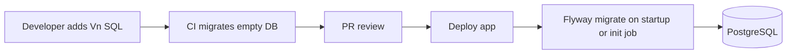

# 65 — Database Architecture

## Purpose

Define PostgreSQL design principles, migration strategy (Flyway), indexing guidance, and open decisions (including multi-tenancy) for the Neurolinx backend.

Entity-level detail: [66_DATABASE_SCHEMA.md](./66_DATABASE_SCHEMA.md).

---

## Requirements

| ID | Requirement |
|----|-------------|
| BR-DB-01 | PostgreSQL is the system of record for transactional domain data. |
| BR-DB-02 | Schema changes are version-controlled and applied via Flyway. |
| BR-DB-03 | Design must support catalog, commerce, enquiries, CMS/content, media metadata, and RBAC. |
| BR-DB-04 | Architecture must not preclude future ERP/CRM integration. |

---

## Technical Decisions

| Decision | Choice |
|----------|--------|
| RDBMS | PostgreSQL (**major version TBD** at provision time; prefer current stable) |
| ORM | Hibernate via Spring Data JPA |
| Migrations | Flyway SQL migrations (preferred over Hibernate `ddl-auto` in all shared envs) |
| `ddl-auto` | `validate` (or `none`) in deployed envs; never `update`/`create` in prod |
| Charset / collation | UTF-8; collation **TBD** |
| Time storage | `timestamptz` for instants |
| Money | Prefer `numeric` + currency code; currency list **TBD** |
| Primary keys | UUID recommended for public-facing entities; sequences acceptable for internal — final **TBD** per table in schema doc |

---

## Design Principles

1. **Transactional integrity** — orders, payments, inventory adjustments use DB transactions.
2. **Clear aggregates** — order + items; product + variants; enquiry + attachments.
3. **Soft references to files** — store media object keys/URLs in DB; binaries in file storage ([68_FILE_STORAGE.md](./68_FILE_STORAGE.md)).
4. **Normalize** core commerce/RBAC; denormalize only with documented reason (e.g., order line snapshots of product name/price at purchase).
5. **Auditability** — admin mutations write append-only audit logs; mutable entities carry standard audit columns (see below).
6. **Soft delete by default for catalog/CMS** — avoid hard-deleting user-visible content that orders or history may reference.
7. **No invented business columns** — mark unknown attributes `TBD` in [66_DATABASE_SCHEMA.md](./66_DATABASE_SCHEMA.md).

---

## Soft Delete

| Decision | Standard |
|----------|----------|
| Approach | Prefer **soft delete** (`deleted_at timestamptz NULL`) for products, categories, media metadata, content pages, customers (where retention requires), coupons, and reviews |
| Hard delete | Allowed for ephemeral data (guest cart lines, expired rate-limit keys) and after legal retention windows for PII (**policy TBD**) |
| Queries | Default repositories/filters exclude `deleted_at IS NOT NULL` |
| Uniqueness | Unique indexes on business keys (SKU, slug, email) must account for soft-deleted rows (**partial unique indexes recommended**) |
| Orders / payments | Never soft-delete away financial history; cancel/void via status instead |

Source of truth for entity-level soft-delete flags: [66_DATABASE_SCHEMA.md](./66_DATABASE_SCHEMA.md).

---

## Entity Auditing Columns

Mutable business tables SHOULD include:

| Column | Purpose |
|--------|---------|
| `created_at` | Insert timestamp (`timestamptz`) |
| `updated_at` | Last update timestamp |
| `created_by` / `updated_by` | Optional user id for admin-originated writes |
| `deleted_at` | Soft delete marker when applicable |

Separately, **`audit_logs`** records privileged admin actions (who, what, when, before/after or diff summary). Schema detail: [66_DATABASE_SCHEMA.md](./66_DATABASE_SCHEMA.md); security: [90_SECURITY_ARCHITECTURE.md](./90_SECURITY_ARCHITECTURE.md).

---

## Multi-Tenancy

| Option | Description | Status |
|--------|-------------|--------|
| Single-tenant | One Neurolinx org per deployment | Likely default for v1 |
| Shared DB, `tenant_id` column | SaaS-style isolation | **TBD** |
| Schema-per-tenant | Strong isolation, higher ops cost | **TBD** |

**Decision:** Multi-tenancy approach is **TBD**. Until decided, design tables without mandatory `tenant_id`, but avoid patterns that make adding tenant isolation impossible (e.g., globally unique assumptions without documented scope).

---

## Indexing Guidance

| Pattern | Guidance |
|---------|----------|
| Primary keys | Indexed by default |
| Foreign keys | Index columns used in joins/filters |
| Lookup by email / SKU / slug | Unique indexes where uniqueness is required |
| Status + created_at lists | Composite indexes for admin queues (orders, enquiries) |
| Full-text search | PostgreSQL FTS or external engine — **TBD** |
| JSONB attributes | GIN indexes only if query patterns justify |

Do not over-index write-heavy tables without measured need.

---

## Flyway Migrations

```text
src/main/resources/db/migration/
  V1__baseline.sql
  V2__auth_users_roles.sql
  V3__catalog_products.sql
  ...
```

| Rule | Detail |
|------|--------|
| Versioning | Integer versions `V{n}__description.sql` |
| Immutability | Never edit applied migrations in shared environments; add new versions |
| Repeatable | `R__` scripts only for views/functions if needed |
| Local | Fresh DB applies all; CI verifies migrate on empty DB |
| Seeds | Reference/demo data via separate seed mechanism — **TBD**; never put prod secrets in SQL |



Startup migrate vs init Job/container: **TBD** with [120_DEPLOYMENT_ARCHITECTURE.md](./120_DEPLOYMENT_ARCHITECTURE.md).

---

## Environments & Backups

| Concern | Status |
|---------|--------|
| Backup frequency / retention | **TBD** — required by infrastructure docs |
| Point-in-time recovery | **TBD** |
| Connection pooling | HikariCP (Spring default); pool size **TBD** |
| Read replicas | **TBD** — not required for initial architecture |

---

## Functional Requirements

| ID | Requirement |
|----|-------------|
| FR-DB-01 | All production schema changes ship as Flyway migrations. |
| FR-DB-02 | App fails fast if schema does not match expected migrations/validation. |
| FR-DB-03 | Critical unique business keys enforced in DB (email, SKU uniqueness rules as confirmed). |

---

## Non-Functional Requirements

| ID | Requirement |
|----|-------------|
| NFR-DB-01 | OLTP latency suitable for interactive web/admin use (**SLOs TBD**). |
| NFR-DB-02 | Migrations are backward-compatible during rolling deploys where possible. |
| NFR-DB-03 | PII storage complies with [92_DATA_SECURITY.md](./92_DATA_SECURITY.md). |

---

## Dependencies

- [60_SPRING_BOOT_ARCHITECTURE.md](./60_SPRING_BOOT_ARCHITECTURE.md)
- [66_DATABASE_SCHEMA.md](./66_DATABASE_SCHEMA.md)
- [67_REDIS_ARCHITECTURE.md](./67_REDIS_ARCHITECTURE.md) — cache is not source of truth
- [92_DATA_SECURITY.md](./92_DATA_SECURITY.md)
- [120_DEPLOYMENT_ARCHITECTURE.md](./120_DEPLOYMENT_ARCHITECTURE.md)
- [124_BACKUP_AND_RECOVERY.md](./124_BACKUP_AND_RECOVERY.md)

---

## Constraints

- Redis must not replace PostgreSQL for durable order/payment records.
- Do not enable Hibernate auto-DDL in production.
- Do not invent tax/compliance schemas without legal/business input (**TBD**).

---

## Acceptance Criteria

- [ ] Flyway is the only schema mutation path in shared environments.
- [ ] Indexing strategy documented for high-traffic queries as they are identified.
- [ ] Multi-tenancy marked TBD until product decision.
- [ ] Schema doc stays consistent with migrations.

---

## Open Questions (TBD)

| Topic | Status |
|-------|--------|
| Multi-tenancy model | TBD |
| UUID vs bigint PKs | TBD (lean UUID for external IDs) |
| Soft delete policy | TBD |
| Search strategy | TBD |
| Backup RPO/RTO | TBD |
