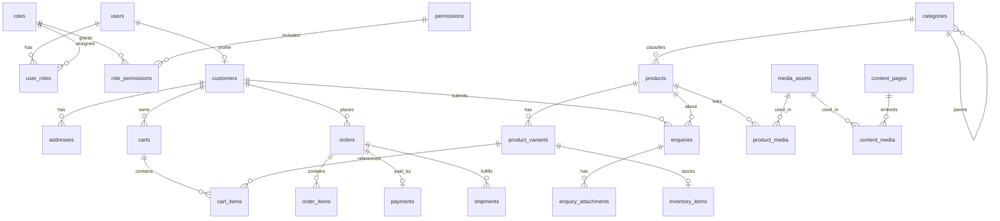

# 66 — Database Schema

## Purpose

Describe **core entities and relationships** for Neurolinx: users/RBAC, catalog (products/variants/categories), inventory, cart, orders, payments, enquiries, content, and media. Column-level unknowns are marked **TBD** — do not treat placeholders as approved business rules.

Architecture principles: [65_DATABASE_ARCHITECTURE.md](./65_DATABASE_ARCHITECTURE.md).

---

## Requirements

| ID | Requirement |
|----|-------------|
| BR-SCH-01 | Schema must support B2C commerce and B2B enquiry/quotation workflows. |
| BR-SCH-02 | Products support categories, variants, media, documents, and 3D model references. |
| BR-SCH-03 | Orders retain line snapshots suitable for history/invoices. |
| BR-SCH-04 | Media binaries are not stored in PostgreSQL; metadata and object keys are. |

---

## Technical Decisions

| Decision | Choice |
|----------|--------|
| Naming | `snake_case` tables/columns |
| Status fields | Enumerated strings or Postgres enums — **TBD** |
| Money | `numeric(19,4)` + `currency_code` (**allowed currencies TBD**) |
| Deleted rows | Soft delete via `deleted_at timestamptz NULL` for catalog/CMS/media metadata; see [65_DATABASE_ARCHITECTURE.md](./65_DATABASE_ARCHITECTURE.md) |
| Audit columns | `created_at`, `updated_at`; `created_by`/`updated_by` on admin-managed tables |
| Append-only audit | `audit_logs` for privileged actions |

---

## ER Overview (Core)

---

## Key Tables

### Users & RBAC

#### `users`

| Column | Type (indicative) | Notes |
|--------|-------------------|-------|
| `id` | UUID PK | |
| `email` | varchar, unique | |
| `password_hash` | varchar | |
| `status` | varchar | active/disabled values **TBD** |
| `email_verified_at` | timestamptz null | |
| `created_at` / `updated_at` | timestamptz | |
| … | | Display name, phone, locale **TBD** |

#### `roles`, `permissions`, `user_roles`, `role_permissions`

| Table | Purpose |
|-------|---------|
| `roles` | Role codes aligned with [04_USER_ROLES.md](./04_USER_ROLES.md) |
| `permissions` | Permission codes |
| `user_roles` | User ↔ role |
| `role_permissions` | Role ↔ permission |

Exact seed roles/permissions: **TBD** from `04`.

---

### Customers

#### `customers`

| Column | Type | Notes |
|--------|------|-------|
| `id` | UUID PK | |
| `user_id` | UUID FK → users, unique | |
| `customer_type` | varchar | `B2C` / `B2B` or similar — **TBD** |
| `company_name` | varchar null | B2B |
| `tax_id` | varchar null | **TBD** / compliance |
| … | | Sales owner, credit terms **TBD** |

#### `addresses`

| Column | Notes |
|--------|-------|
| `id`, `customer_id` | |
| `line1`, `line2`, `city`, `region`, `postal_code`, `country_code` | Required set **TBD** by shipping regions |
| `type` | billing/shipping **TBD** |
| `is_default` | |

---

### Catalog

#### `categories`

| Column | Notes |
|--------|-------|
| `id`, `parent_id` null | Tree |
| `slug` unique | |
| `name`, `description` | |
| `sort_order`, `is_active` | |
| SEO fields | **TBD** |

#### `products`

| Column | Notes |
|--------|-------|
| `id`, `category_id` | Category model may be M:N later **TBD** |
| `slug` unique, `name`, `summary`, `description` | |
| `status` | draft/published/archived **TBD** |
| `is_purchasable` | Supports buy vs enquiry-only — **TBD** flags |
| `is_enquiry_enabled` | B2B quote CTA |
| Specs | Separate `product_specifications` or JSONB — **TBD** |
| Pricing at product level | Optional if variant-priced only — **TBD** |

#### `product_variants`

| Column | Notes |
|--------|-------|
| `id`, `product_id` | |
| `sku` unique | |
| `name` / option labels | Option model **TBD** |
| `price_amount`, `currency_code` | |
| `compare_at_amount` | **TBD** |
| `is_active` | |
| Dimensions/weight | **TBD** for shipping |

#### `inventory_items`

| Column | Notes |
|--------|-------|
| `variant_id` PK/FK | 1:1 with variant initially |
| `quantity_on_hand` | |
| `quantity_reserved` | Cart/checkout reservation **TBD** |
| `low_stock_threshold` | Alerts — threshold policy **TBD** |
| Warehouse multi-location | **TBD** |

---

### Cart

#### `carts` / `cart_items`

| Column | Notes |
|--------|-------|
| `carts.id` | |
| `customer_id` null | Null for guest |
| `guest_token` null | Guest cart key — see [41_CART.md](./41_CART.md) |
| `cart_items.variant_id`, `quantity` | |
| Price snapshot on cart | **TBD** (reprice vs freeze) |

---

### Orders & Payments

#### `orders`

| Column | Notes |
|--------|-------|
| `id`, `order_number` unique | Number format **TBD** |
| `customer_id` | |
| `status` | Lifecycle **TBD** — see [44_ORDER_MANAGEMENT.md](./44_ORDER_MANAGEMENT.md) |
| `currency_code` | |
| `subtotal`, `discount_total`, `shipping_total`, `tax_total`, `grand_total` | Tax rules **TBD** |
| Shipping/billing address snapshots | JSON or FK copies **TBD** |
| `placed_at` | |

#### `order_items`

| Column | Notes |
|--------|-------|
| `order_id`, `variant_id` null | Variant may be deleted later; keep snapshots |
| `sku`, `product_name`, `variant_name` | Snapshot |
| `unit_price`, `quantity`, `line_total` | |
| Tax lines | **TBD** |

#### `payments`

| Column | Notes |
|--------|-------|
| `id`, `order_id` | |
| `provider` | Gateway name — adapters **TBD** |
| `provider_ref` | External id |
| `status` | **TBD** enum |
| `amount`, `currency_code` | |
| Raw provider payload | Store minimally; PCI constraints [94_PAYMENT_SECURITY.md](./94_PAYMENT_SECURITY.md) |

#### `shipments` (optional v1)

| Column | Notes |
|--------|-------|
| `order_id`, `carrier`, `tracking_number`, `status` | Carrier list **TBD** |

---

### Enquiries (B2B / Sales)

#### `enquiries`

| Column | Notes |
|--------|-------|
| `id` | |
| `customer_id` null | Guest enquiry allowed? **TBD** |
| `product_id` null | |
| `company_name`, `contact_name`, `email`, `phone` | |
| `quantity`, `requirements`, `notes` | From master B2B enquiry list |
| `status` | Sales pipeline statuses **TBD** |
| `assigned_admin_user_id` null | Admin assignment |
| `follow_up_at` | **TBD** |

#### `enquiry_attachments`

| Column | Notes |
|--------|-------|
| `enquiry_id`, `media_asset_id` or storage key | |

Align with [27_CONTACT_AND_ENQUIRY.md](./27_CONTACT_AND_ENQUIRY.md), [40_ECOMMERCE_ARCHITECTURE.md](./40_ECOMMERCE_ARCHITECTURE.md).

---

### Content & Projects

#### `content_pages` / `blog_posts` / `projects`

Indicative shared pattern:

| Column | Notes |
|--------|-------|
| `id`, `slug` unique | |
| `title`, `body` / blocks | Body format (Markdown/JSON blocks) **TBD** |
| `status` | draft/published **TBD** |
| `published_at` | |
| SEO fields | **TBD** |

Exact CMS model: [75_ADMIN_CONTENT_MANAGEMENT.md](./75_ADMIN_CONTENT_MANAGEMENT.md).

---

### Media

#### `media_assets`

| Column | Notes |
|--------|-------|
| `id` | |
| `storage_key` | Path/key in storage |
| `media_type` | image / video / model_3d / document |
| `mime_type`, `byte_size`, `checksum` | |
| `original_filename` | |
| `width` / `height` null | Images |
| `processing_status` | **TBD** if async transforms |
| `created_by_user_id` | |

#### `product_media`

| Column | Notes |
|--------|-------|
| `product_id` / `variant_id` null | |
| `media_asset_id` | |
| `role` | gallery / datasheet / manual / glb **TBD** enum |
| `sort_order` | |

---

### Supporting (as needed)

| Table | Purpose | Status |
|-------|---------|--------|
| `reviews` | Product reviews | Fields **TBD** — [47_REVIEWS.md](./47_REVIEWS.md) |
| `coupons` / `coupon_redemptions` | Discounts | Rules **TBD** — [48_COUPONS.md](./48_COUPONS.md) |
| `wishlists` | Wishlist | [46_WISHLIST.md](./46_WISHLIST.md) |
| `refresh_sessions` | Auth refresh tokens | [63_AUTHENTICATION.md](./63_AUTHENTICATION.md) |
| `audit_logs` | Admin audit | See below |
| `notifications` | Notification outbox | Channel **TBD** |

### `audit_logs` (minimum)

| Column | Notes |
|--------|-------|
| `id` | UUID PK |
| `actor_user_id` | Who performed the action |
| `action` | e.g. `PRODUCT_UPDATE`, `ORDER_REFUND` |
| `entity_type` / `entity_id` | Target resource |
| `metadata` | JSONB summary / diff — **PII minimized** |
| `ip` / `user_agent` | Optional request context |
| `created_at` | Append-only; no updates |

---

## Soft-delete column convention

Where soft delete applies, add:

| Column | Type |
|--------|------|
| `deleted_at` | `timestamptz NULL` |

Applies at minimum to: `products`, `categories`, `media_assets`, `content_pages`, `coupons` (and other catalog/CMS tables as listed in [65_DATABASE_ARCHITECTURE.md](./65_DATABASE_ARCHITECTURE.md)).

---

## Functional Requirements

| ID | Requirement |
|----|-------------|
| FR-SCH-01 | Core tables above are covered by Flyway migrations before feature launch. |
| FR-SCH-02 | Order line snapshots preserve purchased identity/price even if catalog changes. |
| FR-SCH-03 | Product 3D/docs link through `media_assets` + `product_media`. |
| FR-SCH-04 | Enquiry supports assignment and status for sales follow-up. |

---

## Non-Functional Requirements

| ID | Requirement |
|----|-------------|
| NFR-SCH-01 | Unique constraints enforce SKU and email uniqueness as specified. |
| NFR-SCH-02 | PII columns identified for encryption/access control — **TBD** list. |

---

## Dependencies

- [65_DATABASE_ARCHITECTURE.md](./65_DATABASE_ARCHITECTURE.md)
- [04_USER_ROLES.md](./04_USER_ROLES.md)
- [30_PRODUCT_ARCHITECTURE.md](./30_PRODUCT_ARCHITECTURE.md)
- [40_ECOMMERCE_ARCHITECTURE.md](./40_ECOMMERCE_ARCHITECTURE.md)
- [68_FILE_STORAGE.md](./68_FILE_STORAGE.md)
- [44_ORDER_MANAGEMENT.md](./44_ORDER_MANAGEMENT.md)

---

## Constraints

- Do not invent final order status machines, tax calculations, or coupon math.
- Do not store card PANs or CVV.
- Do not embed large binaries in bytea for product media.

---

## Acceptance Criteria

- [ ] ER diagram matches implemented migrations for v1 scope.
- [ ] TBD columns resolved or explicitly deferred before production use of that feature.
- [ ] Media references use storage keys, not filesystem paths hardcoded per environment.
- [ ] RBAC tables can represent roles from [04_USER_ROLES.md](./04_USER_ROLES.md).

---

## Open Questions (TBD)

| Topic | Status |
|-------|--------|
| Product↔category cardinality (1:N vs M:N) | TBD |
| Spec storage model | TBD |
| Order / enquiry status enums | TBD |
| Tax / invoice entities | TBD |
| Multi-warehouse inventory | TBD |
| CMS body format | TBD |
