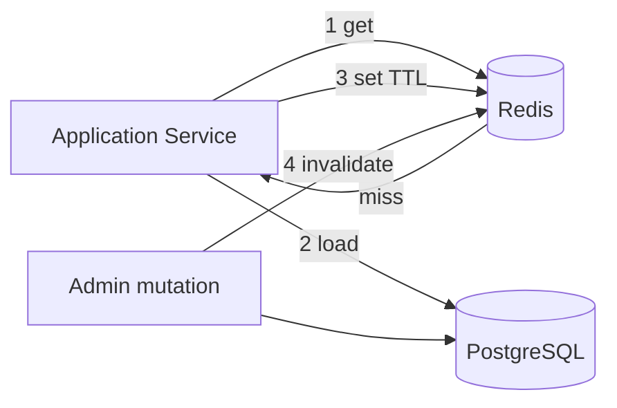

# 67 — Redis Architecture

## Purpose

Define how Neurolinx uses **Redis** for caching, authentication-related ephemeral state (refresh sessions / access-token blacklist), and rate limiting — without treating Redis as the system of record for commerce data.

---

## Requirements

| ID | Requirement |
|----|-------------|
| BR-RD-01 | Redis supports performance and security controls for the API. |
| BR-RD-02 | Durable business data remains in PostgreSQL. |
| BR-RD-03 | Rate limiting protects auth and sensitive endpoints. |

---

## Technical Decisions

| Decision | Choice |
|----------|--------|
| Role of Redis | Cache + ephemeral security/state, not primary DB |
| Client | Spring Data Redis / Lettuce |
| Key namespace | Prefixed keys, e.g. `nlx:{env}:{purpose}:...` |
| Serialization | JSON or Java serialization carefully — prefer JSON/String for interoperability |
| HA | Redis standalone for early envs; Sentinel/Cluster **TBD** for production |

---

## Use Cases

### 1. Caching

| Cache candidate | Rationale | TTL guidance |
|-----------------|-----------|--------------|
| Public product detail / category trees | Read-heavy | **TBD** minutes; invalidate on admin update |
| CMS published pages | Read-heavy | Invalidate on publish |
| Feature flags / config | Low churn | **TBD** |
| Session-like cart for guests | Optional — may stay in DB | **TBD** — prefer DB if durability required |

**Rules:**

- Cache-aside pattern via application services.
- Writes to PostgreSQL invalidate or update related keys.
- Never cache sensitive secrets or raw payment provider credentials.



### 2. Sessions / Token Blacklist

Align with [63_AUTHENTICATION.md](./63_AUTHENTICATION.md).

| Key purpose | Value | TTL |
|-------------|-------|-----|
| Refresh session | Session metadata / token hash reference | ≈ refresh lifetime |
| Access token blacklist (`jti`) | Marker | Remaining access TTL |
| Password reset / email verify tokens | One-time token hash | Short **TBD** |

Logout and refresh rotation must update Redis (and/or DB) so revoked credentials cannot be reused.

**Note:** Refresh sessions may also be stored in PostgreSQL for durability across Redis flushes — dual-write strategy **TBD**.

### 3. Rate Limiting

| Target | Suggested approach | Limits |
|--------|--------------------|--------|
| `/auth/login`, password reset | Fixed/sliding window per IP + account | **TBD** |
| Public write endpoints (enquiry, review) | Per IP | **TBD** |
| Admin APIs | Per user | **TBD** |
| General API | Optional global/user quotas | **TBD** |

Implementation options: Bucket4j + Redis, or gateway (Nginx) limits — **TBD**; document chosen approach in [91_API_SECURITY.md](./91_API_SECURITY.md).

On limit exceeded: HTTP `429` with problem details ([62_API_ARCHITECTURE.md](./62_API_ARCHITECTURE.md)).

---

## Key Design

```text
nlx:{env}:cache:product:{id}
nlx:{env}:cache:category:tree
nlx:{env}:auth:refresh:{sessionId}
nlx:{env}:auth:blacklist:jti:{jti}
nlx:{env}:ratelimit:login:ip:{ip}
nlx:{env}:ratelimit:login:user:{userId}
```

| Convention | Rule |
|------------|------|
| Env segment | Prevents collisions across shared Redis (**if shared — avoid in prod**) |
| TTLs | Always set; no immortal keys unless explicitly justified |
| PII in keys | Prefer opaque ids over emails in key names |

---

## Failure Behavior

| Scenario | Expected behavior |
|----------|-------------------|
| Redis down | Auth blacklist/rate-limit degraded mode **TBD** (fail closed for admin login vs fail open for public reads — decide per use case) |
| Cache miss storm | Protect DB with sensible TTLs and optional locking **TBD** |
| Flush | Rebuild caches; refresh sessions recoverable if mirrored in DB |

---

## Functional Requirements

| ID | Requirement |
|----|-------------|
| FR-RD-01 | Product/CMS caches invalidate on relevant admin writes. |
| FR-RD-02 | Logout blacklists or deletes server-side session material. |
| FR-RD-03 | Auth endpoints enforce Redis-backed (or equivalent) rate limits. |
| FR-RD-04 | Orders/payments are not solely stored in Redis. |

---

## Non-Functional Requirements

| ID | Requirement |
|----|-------------|
| NFR-RD-01 | Cache stampedes mitigated for hot keys (**strategy TBD**). |
| NFR-RD-02 | Memory usage monitored; eviction policy **TBD** (`allkeys-lru` common). |
| NFR-RD-03 | Redis auth and network isolation in production ([90_SECURITY_ARCHITECTURE.md](./90_SECURITY_ARCHITECTURE.md)). |

---

## Dependencies

- [60_SPRING_BOOT_ARCHITECTURE.md](./60_SPRING_BOOT_ARCHITECTURE.md)
- [63_AUTHENTICATION.md](./63_AUTHENTICATION.md)
- [65_DATABASE_ARCHITECTURE.md](./65_DATABASE_ARCHITECTURE.md)
- [91_API_SECURITY.md](./91_API_SECURITY.md)
- [125_MONITORING_AND_LOGGING.md](./125_MONITORING_AND_LOGGING.md)

---

## Constraints

- Do not use Redis as the only store for orders, payments, or inventory truth.
- Do not log Redis values containing tokens.
- Do not share one unprefixed Redis DB across unrelated apps in production.

---

## Acceptance Criteria

- [ ] Documented key prefixes and TTLs implemented for adopted use cases.
- [ ] Cache invalidation tested for product and content updates.
- [ ] Rate limit returns `429` on auth abuse paths.
- [ ] Production Redis is authenticated and not publicly exposed.

---

## Open Questions (TBD)

| Topic | Status |
|-------|--------|
| Exact rate limit numbers | TBD |
| Refresh session in Redis vs DB vs both | TBD |
| Fail-open vs fail-closed when Redis unavailable | TBD per feature |
| Redis HA topology | TBD |
| Guest cart in Redis | TBD |
