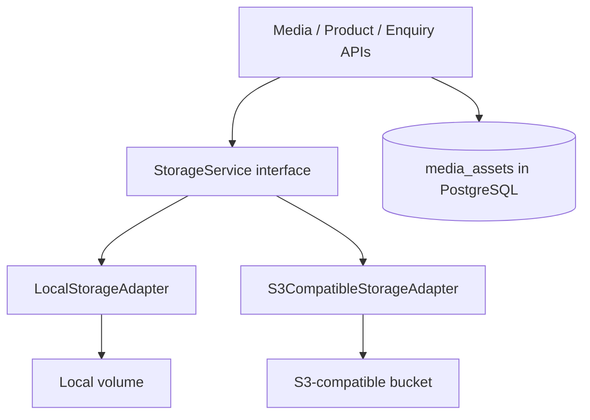
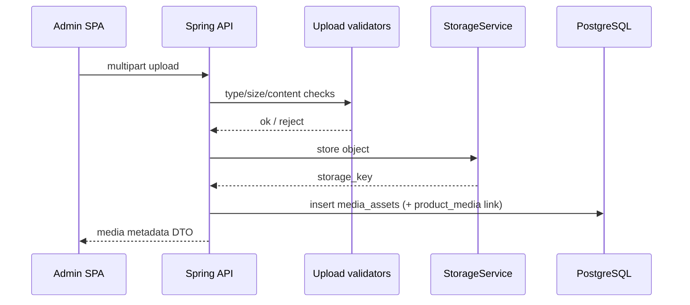

# 68 — File Storage

## Purpose

Define the **storage abstraction** for Neurolinx media (product images, videos, 3D models, datasheets/manuals, enquiry attachments, CMS assets), supporting **local** development storage and **S3-compatible** object storage in deployed environments.

---

## Requirements

| ID | Requirement |
|----|-------------|
| BR-FS-01 | Products support images, videos, technical documents, datasheets, manuals, and 3D models (GLB/GLTF). |
| BR-FS-02 | Admin can manage media without code changes ([76_ADMIN_MEDIA_MANAGEMENT.md](./76_ADMIN_MEDIA_MANAGEMENT.md)). |
| BR-FS-03 | Binaries are not stored in PostgreSQL; metadata is ([66_DATABASE_SCHEMA.md](./66_DATABASE_SCHEMA.md)). |
| BR-FS-04 | Uploads must follow security controls ([93_FILE_UPLOAD_SECURITY.md](./93_FILE_UPLOAD_SECURITY.md)). |

---

## Technical Decisions

| Decision | Choice |
|----------|--------|
| Abstraction | `StorageService` port with Local + S3-compatible adapters |
| Metadata | `media_assets` table stores `storage_key`, mime, size, type |
| Public vs private objects | Product/CMS public assets vs private enquiry attachments — ACL strategy **TBD** |
| CDN | Optional in front of object storage — **TBD** |
| Image derivatives | Thumbnails/responsive sizes — **TBD** (sync vs async) |
| 3D optimization | Source GLB stored; compressed derivatives **TBD** — see [82_3D_MODEL_GUIDELINES.md](./82_3D_MODEL_GUIDELINES.md) |

---

## Storage Abstraction



### Port operations (minimum)

| Operation | Description |
|-----------|-------------|
| `store(stream, key, contentType)` | Persist object |
| `delete(key)` | Remove object |
| `exists(key)` | Check |
| `resolveUrl(key)` / `presign(key)` | Public URL or time-limited URL — **TBD** which is default per media class |

Configuration selects adapter via Spring profiles (`storage.type=local|s3`).

---

## Key / Path Layout

Suggested object key layout:

```text
{env}/media/{yyyy}/{mm}/{uuid}/{sanitized-filename}
{env}/products/{productId}/{role}/{uuid}.glb
{env}/enquiries/{enquiryId}/{uuid}-{sanitized-filename}
```

| Rule | Detail |
|------|--------|
| No user-controlled path segments without sanitization | |
| Opaque UUID segment | Avoid collisions and enumeration |
| Env prefix | Separate staging/prod buckets or prefixes |

---

## Media Classes

| Class | Examples | Typical visibility |
|-------|----------|--------------------|
| Product gallery | Images, video | Public or CDN |
| Product documents | PDF datasheets, manuals | Public or gated **TBD** |
| Product 3D | `.glb` / `.gltf` (+ bins if any) | Public optimized assets preferred |
| CMS / blog / projects | Images | Public |
| Enquiry attachments | Customer uploads | Private |
| Admin-only | Internal docs | Private |

Linking to products: `product_media.role` values **TBD** (gallery, datasheet, manual, model_3d, …).

---

## Upload Flow



Security checks (non-exhaustive; full rules in [93_FILE_UPLOAD_SECURITY.md](./93_FILE_UPLOAD_SECURITY.md)):

- Authenticated + permitted role for admin uploads
- Allowlist MIME and extensions
- Max size per media class (**TBD** numeric limits)
- Virus scanning **TBD**
- Do not trust client-declared content type alone

---

## Local vs S3-Compatible

| Aspect | Local | S3-compatible |
|--------|-------|----------------|
| Use | Dev/test | Staging/production |
| Config | Base directory path | Endpoint, region, bucket, credentials |
| URLs | App-served or static mapping **TBD** | Virtual-hosted / path-style + optional CDN |
| Backup | Tied to volume backups | Bucket versioning/lifecycle **TBD** |

Compatible targets may include AWS S3, MinIO, or other S3 APIs — vendor choice **TBD**.

---

## Functional Requirements

| ID | Requirement |
|----|-------------|
| FR-ST-01 | Application code depends on `StorageService`, not raw AWS SDK calls scattered in modules. |
| FR-ST-02 | Product can attach multiple media assets including one or more 3D models. |
| FR-ST-03 | Switching local→S3 is configuration-only for a given environment. |
| FR-ST-04 | Deleting media removes or orphans storage objects per documented policy (**orphan GC TBD**). |

---

## Non-Functional Requirements

| ID | Requirement |
|----|-------------|
| NFR-ST-01 | Large uploads support size limits and timeouts suitable for 3D assets (**limits TBD**). |
| NFR-ST-02 | Public asset URLs are cacheable at CDN/browser where appropriate. |
| NFR-ST-03 | Private assets are not world-readable. |

---

## Dependencies

- [66_DATABASE_SCHEMA.md](./66_DATABASE_SCHEMA.md)
- [36_PRODUCT_MEDIA.md](./36_PRODUCT_MEDIA.md)
- [33_PRODUCT_3D_VIEWER.md](./33_PRODUCT_3D_VIEWER.md)
- [76_ADMIN_MEDIA_MANAGEMENT.md](./76_ADMIN_MEDIA_MANAGEMENT.md)
- [82_3D_MODEL_GUIDELINES.md](./82_3D_MODEL_GUIDELINES.md)
- [93_FILE_UPLOAD_SECURITY.md](./93_FILE_UPLOAD_SECURITY.md)

---

## Constraints

- Do not commit binary product assets into the Git repository as the primary CMS.
- Do not expose open upload endpoints without authZ and validation.
- GLTF external resources must be constrained (no arbitrary remote fetches) — see 3D docs.

---

## Acceptance Criteria

- [ ] Local and S3-compatible adapters implement the same port.
- [ ] `media_assets.storage_key` is the durable pointer used by APIs.
- [ ] Product, CMS, and enquiry upload paths enforce security allowlists.
- [ ] 3D and document attachments appear in admin product flows ([72_ADMIN_PRODUCTS.md](./72_ADMIN_PRODUCTS.md)).

---

## Open Questions (TBD)

| Topic | Status |
|-------|--------|
| Max upload sizes per type | TBD |
| Thumbnail / transcoding pipeline | TBD |
| CDN provider | TBD |
| Presigned upload (direct-to-bucket) vs proxy via API | TBD |
| Datasheet gating (login required?) | TBD |
| Object lifecycle / orphan cleanup | TBD |
