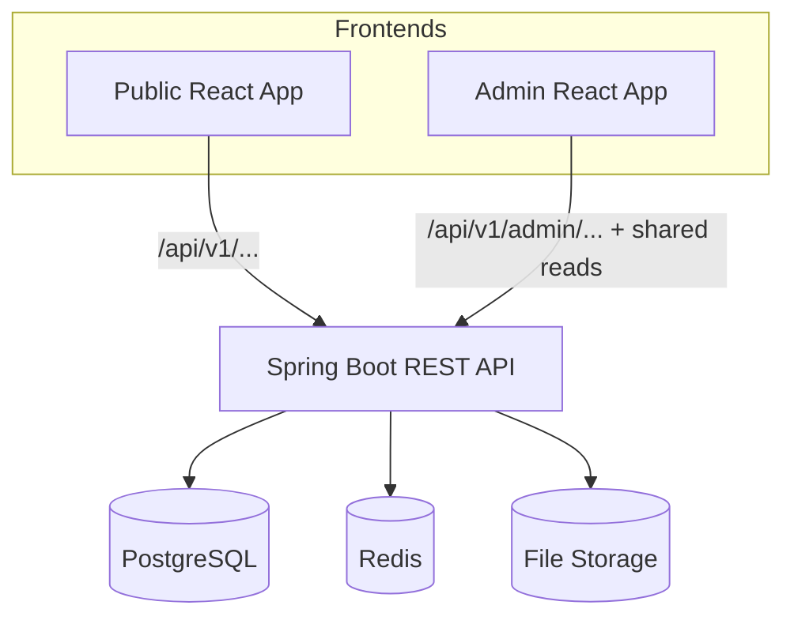
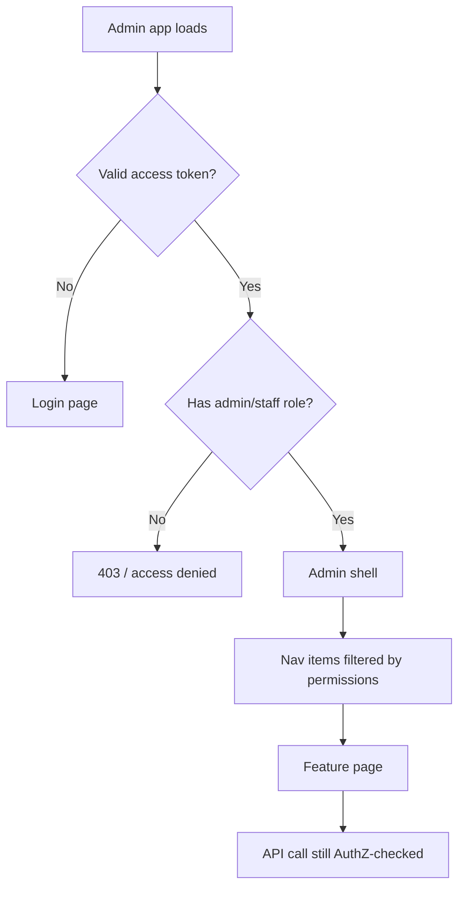

# 70 — Admin Architecture

## Purpose

Define the **Neurolinx Admin platform**: a separate React application that manages the platform through the **same Spring Boot REST API**, with **role-gated** access aligned to [04_USER_ROLES.md](./04_USER_ROLES.md) and [64_AUTHORIZATION_RBAC.md](./64_AUTHORIZATION_RBAC.md).

---

## Requirements

| ID | Requirement |
|----|-------------|
| BR-ADM-01 | Authorized users manage the platform without editing source code. |
| BR-ADM-02 | Admin UI and public UI are separate frontends sharing one API. |
| BR-ADM-03 | Security is enforced on the API; UI gating is UX only. |
| BR-ADM-04 | Admin covers dashboard, catalog, inventory, orders, customers, payments visibility, enquiries, projects, content, media, blog, reviews, coupons, analytics, settings, user management, and audit logs (depth per area may be phased — **TBD**). |

---

## Technical Decisions

| Decision | Choice |
|----------|--------|
| Client stack | React + TypeScript + Vite (same family as public app) |
| Routing | React Router; admin routes under admin app origin/path |
| Data fetching | TanStack Query against REST |
| Auth | JWT + refresh per [63_AUTHENTICATION.md](./63_AUTHENTICATION.md) |
| API base | `/api/v1/admin/**` for admin operations ([62_API_ARCHITECTURE.md](./62_API_ARCHITECTURE.md)) |
| Design | Prefer existing Neurolinx design system tokens where applicable; admin may prioritize density/usability over marketing visuals |
| Deployment | Separate static build hosted behind Nginx — **TBD** subdomain (`admin.` vs path) |

---

## Context



---

## Application Structure (Suggested)

```text
apps/admin/   # Locked — Vite React admin app in monorepo ([50_REACT_ARCHITECTURE.md](./50_REACT_ARCHITECTURE.md), [ADR-001](./ADR/ADR-001-FRONTEND-STACK.md))
├── src/
│   ├── app/           # router, providers, auth gate
│   ├── features/      # dashboard, products, orders, ...
│   ├── shared/        # UI primitives, API client
│   └── main.tsx
```

Feature modules should map 1:1 to admin docs:

| Feature | Doc |
|---------|-----|
| Dashboard | [71_ADMIN_DASHBOARD.md](./71_ADMIN_DASHBOARD.md) |
| Products / categories / inventory | [72_ADMIN_PRODUCTS.md](./72_ADMIN_PRODUCTS.md) |
| Orders | [73_ADMIN_ORDERS.md](./73_ADMIN_ORDERS.md) |
| Customers | [74_ADMIN_CUSTOMERS.md](./74_ADMIN_CUSTOMERS.md) |
| Content / blog / projects | [75_ADMIN_CONTENT_MANAGEMENT.md](./75_ADMIN_CONTENT_MANAGEMENT.md) |
| Media | [76_ADMIN_MEDIA_MANAGEMENT.md](./76_ADMIN_MEDIA_MANAGEMENT.md) |
| Analytics | [77_ADMIN_ANALYTICS.md](./77_ADMIN_ANALYTICS.md) |

Additional areas (payments, reviews, coupons, settings, users, audit): document inline here until dedicated docs exist — implementation still API-backed.

---

## Role Gating



| Layer | Responsibility |
|-------|----------------|
| Route guard | Block unauthenticated users |
| Nav/menu filter | Hide features without permission |
| Page actions | Disable buttons lacking permission |
| API | **Authoritative** allow/deny |

Exact roles: [04_USER_ROLES.md](./04_USER_ROLES.md). Fine-grained editor vs fulfillment roles: **TBD** in that doc.

---

## Functional Requirements

| ID | Requirement |
|----|-------------|
| FR-ADM-01 | Admin users authenticate and land in a gated shell. |
| FR-ADM-02 | Each major management area is reachable only with appropriate permission. |
| FR-ADM-03 | Mutations call admin REST endpoints; success/error surfaces problem details. |
| FR-ADM-04 | Media and product 3D attachments use media APIs ([68_FILE_STORAGE.md](./68_FILE_STORAGE.md)). |
| FR-ADM-05 | Audit-sensitive actions are attributable to the acting user (**audit UI TBD**). |

---

## Non-Functional Requirements

| ID | Requirement |
|----|-------------|
| NFR-ADM-01 | Admin UX prioritizes clarity and efficient data tables/forms. |
| NFR-ADM-02 | Admin app is not publicly indexable (robots/auth) — SEO details **TBD**. |
| NFR-ADM-03 | Separate deployable artifact from the public site. |

---

## Dependencies

- [60_SPRING_BOOT_ARCHITECTURE.md](./60_SPRING_BOOT_ARCHITECTURE.md)
- [62_API_ARCHITECTURE.md](./62_API_ARCHITECTURE.md)
- [63_AUTHENTICATION.md](./63_AUTHENTICATION.md)
- [64_AUTHORIZATION_RBAC.md](./64_AUTHORIZATION_RBAC.md)
- [50_REACT_ARCHITECTURE.md](./50_REACT_ARCHITECTURE.md)
- [90_SECURITY_ARCHITECTURE.md](./90_SECURITY_ARCHITECTURE.md)

---

## Constraints

- Do not embed admin screens inside the public marketing bundle as the long-term model (separate app).
- Do not bypass API with direct DB tools as a product feature.
- Do not invent staff role matrices beyond `04_USER_ROLES.md`.

---

## Acceptance Criteria

- [ ] Admin React app consumes the shared REST API only.
- [ ] Unauthenticated users cannot access admin routes.
- [ ] Users without staff/admin roles receive forbidden treatment.
- [ ] Feature docs (71–77) map to navigable admin sections (phased delivery OK if documented).

---

## Open Questions (TBD)

| Topic | Status |
|-------|--------|
| Admin hostname / path | TBD |
| Shared component library with public app | TBD |
| MFA for admin login | TBD |
| Audit log UI scope | TBD |
