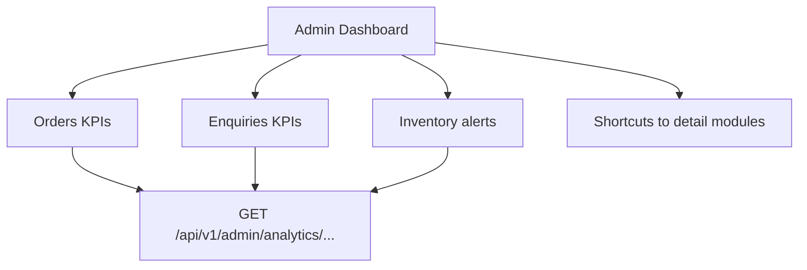

# 71 — Admin Dashboard

## Purpose

Define the admin **KPI overview** home: a single landing view that surfaces operational health signals for orders, enquiries, and inventory alerts. Exact metric formulas and targets are **TBD** where business has not defined them.

---

## Requirements

| ID | Requirement |
|----|-------------|
| BR-DASH-01 | Admins need a quick operational overview after login. |
| BR-DASH-02 | Dashboard highlights orders, enquiries, and inventory risk. |
| BR-DASH-03 | Metrics must be API-driven, not hardcoded. |

---

## Technical Decisions

| Decision | Choice |
|----------|--------|
| Data source | Admin analytics/dashboard aggregate endpoints |
| Refresh | On load + manual refresh; polling interval **TBD** |
| Visualization | Simple summary cards / small charts — avoid marketing clutter |
| Permissions | Requires dashboard/analytics read authority (**code TBD** in [04_USER_ROLES.md](./04_USER_ROLES.md)) |

---

## Dashboard Composition

**One job:** operational snapshot. Do not overload with CMS editing or full order grids (link out instead).

### Orders KPIs (indicative)

| Metric | Description | Status |
|--------|-------------|--------|
| Orders today / period | Count of placed orders | Period default **TBD** |
| Revenue today / period | Sum of paid/placed grand totals | Include which statuses **TBD** |
| Orders by status | Open / processing / fulfilled / cancelled | Status set **TBD** |
| Avg order value | Revenue / orders | **TBD** |

### Enquiries KPIs (indicative)

| Metric | Description | Status |
|--------|-------------|--------|
| New enquiries | Unassigned or `new` status count | Status enum **TBD** |
| Open pipeline | Non-closed enquiries | **TBD** |
| SLA / follow-up due | Items past `follow_up_at` | SLA rules **TBD** |

### Inventory alerts (indicative)

| Metric | Description | Status |
|--------|-------------|--------|
| Low stock variants | `quantity_on_hand` ≤ threshold | Threshold policy **TBD** |
| Out of stock | Quantity ≤ 0 | Reservation handling **TBD** |
| Alert list | Top N SKUs needing attention | Sort **TBD** |

### Explicitly out of first viewport / page noise

Do not dump full product editors, blog drafts, or raw log streams on the dashboard. Link to [72_ADMIN_PRODUCTS.md](./72_ADMIN_PRODUCTS.md), [73_ADMIN_ORDERS.md](./73_ADMIN_ORDERS.md), etc.

---

## Functional Requirements

| ID | Requirement |
|----|-------------|
| FR-DASH-01 | Authenticated admin sees KPI summary widgets for orders, enquiries, inventory alerts. |
| FR-DASH-02 | Each widget links to the relevant management list filtered when possible. |
| FR-DASH-03 | Empty/error states are explicit if analytics API fails. |
| FR-DASH-04 | Unknown business targets are labeled TBD in UI copy only if product requests; otherwise omit targets. |

---

## Non-Functional Requirements

| ID | Requirement |
|----|-------------|
| NFR-DASH-01 | Dashboard aggregate query remains efficient (pre-aggregation **TBD**). |
| NFR-DASH-02 | Timezone for “today” documented — default **TBD** (suggest UTC or company TZ). |

---

## Dependencies

- [70_ADMIN_ARCHITECTURE.md](./70_ADMIN_ARCHITECTURE.md)
- [77_ADMIN_ANALYTICS.md](./77_ADMIN_ANALYTICS.md)
- [73_ADMIN_ORDERS.md](./73_ADMIN_ORDERS.md)
- [72_ADMIN_PRODUCTS.md](./72_ADMIN_PRODUCTS.md)
- [66_DATABASE_SCHEMA.md](./66_DATABASE_SCHEMA.md)
- [103_ANALYTICS.md](./103_ANALYTICS.md)

---

## Constraints

- Do not invent revenue targets, conversion goals, or SLA hours.
- Do not show PII beyond what the role permits.
- Dashboard is not a substitute for full analytics export ([77_ADMIN_ANALYTICS.md](./77_ADMIN_ANALYTICS.md)).

---

## Acceptance Criteria

- [ ] Dashboard route is default landing for permitted admins.
- [ ] Orders, enquiries, and inventory alert sections exist (even if some metrics remain TBD placeholders in docs only — UI should show real counts when APIs exist).
- [ ] Widgets deep-link to detail modules.
- [ ] Metric definitions documented or marked TBD before treating numbers as contractual KPIs.

---

## Open Questions (TBD)

| Topic | Status |
|-------|--------|
| Exact KPI formulas and included order statuses | TBD |
| Default reporting timezone | TBD |
| Refresh/polling cadence | TBD |
| Which roles see which widgets | TBD in `04` |
