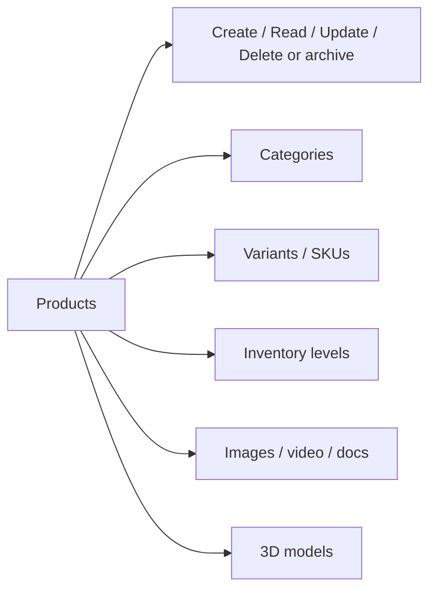

# 72 — Admin Products

## Purpose

Specify admin capabilities to **CRUD products**, manage **categories**, **inventory**, **variants**, **media**, and **3D model attachment** without code changes.

---

## Requirements

| ID | Requirement |
|----|-------------|
| BR-AP-01 | Staff can create and update catalog products for shop and showcase. |
| BR-AP-02 | Products support variants, categories, stock, pricing fields, and media including 3D. |
| BR-AP-03 | Products may be purchasable and/or enquiry-enabled (B2C + B2B) — exact flags **TBD**. |
| BR-AP-04 | Datasheets, manuals, galleries, and GLB/GLTF can be attached via media library. |

Align with [30_PRODUCT_ARCHITECTURE.md](./30_PRODUCT_ARCHITECTURE.md), [36_PRODUCT_MEDIA.md](./36_PRODUCT_MEDIA.md), [33_PRODUCT_3D_VIEWER.md](./33_PRODUCT_3D_VIEWER.md).

---

## Technical Decisions

| Decision | Choice |
|----------|--------|
| API | `/api/v1/admin/products`, categories, inventory, media link endpoints |
| Forms | Structured forms + media picker (not raw JSON for operators) |
| 3D attach | Select/upload asset with role `model_3d` (name **TBD**) |
| Draft/publish | Status workflow **TBD** |
| Slug | Editable with uniqueness validation |

---

## Feature Map

### Products CRUD

| Action | Notes |
|--------|-------|
| List / search / filter | By status, category, SKU **TBD** |
| Create | Name, slug, description, category, flags |
| Update | Same fields + SEO **TBD** |
| Delete / archive | Prefer archive if ordered historically — **TBD** |
| Specs | Editor for specifications — storage model **TBD** |

### Categories

| Action | Notes |
|--------|-------|
| Tree manage | Create/rename/reorder/move |
| Assign products | Per product or bulk **TBD** |

### Variants & inventory

| Action | Notes |
|--------|-------|
| Add variant | SKU, options, price, currency |
| Edit stock | Adjust on-hand; reservations **TBD** |
| Low-stock threshold | Per variant **TBD** |

### Media & 3D

| Action | Notes |
|--------|-------|
| Attach gallery images | Ordered |
| Attach documents | Datasheet/manual roles |
| Attach 3D | GLB/GLTF via [76_ADMIN_MEDIA_MANAGEMENT.md](./76_ADMIN_MEDIA_MANAGEMENT.md) / [68_FILE_STORAGE.md](./68_FILE_STORAGE.md) |
| Remove / replace | Updates `product_media` |

---

## Functional Requirements

| ID | Requirement |
|----|-------------|
| FR-AP-01 | Authorized users can create and edit products and variants. |
| FR-AP-02 | Category management supports hierarchical navigation needs of the shop. |
| FR-AP-03 | Inventory quantities are editable and reflected to storefront availability rules (**rules TBD**). |
| FR-AP-04 | Media library assets can be linked to products with explicit roles. |
| FR-AP-05 | At least one 3D asset can be associated for viewer-enabled products. |
| FR-AP-06 | Validation errors from API display per field. |

---

## Non-Functional Requirements

| ID | Requirement |
|----|-------------|
| NFR-AP-01 | Large catalogs remain usable via pagination/search. |
| NFR-AP-02 | Uploads obey file security limits. |
| NFR-AP-03 | Product updates invalidate relevant caches ([67_REDIS_ARCHITECTURE.md](./67_REDIS_ARCHITECTURE.md)). |

---

## Dependencies

- [70_ADMIN_ARCHITECTURE.md](./70_ADMIN_ARCHITECTURE.md)
- [66_DATABASE_SCHEMA.md](./66_DATABASE_SCHEMA.md)
- [68_FILE_STORAGE.md](./68_FILE_STORAGE.md)
- [76_ADMIN_MEDIA_MANAGEMENT.md](./76_ADMIN_MEDIA_MANAGEMENT.md)
- [64_AUTHORIZATION_RBAC.md](./64_AUTHORIZATION_RBAC.md)
- [93_FILE_UPLOAD_SECURITY.md](./93_FILE_UPLOAD_SECURITY.md)

---

## Constraints

- Do not invent final pricing rules, tax inclusive/exclusive display, or configurator option schemas beyond product docs.
- Do not require engineers to redeploy for routine catalog edits.
- 3D assets must meet guidelines in [82_3D_MODEL_GUIDELINES.md](./82_3D_MODEL_GUIDELINES.md) (enforce what can be automated; rest is operational process).

---

## Acceptance Criteria

- [ ] Admin can perform product CRUD end-to-end against API.
- [ ] Variants with SKUs and stock are manageable.
- [ ] Categories can be maintained as a tree/list as designed.
- [ ] Images, documents, and 3D models can be attached and ordered/replaced.
- [ ] Permission checks block unauthorized catalog editors.

---

## Open Questions (TBD)

| Topic | Status |
|-------|--------|
| Publish workflow / approvals | TBD |
| M:N categories | TBD |
| Variant option model (size/color/config) | TBD |
| Enquiry-only vs purchasable flags | TBD |
| Bulk import CSV | TBD |
