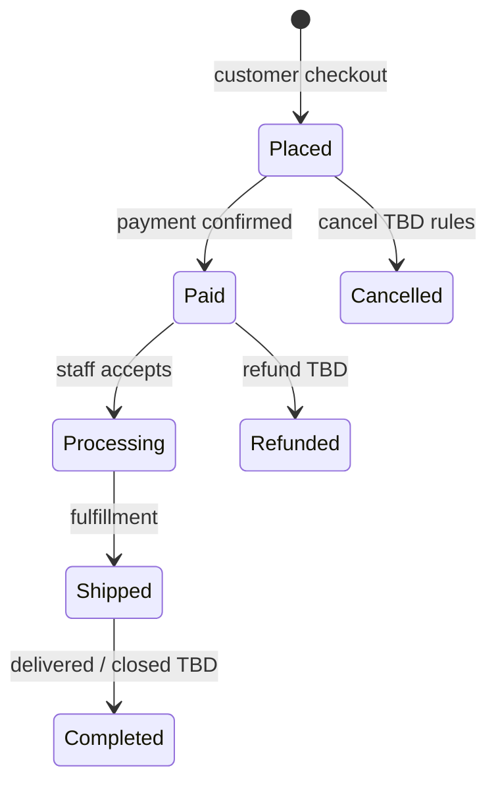

# 73 — Admin Orders

## Purpose

Define **order management** in the admin platform: listing orders, viewing detail, updating status, and supporting fulfillment workflows. Exact status machine and carrier integrations are **TBD** pending business/e-commerce docs.

---

## Requirements

| ID | Requirement |
|----|-------------|
| BR-AO-01 | Staff can view and manage customer orders placed via the shop. |
| BR-AO-02 | Order status can be updated as fulfillment progresses. |
| BR-AO-03 | Order history retains line snapshots for support and invoices. |
| BR-AO-04 | Payments and shipping provider specifics remain adapter-based — [43_PAYMENT.md](./43_PAYMENT.md), shipping **TBD**. |

Related: [44_ORDER_MANAGEMENT.md](./44_ORDER_MANAGEMENT.md), [40_ECOMMERCE_ARCHITECTURE.md](./40_ECOMMERCE_ARCHITECTURE.md).

---

## Technical Decisions

| Decision | Choice |
|----------|--------|
| API | `/api/v1/admin/orders` |
| List UX | Filterable table (status, date, customer, order number) |
| Detail UX | Header + line items + payment summary + shipment panel |
| Status updates | Explicit transitions via API (not free-text only) |
| Notes | Internal admin notes **TBD** |
| Refunds / cancellations | Policy **TBD** — must not invent |

---

## Order Management Flow

> Status names above are **illustrative**. Replace with the approved enum from [44_ORDER_MANAGEMENT.md](./44_ORDER_MANAGEMENT.md) / business sign-off.

---

## Capabilities

| Capability | Description | Status |
|------------|-------------|--------|
| List / search | By order number, email, date range, status | |
| View detail | Customer, addresses, lines, totals, payment state | |
| Update status | Controlled transition | Transition matrix **TBD** |
| Add tracking | Carrier + tracking number | Carriers **TBD** |
| Resend notification | Email/SMS | Channels **TBD** |
| Print invoice | PDF | Template **TBD** |
| Refund | Partial/full | **TBD** + [94_PAYMENT_SECURITY.md](./94_PAYMENT_SECURITY.md) |

---

## Fulfillment

| Step | Admin action | System effect |
|------|--------------|---------------|
| Acknowledge | Move to processing | **TBD** inventory commit |
| Ship | Enter tracking, mark shipped | Notify customer **TBD** |
| Complete | Mark completed | Close order |

Multi-warehouse pick/pack: **TBD**.

---

## Functional Requirements

| ID | Requirement |
|----|-------------|
| FR-AO-01 | Authorized staff can list and open any order (within tenancy rules **TBD**). |
| FR-AO-02 | Status updates persist and appear on customer order tracking when that feature exists. |
| FR-AO-03 | Invalid status transitions are rejected by API. |
| FR-AO-04 | Payment status is visible; card data is never shown. |
| FR-AO-05 | Actions are audited to the acting admin user (**audit store TBD**). |

---

## Non-Functional Requirements

| ID | Requirement |
|----|-------------|
| NFR-AO-01 | Order list queries are indexed/paginated. |
| NFR-AO-02 | Concurrent status updates use optimistic locking or equivalent. |

---

## Dependencies

- [70_ADMIN_ARCHITECTURE.md](./70_ADMIN_ARCHITECTURE.md)
- [66_DATABASE_SCHEMA.md](./66_DATABASE_SCHEMA.md)
- [44_ORDER_MANAGEMENT.md](./44_ORDER_MANAGEMENT.md)
- [43_PAYMENT.md](./43_PAYMENT.md)
- [64_AUTHORIZATION_RBAC.md](./64_AUTHORIZATION_RBAC.md)
- [71_ADMIN_DASHBOARD.md](./71_ADMIN_DASHBOARD.md)

---

## Constraints

- Do not invent refund windows, restocking fees, or legal invoice fields.
- Do not expose gateway raw payloads with sensitive fields to the UI.
- B2B quotes/enquiries are not orders — manage under enquiries unless converted (**conversion process TBD**).

---

## Acceptance Criteria

- [ ] Admin order list and detail screens work against API.
- [ ] Status update endpoint enforces allowed transitions once matrix is defined.
- [ ] Fulfillment fields (tracking) can be stored when shipping module is enabled.
- [ ] Unauthorized users cannot mutate orders.

---

## Open Questions (TBD)

| Topic | Status |
|-------|--------|
| Official status enum + transitions | TBD |
| Cancellation/refund policy | TBD |
| Invoice/tax document format | TBD |
| Partial shipment support | TBD |
| ERP sync on status change | TBD |
