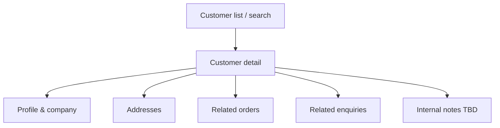

# 74 — Admin Customers

## Purpose

Define admin management of **customers**, including **B2C accounts** and **B2B/company** contexts: lookup, profile review, address visibility, and operational actions needed for sales and support. Business-specific CRM fields remain **TBD**.

---

## Requirements

| ID | Requirement |
|----|-------------|
| BR-AC-01 | Staff can find and view customer accounts. |
| BR-AC-02 | B2B customers may include company attributes and enquiry history. |
| BR-AC-03 | Customer PII access is permission-restricted and auditable. |
| BR-AC-04 | Admin does not replace a full external CRM unless decided later. |

Related: [45_CUSTOMER_ACCOUNT.md](./45_CUSTOMER_ACCOUNT.md), [04_USER_ROLES.md](./04_USER_ROLES.md), [26 B2B enquiry](./27_CONTACT_AND_ENQUIRY.md).

---

## Technical Decisions

| Decision | Choice |
|----------|--------|
| API | `/api/v1/admin/customers` |
| Identity link | `customers.user_id` → `users` |
| B2B model | Fields on `customers` and/or org table — **org entity TBD** |
| Mutations | Limited; prefer customer self-service for profile edits where possible |
| Impersonation | **TBD** — disabled unless explicitly approved |

---

## Capabilities

| Capability | Description | Status |
|------------|-------------|--------|
| Search | Email, name, company, id | |
| View profile | Type B2C/B2B, contact fields | Type enum **TBD** |
| View addresses | Shipping/billing | |
| View orders | Deep link to [73_ADMIN_ORDERS.md](./73_ADMIN_ORDERS.md) | |
| View enquiries | Deep link to enquiry admin | |
| Disable login | Suspend user account | Policy **TBD** |
| Assign sales owner | For B2B | **TBD** |
| Export customer list | CSV | Privacy review **TBD** |
| Merge duplicates | | **TBD** |

---

## B2B Considerations

From master spec quotation workflows, admin should be able to see:

- Company name
- Contact details
- Related product enquiries / quote requests
- Assignment / follow-up context (often on enquiry records)

Credit terms, contract pricing, and multi-user company seats: **TBD**.

---

## Functional Requirements

| ID | Requirement |
|----|-------------|
| FR-AC-01 | Authorized staff can list/search customers with pagination. |
| FR-AC-02 | Detail view shows profile, addresses, and links to orders/enquiries. |
| FR-AC-03 | B2B company fields display when present. |
| FR-AC-04 | Actions that disable access require appropriate permission. |
| FR-AC-05 | API never returns password hashes. |

---

## Non-Functional Requirements

| ID | Requirement |
|----|-------------|
| NFR-AC-01 | PII access logged for admin reads/exports where required — **TBD** retention. |
| NFR-AC-02 | Search remains responsive with indexes on email/company. |

---

## Dependencies

- [70_ADMIN_ARCHITECTURE.md](./70_ADMIN_ARCHITECTURE.md)
- [66_DATABASE_SCHEMA.md](./66_DATABASE_SCHEMA.md)
- [64_AUTHORIZATION_RBAC.md](./64_AUTHORIZATION_RBAC.md)
- [45_CUSTOMER_ACCOUNT.md](./45_CUSTOMER_ACCOUNT.md)
- [92_DATA_SECURITY.md](./92_DATA_SECURITY.md)
- [27_CONTACT_AND_ENQUIRY.md](./27_CONTACT_AND_ENQUIRY.md)

---

## Constraints

- Do not invent loyalty tiers, credit limits, or tax exemption rules.
- Do not implement password viewing or plaintext reset display.
- Do not enable impersonation without explicit security approval.

---

## Acceptance Criteria

- [ ] Customer list/detail available to permitted roles.
- [ ] Orders and enquiries reachable from customer context.
- [ ] B2B company fields supported in API/UI when schema fields exist.
- [ ] Unauthorized PII access blocked with `403`.

---

## Open Questions (TBD)

| Topic | Status |
|-------|--------|
| Organization / multi-user B2B accounts | TBD |
| Sales owner assignment model | TBD |
| Customer export & GDPR/erasure process | TBD |
| Account suspension workflow | TBD |
| Admin-editable vs read-only profile fields | TBD |
