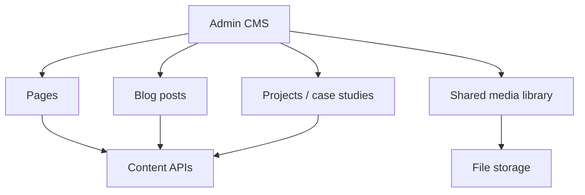

# 75 — Admin Content Management

## Purpose

Define the **CMS capabilities** of the admin platform for managing **pages**, **blog**, **projects**, and related corporate content **without code edits**, so marketing/engineering content can be updated through the API-backed admin UI.

---

## Requirements

| ID | Requirement |
|----|-------------|
| BR-CMS-01 | Authorized users manage site content without deploying code for routine copy/media changes. |
| BR-CMS-02 | Coverage includes pages, blog, and projects (case studies / showcase). |
| BR-CMS-03 | Content supports draft/publish semantics (**exact workflow TBD**). |
| BR-CMS-04 | Public site reads published content via API or agreed delivery mechanism. |

Related IA: [20_WEBSITE_INFORMATION_ARCHITECTURE.md](./20_WEBSITE_INFORMATION_ARCHITECTURE.md), [21_PAGE_INVENTORY.md](./21_PAGE_INVENTORY.md).

---

## Technical Decisions

| Decision | Choice |
|----------|--------|
| Storage | PostgreSQL content entities + media refs |
| Body format | Markdown or structured block JSON — **TBD** |
| Preview | Preview by draft token or admin-only flag — **TBD** |
| Routing | Slug-based public routes mapped in frontend |
| Localization | Multi-language content — **TBD** |
| Hardcoded vs CMS | Some structural chrome may remain in code; CMS owns page bodies listed as manageable |

---

## Content Types

| Type | Managed fields (indicative) | Notes |
|------|----------------------------|-------|
| Page | title, slug, body, status, SEO **TBD** | About, technology, industry landing bodies, etc. |
| Blog post | title, slug, body, author, tags, published_at | Tags model **TBD** |
| Project | title, slug, summary, body, industry, media | Align with Projects module |
| Navigation labels | | Prefer nav config doc; CMS ownership **TBD** |

Which pages are CMS-driven vs React-coded: **TBD** inventory decision with [21_PAGE_INVENTORY.md](./21_PAGE_INVENTORY.md).

---

## Editor Workflow

| Step | Description |
|------|-------------|
| 1 | Create draft content record |
| 2 | Edit fields + attach media |
| 3 | Preview (**TBD**) |
| 4 | Publish → visible on public site |
| 5 | Unpublish / archive |

Scheduling (`publish_at` future): **TBD**.

---

## Functional Requirements

| ID | Requirement |
|----|-------------|
| FR-CMS-01 | CRUD for pages, blog posts, and projects for permitted roles. |
| FR-CMS-02 | Slug uniqueness enforced. |
| FR-CMS-03 | Only published content is returned by public content APIs. |
| FR-CMS-04 | Media attachments use [76_ADMIN_MEDIA_MANAGEMENT.md](./76_ADMIN_MEDIA_MANAGEMENT.md). |
| FR-CMS-05 | Publishing invalidates CDN/Redis caches where used. |

---

## Non-Functional Requirements

| ID | Requirement |
|----|-------------|
| NFR-CMS-01 | Editor autosave **TBD**; prevent silent data loss on navigation. |
| NFR-CMS-02 | XSS-safe rendering on public site (sanitize/store policy **TBD**). |

---

## Dependencies

- [70_ADMIN_ARCHITECTURE.md](./70_ADMIN_ARCHITECTURE.md)
- [66_DATABASE_SCHEMA.md](./66_DATABASE_SCHEMA.md)
- [68_FILE_STORAGE.md](./68_FILE_STORAGE.md)
- [76_ADMIN_MEDIA_MANAGEMENT.md](./76_ADMIN_MEDIA_MANAGEMENT.md)
- [100_SEO_STRATEGY.md](./100_SEO_STRATEGY.md)
- [64_AUTHORIZATION_RBAC.md](./64_AUTHORIZATION_RBAC.md)

---

## Constraints

- Do not invent legal page obligatory text.
- Do not allow arbitrary script injection in CMS fields.
- Do not require developers for typo fixes on CMS-managed pages once live.

---

## Acceptance Criteria

- [ ] Admin can create, edit, publish, and unpublish page/blog/project content.
- [ ] Public API/site shows only published content.
- [ ] Media can be embedded/linked per content type.
- [ ] Permissions separate content editors from unrelated admin modules if roles define that.

---

## Open Questions (TBD)

| Topic | Status |
|-------|--------|
| Body editor format (Markdown vs blocks) | TBD |
| Which routes are CMS-managed | TBD |
| Preview mechanism | TBD |
| Localization | TBD |
| Content approval chain | TBD |
| Version history / rollback | TBD |
