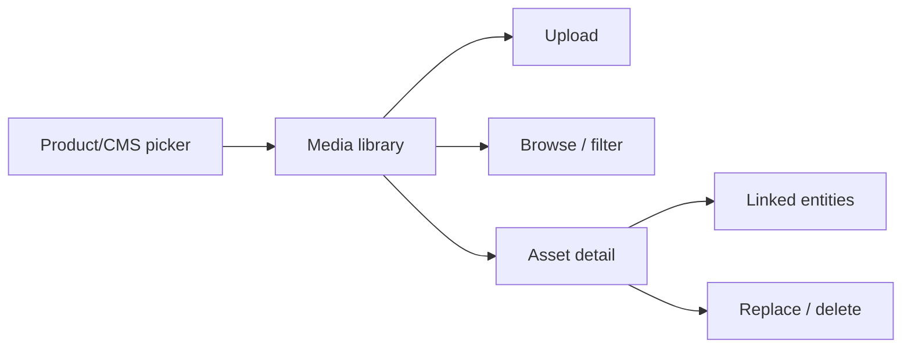

# 76 — Admin Media Management

## Purpose

Define the admin **media library**: upload, organize, and reuse **images, videos, 3D models, and documents**, and link them to products, content, projects, and enquiries. Upload security is mandatory and cross-referenced to [93_FILE_UPLOAD_SECURITY.md](./93_FILE_UPLOAD_SECURITY.md) and [68_FILE_STORAGE.md](./68_FILE_STORAGE.md).

---

## Requirements

| ID | Requirement |
|----|-------------|
| BR-MM-01 | Staff can upload and manage media without code deploys. |
| BR-MM-02 | Media types include images, videos, 3D (GLB/GLTF), and documents (e.g., PDF). |
| BR-MM-03 | Assets can be linked to products (gallery, datasheet, manual, 3D) and CMS entities. |
| BR-MM-04 | Uploads are authenticated, authorized, validated, and size/type-limited. |

---

## Technical Decisions

| Decision | Choice |
|----------|--------|
| Metadata store | `media_assets` in PostgreSQL |
| Bytes | StorageService (local / S3-compatible) |
| UI | Media library grid/list + detail + picker modal used by other admin features |
| Organization | Folders/tags — **TBD** (minimum: filters by type + search by name) |
| Dedup | Checksum-based dedup **TBD** |

---

## Media Library UX

| Capability | Notes |
|------------|-------|
| Upload single/multi | Multipart; progress UI |
| Filter | `image` / `video` / `model_3d` / `document` |
| Search | Filename / title **TBD** |
| View metadata | mime, size, dimensions, storage key (maybe hidden), creator |
| Delete | Block if in-use or force detach — **TBD** |
| Picker | Return `media_asset_id` to calling form |

---

## Link to File Upload Security

All admin uploads **must** comply with [93_FILE_UPLOAD_SECURITY.md](./93_FILE_UPLOAD_SECURITY.md). Minimum controls echoed here:

| Control | Requirement |
|---------|-------------|
| AuthN/AuthZ | `media:upload` (or equivalent from [04_USER_ROLES.md](./04_USER_ROLES.md)) |
| Allowlist | Extensions + MIME per class |
| Size caps | Per class **TBD** numeric values |
| Content sniffing | Verify magic bytes where feasible |
| Filename | Sanitize; store original separately |
| Execution | Serve with safe `Content-Type`; no executable hosting |
| Private vs public | Enquiry attachments private; product/CMS typically public |
| Malware scan | **TBD** |
| Rate limit | Apply to upload endpoints |

Do not document bypasses. Security doc wins on conflict.

---

## 3D & Documents

| Type | Notes |
|------|-------|
| GLB/GLTF | Preferred GLB for single-file delivery; validate per [82_3D_MODEL_GUIDELINES.md](./82_3D_MODEL_GUIDELINES.md) |
| PDF datasheets/manuals | Link via `product_media.role` |
| Video | Format allowlist **TBD** (e.g., mp4) |

Product attach flows: [72_ADMIN_PRODUCTS.md](./72_ADMIN_PRODUCTS.md).

---

## Functional Requirements

| ID | Requirement |
|----|-------------|
| FR-MM-01 | Authorized users can upload allowed media types to storage and create `media_assets`. |
| FR-MM-02 | Library lists assets with pagination and type filters. |
| FR-MM-03 | Other admin modules can pick existing assets without re-uploading. |
| FR-MM-04 | Rejected uploads return clear validation errors (`400`). |
| FR-MM-05 | Delete/detach behavior is defined and enforced (**policy TBD** but must be explicit before prod). |

---

## Non-Functional Requirements

| ID | Requirement |
|----|-------------|
| NFR-MM-01 | Large 3D uploads supported within configured limits/timeouts. |
| NFR-MM-02 | Public URLs cacheable; private assets not listable anonymously. |

---

## Dependencies

- [68_FILE_STORAGE.md](./68_FILE_STORAGE.md)
- [93_FILE_UPLOAD_SECURITY.md](./93_FILE_UPLOAD_SECURITY.md)
- [66_DATABASE_SCHEMA.md](./66_DATABASE_SCHEMA.md)
- [72_ADMIN_PRODUCTS.md](./72_ADMIN_PRODUCTS.md)
- [75_ADMIN_CONTENT_MANAGEMENT.md](./75_ADMIN_CONTENT_MANAGEMENT.md)
- [70_ADMIN_ARCHITECTURE.md](./70_ADMIN_ARCHITECTURE.md)
- [36_PRODUCT_MEDIA.md](./36_PRODUCT_MEDIA.md)

---

## Constraints

- Do not use the Git repo as the media CMS.
- Do not accept SVG/HTML uploads without an explicit XSS-safe policy (**TBD** — default deny if unsure).
- Do not expose storage admin credentials to the browser.

---

## Acceptance Criteria

- [ ] Media library upload/list/detail works via admin API.
- [ ] Security allowlist rejects disallowed types/sizes.
- [ ] Product and CMS flows can attach library assets including 3D and PDFs.
- [ ] Cross-refs to storage + upload security docs remain accurate.

---

## Open Questions (TBD)

| Topic | Status |
|-------|--------|
| Folders/tags taxonomy | TBD |
| Max sizes per media class | TBD |
| Virus scanning | TBD |
| Delete when asset in use | TBD |
| SVG allow/deny | TBD |
| Direct-to-bucket presigned uploads | TBD |
