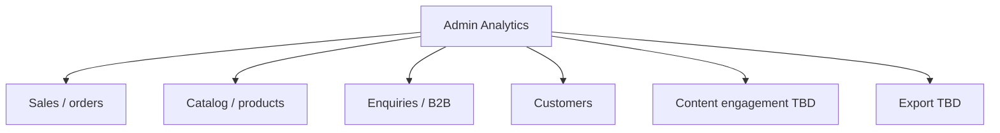

# 77 — Admin Analytics

## Purpose

Define **admin analytics views** for operational and commercial insight (orders, catalogue performance, enquiries, traffic proxies as available). **Export formats, metric catalogs, and retention** are **TBD** until business and [103_ANALYTICS.md](./103_ANALYTICS.md) finalize them.

---

## Requirements

| ID | Requirement |
|----|-------------|
| BR-AN-01 | Admin users can view analytics relevant to running the platform. |
| BR-AN-02 | Dashboard KPIs ([71_ADMIN_DASHBOARD.md](./71_ADMIN_DASHBOARD.md)) are a subset of broader analytics. |
| BR-AN-03 | Export capability is anticipated but not fully specified — mark **TBD**. |
| BR-AN-04 | Analytics must not expose payment card data or unnecessary PII. |

---

## Technical Decisions

| Decision | Choice |
|----------|--------|
| Serving | Admin analytics API aggregates from PostgreSQL (and later warehouse **TBD**) |
| Client | Charts/tables in admin React app |
| Product analytics | Distinguish **first-party operational metrics** vs **marketing web analytics** (GA/etc.) — [103_ANALYTICS.md](./103_ANALYTICS.md) |
| Real-time | Near-real-time SQL aggregates initially; streaming **TBD** |
| Export | CSV/XLSX/PDF — **TBD** |

---

## Analytics Views (Indicative)

| View | Example metrics | Status |
|------|-----------------|--------|
| Sales | Orders count, revenue, AOV, status breakdown | Formulas **TBD** |
| Catalog | Top sellers, low stock, view→cart **TBD** if tracked | Event tracking **TBD** |
| Enquiries | Volume, conversion to order **TBD**, response time **TBD** | |
| Customers | New registrations, B2B vs B2C mix | |
| Content | Blog traffic | Depends on web analytics integration **TBD** |

Do not treat illustrative metric names as approved KPIs.

---

## Data Sources

| Source | Use |
|--------|-----|
| PostgreSQL orders/order_items | Sales aggregates |
| Enquiries tables | Pipeline metrics |
| Inventory | Stock risk |
| `media_assets` / products | Catalog completeness **TBD** |
| Web analytics provider | Traffic/funnels — **TBD** provider |
| Application events | Custom product events — **TBD** |

---

## Export (TBD)

| Topic | Status |
|-------|--------|
| Formats (CSV, XLSX, PDF) | TBD |
| Max row limits | TBD |
| Async export for large ranges | TBD |
| Who may export | TBD in [04_USER_ROLES.md](./04_USER_ROLES.md) |
| PII redaction in exports | TBD |
| Retention of generated files | TBD |

Until decided, implement views without export, or gate export behind explicit approval.

---

## Functional Requirements

| ID | Requirement |
|----|-------------|
| FR-AN-01 | Permitted roles can open analytics section and select a date range (**range limits TBD**). |
| FR-AN-02 | Sales and enquiry summary views are available once underlying data exists. |
| FR-AN-03 | Dashboard widgets reuse the same metric definitions where overlapping. |
| FR-AN-04 | Export, when implemented, respects RBAC and data-minimization rules. |

---

## Non-Functional Requirements

| ID | Requirement |
|----|-------------|
| NFR-AN-01 | Heavy aggregate queries must not lock OLTP unduly (read replicas/materialized views **TBD**). |
| NFR-AN-02 | Metric responses are cacheable briefly in Redis if needed. |

---

## Dependencies

- [70_ADMIN_ARCHITECTURE.md](./70_ADMIN_ARCHITECTURE.md)
- [71_ADMIN_DASHBOARD.md](./71_ADMIN_DASHBOARD.md)
- [66_DATABASE_SCHEMA.md](./66_DATABASE_SCHEMA.md)
- [103_ANALYTICS.md](./103_ANALYTICS.md)
- [64_AUTHORIZATION_RBAC.md](./64_AUTHORIZATION_RBAC.md)
- [92_DATA_SECURITY.md](./92_DATA_SECURITY.md)

---

## Constraints

- Do not invent conversion targets or OKRs.
- Do not export full PII datasets without policy.
- Do not couple analytics UI to a single third-party vendor in core domain code.

---

## Acceptance Criteria

- [ ] Analytics section exists in admin IA and is role-gated.
- [ ] At least sales and enquiry aggregate views are specified against real tables when implemented.
- [ ] Shared definitions with dashboard documented or marked TBD consistently.
- [ ] Export remains TBD or implemented only after format/permissions decisions.

---

## Open Questions (TBD)

| Topic | Status |
|-------|--------|
| Full metric dictionary | TBD |
| Export formats and permissions | TBD |
| Web analytics vendor | TBD |
| Data warehouse / BI tool | TBD |
| Event taxonomy for product funnel | TBD |
| Retention period for aggregates | TBD |
