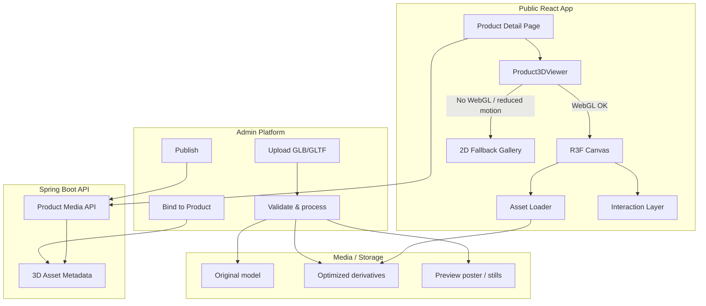
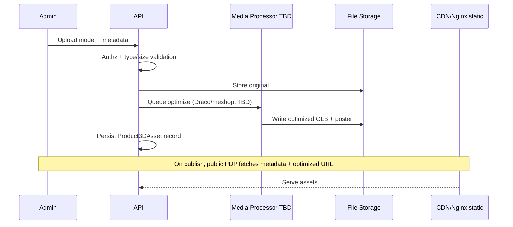

# 80 — 3D Architecture

## Purpose

Define how interactive 3D product experiences are integrated into the Neurolinx React application, including the asset pipeline, runtime architecture, and admin workflows for adding 3D-enabled products without code changes.

## Scope

- In: React Three Fiber (R3F) scene composition, asset loading, product–model binding, admin upload/publish flow, fallbacks.
- Out: Low-level Three.js coding standards (see [81_THREE_JS_STANDARDS.md](./81_THREE_JS_STANDARDS.md)), polygon/texture limits (see [82_3D_MODEL_GUIDELINES.md](./82_3D_MODEL_GUIDELINES.md)), interaction UX details (see [83_3D_PRODUCT_INTERACTIONS.md](./83_3D_PRODUCT_INTERACTIONS.md)), performance budgets (see [84_3D_PERFORMANCE.md](./84_3D_PERFORMANCE.md)).

## Requirements

1. The platform must support interactive 3D product visualization using Three.js, React Three Fiber, and Drei.
2. Supported model formats: **GLB** (preferred) and **GLTF**.
3. New 3D products must be addable from the admin system (upload model + metadata + publish).
4. Mobile devices must receive optimized experiences or suitable 2D fallbacks.
5. 3D must not block core product discovery, cart, checkout, or enquiry flows.

## Technical Decisions

| Decision | Choice | Rationale |
|----------|--------|-----------|
| Runtime | Three.js + R3F + Drei | Aligns with project stack; declarative React integration |
| Delivery format | GLB primary; GLTF allowed for authoring | Single-file delivery, fewer requests |
| Compression | Draco and/or meshopt — **TBD** | Evaluate size vs decode cost before locking |
| Scene isolation | One viewer root per mounted product view | Prevents shared WebGL context leaks across routes |
| State | Local viewer state + Zustand for shared prefs (quality, reduced motion) | Keeps product pages lightweight |
| Asset storage | Object/file storage via media service ([68_FILE_STORAGE.md](./68_FILE_STORAGE.md)) | Admin-manageable, CDN-friendly |
| Capability detection | Feature detect WebGL2 → WebGL1 → 2D fallback | Graceful degradation |

## System Architecture



## Runtime Component Model

```text
Product3DViewer
├── CapabilityGate (WebGL / reduced-motion / force-2D)
├── ViewerShell (UI chrome: reset, explode, annotations toggle)
├── Canvas (R3F)
│   ├── SceneEnvironment (lights, HDRI — TBD per brand)
│   ├── CameraRig + Controls
│   ├── ProductModel (useGLTF / Suspense)
│   ├── Hotspots / Annotations
│   └── Effects (optional, quality-gated)
└── A11yAlternatives (image carousel, keyboard description)
```

## Asset Pipeline



### Pipeline stages

| Stage | Responsibility |
|-------|----------------|
| Ingest | Accept GLB/GLTF; reject unsafe types ([93_FILE_UPLOAD_SECURITY.md](./93_FILE_UPLOAD_SECURITY.md)) |
| Validate | Extension + MIME + magic bytes; max size; optional schema/node sanity checks |
| Optimize | Compress geometry/textures — **TBD** tooling (gltf-transform, gltfpack, etc.) |
| Derive | Generate poster image / turntable stills for SEO & fallback |
| Publish | Mark asset `READY` only when optimized (or original if optimize skipped) |

## Admin-Addable 3D Products

Admin must be able to:

1. Upload one or more models per product (e.g., default + variant).
2. Set camera defaults (position, target, FOV) — optional overrides.
3. Configure interaction flags (rotate/zoom/pan/explode/hotspots).
4. Attach hotspot/annotation data (JSON or structured fields).
5. Preview in admin before publish.
6. Unpublish or replace models without redeploying the frontend.

### Suggested metadata (logical)

```text
Product3DAsset
├── productId
├── variantId? (optional)
├── originalUrl
├── optimizedUrl?
├── posterUrl
├── format: GLB | GLTF
├── compression: NONE | DRACO | MESHOPT | TBD
├── polyCount?
├── fileSizeBytes
├── defaultCamera: { position, target, fov }
├── interactions: { rotate, zoom, pan, explode, hotspots }
├── hotspots: [ { id, position, label, contentRef } ]
├── status: UPLOADING | PROCESSING | READY | FAILED | ARCHIVED
└── version
```

Exact schema: see [66_DATABASE_SCHEMA.md](./66_DATABASE_SCHEMA.md) (**TBD** until product schema finalized).

## Functional Requirements

| ID | Requirement |
|----|-------------|
| FR-3D-01 | PDP loads 3D viewer when product has a `READY` 3D asset and client supports WebGL |
| FR-3D-02 | Viewer loads model asynchronously with Suspense/loading UI |
| FR-3D-03 | Admin can upload, replace, and unpublish 3D assets |
| FR-3D-04 | Viewer falls back to poster/gallery when WebGL unavailable or user prefers reduced motion |
| FR-3D-05 | Interaction capabilities are driven by asset/product configuration flags |
| FR-3D-06 | 3D viewer is lazy-loaded (code-split) and not in the critical path of non-3D pages |

## Non-Functional Requirements

| ID | Requirement |
|----|-------------|
| NFR-3D-01 | Initial viewer chrome interactive within Core Web Vitals budgets where applicable ([102_PERFORMANCE_STANDARDS.md](./102_PERFORMANCE_STANDARDS.md)) |
| NFR-3D-02 | Model download size targets per [82_3D_MODEL_GUIDELINES.md](./82_3D_MODEL_GUIDELINES.md) |
| NFR-3D-03 | No uncaught WebGL context loss crashes the page; recover or fallback |
| NFR-3D-04 | Accessibility alternatives required ([101_ACCESSIBILITY.md](./101_ACCESSIBILITY.md)) |

## Dependencies

- Frontend: React, TypeScript, Vite, R3F, Drei, Three.js
- Backend: Product & Media APIs, file storage ([68_FILE_STORAGE.md](./68_FILE_STORAGE.md))
- Admin: Product media management ([72_ADMIN_PRODUCTS.md](./72_ADMIN_PRODUCTS.md), [76_ADMIN_MEDIA_MANAGEMENT.md](./76_ADMIN_MEDIA_MANAGEMENT.md))
- Related product docs: [33_PRODUCT_3D_VIEWER.md](./33_PRODUCT_3D_VIEWER.md), [34_PRODUCT_CONFIGURATOR.md](./34_PRODUCT_CONFIGURATOR.md)

## Constraints

- Do not embed large models in the JS bundle; always load from storage/CDN.
- Do not require native apps for 3D; web-only.
- Do not invent payment or catalogue business rules in the 3D layer.
- Compression strategy remains **TBD** until benchmarked on target devices.

## Acceptance Criteria

- [ ] Architecture diagram and component boundaries documented and followed in implementation.
- [ ] Admin can attach a GLB to a product and see it on the public PDP after publish.
- [ ] Non-WebGL clients see a functional 2D fallback.
- [ ] Viewer is code-split and not loaded on routes without 3D.
- [ ] Cross-refs to standards, guidelines, interactions, and performance docs are accurate.

## Open Items (TBD)

- Draco vs meshopt vs both
- HDRI / environment map brand standards
- Whether variant swapping reuses one scene or remounts
- Server-side optimization worker vs offline artist pipeline
- CDN strategy for large GLB assets

## Related Documents

- [81_THREE_JS_STANDARDS.md](./81_THREE_JS_STANDARDS.md)
- [82_3D_MODEL_GUIDELINES.md](./82_3D_MODEL_GUIDELINES.md)
- [83_3D_PRODUCT_INTERACTIONS.md](./83_3D_PRODUCT_INTERACTIONS.md)
- [84_3D_PERFORMANCE.md](./84_3D_PERFORMANCE.md)
- [93_FILE_UPLOAD_SECURITY.md](./93_FILE_UPLOAD_SECURITY.md)
- [101_ACCESSIBILITY.md](./101_ACCESSIBILITY.md)
- [102_PERFORMANCE_STANDARDS.md](./102_PERFORMANCE_STANDARDS.md)
