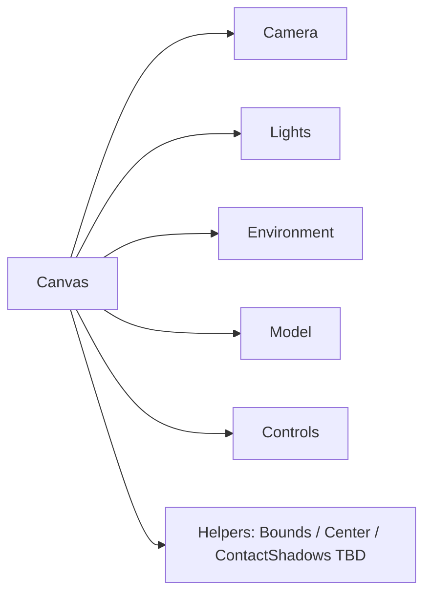

# 81 — Three.js / R3F Standards

## Purpose

Establish consistent standards for scenes, cameras, lights, materials, and R3F/Drei usage across Neurolinx 3D experiences.

## Scope

Applies to all product viewers, hero 3D moments, and admin preview canvases. Complements [80_3D_ARCHITECTURE.md](./80_3D_ARCHITECTURE.md).

## Requirements

1. Prefer declarative R3F patterns over imperative Three.js unless necessary (custom shaders, low-level buffers).
2. Use Drei helpers for common controls, loaders, and environment where they reduce boilerplate safely.
3. Maintain predictable lighting and camera defaults so products look consistent across pages.
4. Support quality tiers (high / medium / low) driven by device capability and user preference.

## Technical Decisions

| Area | Standard |
|------|----------|
| Framework | `@react-three/fiber` + `@react-three/drei` + `three` |
| Color space | `THREE.SRGBColorSpace` (Three r152+); ensure textures marked correctly |
| Tonemapping | `ACESFilmic` default for product scenes — **TBD** brand creative review |
| Shadow map | Optional; off by default on mobile / low tier |
| Controls | Drei `OrbitControls` (or equivalent) with damping; configurable limits |
| Loading | `useGLTF` + Suspense; preload strategically on PDP |
| Disposal | Dispose geometries/materials/textures on unmount; avoid leaks |

## Scene Standards

### Canvas

- Mount only when viewer is visible (or about to be); unmount when leaving route if memory pressure is a concern.
- Set `dpr` capped (e.g., `Math.min(devicePixelRatio, 2)` on high tier; lower on mobile).
- Prefer `frameloop="demand"` when idle (invalidate on interaction) for battery/CPU — **TBD** per page type.
- Always provide a non-WebGL fallback path outside Canvas.

### Camera

| Property | Default guideline |
|----------|-------------------|
| Type | Perspective |
| FOV | 35–45° (product); avoid extreme wide FOV |
| Near / far | Tight bounds around model extents |
| Initial framing | Fit model with padding via Drei `Bounds` / `Center` or stored admin defaults |
| Min distance | Prevent clipping into mesh |
| Max distance | Prevent losing product context |
| Polar / azimuth limits | Soft limits; allow full orbit unless product-specific |

Admin-stored camera overrides take precedence when present ([80_3D_ARCHITECTURE.md](./80_3D_ARCHITECTURE.md)).

### Lights

| Light | Guidance |
|-------|----------|
| Key | Directional or area-like key for form readability |
| Fill | Soft fill; avoid flat wash |
| Rim | Optional for premium look on high tier only |
| Ambient | Low intensity; do not replace directional structure |
| Environment | Drei `Environment` / HDRI optional; keep file size small |
| Shadows | High tier desktop only; soft shadows preferred |

Do not use excessive point lights. Prefer 2–3 lights + environment.

### Materials

| Rule | Detail |
|------|--------|
| Prefer PBR | `MeshStandardMaterial` / `MeshPhysicalMaterial` from authored GLB |
| Avoid runtime material thrashing | Swap variant materials carefully; share textures |
| Transparent materials | Sort/order aware; minimize overdraw |
| Emissive | Use sparingly for UI highlights / hotspots |
| Wireframe / debug | Dev-only; never in production builds |

Authoring material names: see [82_3D_MODEL_GUIDELINES.md](./82_3D_MODEL_GUIDELINES.md).

## R3F / Drei Conventions

### Do

- Colocate scene subcomponents under a `features/product-3d/` (or equivalent) module.
- Type props strictly; avoid `any` for Three objects where practical.
- Use `useFrame` sparingly; prefer controls and declarative animation.
- Gate post-processing (bloom, SSAO, etc.) behind high quality tier — default **off** until approved.
- Invalidate the frame loop on user input when using demand rendering.

### Don't

- Create multiple Canvases on the same PDP without justification.
- Load GLTF on every hover of product cards (list pages use posters).
- Put business logic (cart, pricing) inside the Canvas tree.
- Ignore context loss / resize events.

## Quality Tiers

| Tier | Typical triggers | Settings |
|------|------------------|----------|
| High | Desktop, strong GPU | Higher DPR cap, env map, optional shadows |
| Medium | Default laptop / mid mobile | Moderate DPR, no shadows, simpler env |
| Low | Low-end mobile / thermal | Low DPR, no env, simplified materials if available |
| Off | No WebGL / reduced motion / user choice | 2D fallback only |

Detection heuristics: **TBD** (WebGL renderer info, device memory, `navigator.connection`, FPS sampling).

## Functional Requirements

| ID | Requirement |
|----|-------------|
| FR-TJS-01 | Product scenes use shared camera/light presets unless overridden |
| FR-TJS-02 | Orbit controls support rotate/zoom/pan per interaction config |
| FR-TJS-03 | Materials from GLB are preserved unless configurator overrides |
| FR-TJS-04 | Quality tier changes apply without full page reload |

## Non-Functional Requirements

| ID | Requirement |
|----|-------------|
| NFR-TJS-01 | No unbounded `useFrame` work when viewer idle |
| NFR-TJS-02 | Resources disposed on unmount |
| NFR-TJS-03 | Consistent visual look across products using shared presets |

## Dependencies

- `three`, `@react-three/fiber`, `@react-three/drei`
- [80_3D_ARCHITECTURE.md](./80_3D_ARCHITECTURE.md), [83_3D_PRODUCT_INTERACTIONS.md](./83_3D_PRODUCT_INTERACTIONS.md), [84_3D_PERFORMANCE.md](./84_3D_PERFORMANCE.md)

## Constraints

- Avoid experimental Three.js APIs in production without documentation update.
- Do not introduce alternative 3D engines (Babylon, PlayCanvas) without architecture approval.

## Acceptance Criteria

- [ ] Shared scene presets exist and are documented.
- [ ] DPR and quality gating implemented per tiers.
- [ ] Controls respect product interaction flags.
- [ ] Disposal and idle frameloop strategies verified in testing ([111_FRONTEND_TESTING.md](./111_FRONTEND_TESTING.md)).

## Open Items (TBD)

- Exact tonemapping and HDRI brand kit
- Demand vs always frameloop per page
- Post-processing approval list

## Related Documents

- [82_3D_MODEL_GUIDELINES.md](./82_3D_MODEL_GUIDELINES.md)
- [84_3D_PERFORMANCE.md](./84_3D_PERFORMANCE.md)
- [102_PERFORMANCE_STANDARDS.md](./102_PERFORMANCE_STANDARDS.md)
