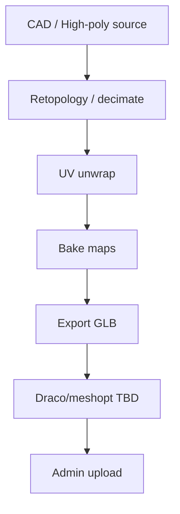

# 82 — 3D Model Guidelines

## Purpose

Define authoring and export standards for Neurolinx product 3D assets so models are web-ready, consistent, and admin-uploadable.

## Scope

Covers polygon budgets, textures, materials, naming, GLB/GLTF export, and compression. Runtime loading is in [80_3D_ARCHITECTURE.md](./80_3D_ARCHITECTURE.md).

## Requirements

1. Models must be optimized for web delivery (not CAD-native density).
2. Preferred delivery: **GLB**; GLTF + bin/textures acceptable for intermediate pipelines.
3. Naming and structure must support hotspots, explode, and variant swaps.
4. Compression (Draco / meshopt) strategy is **TBD** but pipeline must allow enabling it later.

## Technical Decisions

| Topic | Decision |
|-------|----------|
| Units | Meters; Y-up; model origin at ground/center consistent with viewer `Center`/`Bounds` |
| Scale | Real-world scale preferred; document exceptions |
| Pivot | Center of mass / geometric center at origin unless product-specific |
| Format | Export GLB for production; keep source DCC files offline (**TBD** storage policy) |
| Texture color | sRGB for albedo; linear for ORM/normal as appropriate |

## Polygon / Geometry Limits

Targets are **guidelines**; measure on mid-tier mobile before exceeding.

| Complexity | Triangle budget (guide) | Use case |
|------------|-------------------------|----------|
| Hero / flagship | ≤ 150k tris | PDP primary model |
| Standard product | ≤ 80k tris | Most catalogue items |
| Accessory / small part | ≤ 30k tris | Secondary assets |
| LOD1 | ~40–50% of primary | Distance / low tier |
| LOD2 | ~15–25% of primary | Fallback / very low tier |
| Mobile simplified | ≤ 40k tris or LOD1 | Auto quality gate |

Hard max upload size: **TBD** (see [93_FILE_UPLOAD_SECURITY.md](./93_FILE_UPLOAD_SECURITY.md)); provisional soft target **≤ 15 MB** optimized GLB before exceeding requires approval.



## Textures

| Map | Guidance |
|-----|----------|
| Albedo / BaseColor | WebP/PNG/JPEG embedded or KTX2 — **TBD** KTX2 support |
| Normal | OpenGL convention; avoid duplicate huge normals |
| ORM / packed | Prefer packed metallic-roughness-AO where possible |
| Emissive | Only if needed |
| Resolution | 2K max for hero; 1K typical; 512 for small parts |
| Atlas | Prefer atlasing over many tiny textures |
| Power of two | Preferred |

Do not ship unused texture sets. Strip specular-glossiness workflows unless converted to metal-rough.

## Materials

- Use PBR metal-rough workflow.
- Keep material count low (guide: ≤ 8 materials for standard products).
- Name materials meaningfully: `Mat_Body`, `Mat_Glass`, `Mat_LED`, etc.
- Avoid overlapping duplicate materials that differ only by name.
- Transparent glass: single glass material; minimize alpha overdraw.

## Naming & Hierarchy

```text
ProductRoot
├── Body
├── Cover
├── PCB (optional)
├── Connectors
├── Fasteners (optional group for explode)
└── Annotations_Empty (optional empties for hotspots)
```

| Rule | Example |
|------|---------|
| Nodes | `PascalCase` or `snake_case` — pick one per pipeline and stick to it |
| Hotspot empties | `HS_<id>` matching admin hotspot IDs |
| LOD roots | `LOD0`, `LOD1`, `LOD2` if multi-LOD in one file |
| Variant meshes | Clear suffix: `_Red`, `_V2` — or separate files per variant |

Exact convention freeze: **TBD** with content/art team.

## Export — GLB / GLTF

### Checklist

- [ ] Applied transforms (freeze scale/rotation where DCC allows)
- [ ] No leftover lights/cameras unless intentionally used
- [ ] No editor helpers / construction geometry
- [ ] Normals correct; no inverted faces on visible surfaces
- [ ] Tangents present if using normal maps
- [ ] Animations named and trimmed (explode / assembly)
- [ ] Embedded buffers for GLB
- [ ] Validated with glTF Validator

### Recommended tools

- DCC: Blender / 3ds Max / Maya — **TBD** official artist toolchain
- Validation: Khronos glTF Validator
- Optimization: gltf-transform / gltfpack — **TBD**

## Compression

| Method | Status | Notes |
|--------|--------|-------|
| Draco | **TBD** | Strong geometry compression; decode cost on CPU |
| meshopt | **TBD** | Often better runtime decode; good for web |
| Texture compression (KTX2/Basis) | **TBD** | GPU upload benefits; pipeline complexity |
| Gzip/Brotli at CDN | Expected | Transport-level; still optimize source |

Until decided: ship un-Draco’d optimized GLB that meets size budgets; design loader to accept Draco/meshopt later (`DRACOLoader` / meshopt decoder paths).

## Functional Requirements

| ID | Requirement |
|----|-------------|
| FR-MDL-01 | Production assets delivered as GLB meeting size/poly guidelines or approved exception |
| FR-MDL-02 | Naming supports hotspots/explode where those features are enabled |
| FR-MDL-03 | Admin rejects files that fail type/size validation |

## Non-Functional Requirements

| ID | Requirement |
|----|-------------|
| NFR-MDL-01 | Models load within performance budgets on target mobile ([84_3D_PERFORMANCE.md](./84_3D_PERFORMANCE.md)) |
| NFR-MDL-02 | Assets remain replaceable without code deploy |

## Dependencies

- Admin media upload, storage, optional optimize worker
- Viewer loader stack (R3F `useGLTF`, optional decoders)

## Constraints

- Do not upload raw CAD (STEP/IGES) to the public CDN.
- Do not rely on external texture URLs in GLTF that break offline/CDN assumptions — embed or rewrite to storage URLs.

## Acceptance Criteria

- [ ] Artist guideline checklist published and used for first 3 products.
- [ ] Sample GLB passes validator and loads in viewer.
- [ ] Compression decision recorded (or explicitly deferred with loader hooks ready).

## Open Items (TBD)

- Final poly/size hard limits
- Draco vs meshopt vs KTX2
- Official DCC tool
- Multi-LOD in single GLB vs separate files

## Related Documents

- [80_3D_ARCHITECTURE.md](./80_3D_ARCHITECTURE.md)
- [81_THREE_JS_STANDARDS.md](./81_THREE_JS_STANDARDS.md)
- [83_3D_PRODUCT_INTERACTIONS.md](./83_3D_PRODUCT_INTERACTIONS.md)
- [93_FILE_UPLOAD_SECURITY.md](./93_FILE_UPLOAD_SECURITY.md)
