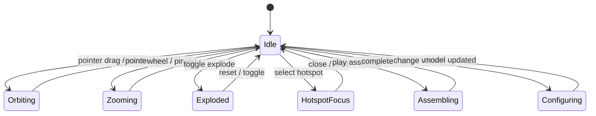
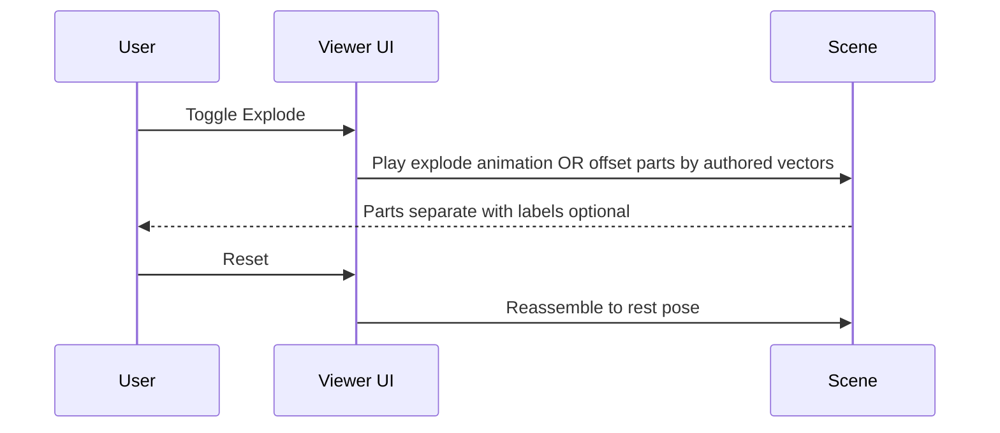
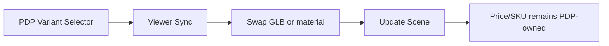

# 83 — 3D Product Interactions

## Purpose

Specify interactive behaviors for Neurolinx 3D product experiences: orbit controls, exploded views, hotspots, annotations, assembly sequences, and configuration.

## Scope

UX and functional behavior of the product 3D viewer. Visual/lighting standards: [81_THREE_JS_STANDARDS.md](./81_THREE_JS_STANDARDS.md). Perf constraints: [84_3D_PERFORMANCE.md](./84_3D_PERFORMANCE.md).

## Requirements

From product vision, the 3D system should support:

- Rotation, zoom, pan, camera controls
- Material / variant changes
- Exploded views
- Component highlighting
- Hotspots and technical annotations
- Interactive assembly
- Product configuration

Not every product must enable every interaction; flags are per product/asset.

## Technical Decisions

| Interaction | Default | Notes |
|-------------|---------|-------|
| Rotate | On | Primary exploration |
| Zoom | On | Clamp min/max |
| Pan | On (desktop); cautious on mobile | May disable on small screens |
| Explode | Off unless authored | Requires named parts / animation |
| Hotspots | Off unless data present | HTML overlay or 3D markers |
| Assembly | Off unless animation present | Timeline / step UI |
| Configurator | Off unless variants defined | Sync with PDP variant state |

## Interaction Model

## Controls — Rotate / Zoom / Pan

| Control | Input | Behavior |
|---------|-------|----------|
| Rotate | LMB drag / one-finger drag | Orbit around target |
| Zoom | Wheel / pinch | Dolly; respect min/max |
| Pan | RMB / two-finger / modifier+drag | Translate target within limits |
| Reset | Button / double-tap **TBD** | Restore default camera |

### Accessibility

- Provide keyboard alternatives where feasible (arrow keys orbit, `+`/`-` zoom) — details in [101_ACCESSIBILITY.md](./101_ACCESSIBILITY.md).
- Honor `prefers-reduced-motion`: disable auto-rotate and long assembly animations; offer stepped controls.

## Exploded Views

### Requirements

| ID | Requirement |
|----|-------------|
| FR-INT-EX-01 | Explode only available when asset marks `interactions.explode = true` and parts/animation exist |
| FR-INT-EX-02 | Explode is reversible (reset) |
| FR-INT-EX-03 | During explode, hotspots remain mappable if positions update |

Implementation options (choose per asset):

1. Authored GLTF animation clip `explode`
2. Procedural offset along part local axes using metadata

## Hotspots & Annotations

| Field | Purpose |
|-------|---------|
| `id` | Stable key |
| `position` | World or local coords / empty node name |
| `label` | Short title |
| `body` | Description or CMS content ref |
| `partId` | Optional highlight target |

### Behaviors

- Click/tap opens annotation panel (accessible dialog/drawer).
- Hover (desktop) may preview label; not required on touch.
- Selecting hotspot can highlight related mesh (`emissive` pulse or outline — quality-gated).
- Hotspots occluded by camera: screen-project and optional occlusion **TBD**.

Annotations must also be available as a non-3D list for screen readers and no-WebGL users.

## Assembly

- Step-based UI: Step N of M with Play / Pause / Next / Prev.
- Prefer authored animation clips over runtime physics.
- Sync step labels with annotation content where relevant.
- Do not autoplay assembly on load if reduced motion is set.

## Product Configuration

Rules:

- Configurator UI lives primarily in PDP; viewer reflects visual state.
- Variant change may swap materials or load alternate GLB (prefer material swap when possible).
- Cart/enquiry payloads use catalogue variant IDs — never invent SKUs in the 3D layer.
- See [34_PRODUCT_CONFIGURATOR.md](./34_PRODUCT_CONFIGURATOR.md).

## Component Highlighting

- Triggered by hotspot, BOM list, or specs cross-link.
- Clear previous highlight before applying new.
- Provide “clear highlight” control.

## Functional Requirements

| ID | Requirement |
|----|-------------|
| FR-INT-01 | Rotate/zoom/pan honor product flags and device constraints |
| FR-INT-02 | Explode/hotspots/assembly/config only when data + flags present |
| FR-INT-03 | Reset camera restores admin/default framing |
| FR-INT-04 | Annotation content readable without WebGL |
| FR-INT-05 | Config changes stay in sync with selected PDP variant |

## Non-Functional Requirements

| ID | Requirement |
|----|-------------|
| NFR-INT-01 | Interactions remain usable at 30 FPS minimum on medium tier targets |
| NFR-INT-02 | Touch targets for hotspot markers ≥ 44×44 CSS px equivalent |
| NFR-INT-03 | No interaction traps keyboard focus inside Canvas without escape |

## Dependencies

- Asset metadata & hotspot JSON from API
- PDP variant state (Zustand / query cache)
- A11y patterns ([101_ACCESSIBILITY.md](./101_ACCESSIBILITY.md))

## Constraints

- Do not auto-rotate by default on mobile (battery + motion sensitivity).
- Do not block add-to-cart / enquiry CTAs with mandatory 3D tutorials.
- Physics-based dismantle is out of scope unless explicitly approved.

## Acceptance Criteria

- [ ] Flag-gated interactions verified with sample products (minimal vs full-featured).
- [ ] Explode + reset works for authored sample.
- [ ] Hotspot opens accessible annotation UI.
- [ ] Variant change updates visuals without full page reload.
- [ ] Reduced-motion path disables auto animations.

## Open Items (TBD)

- Occlusion handling for hotspots
- Double-tap reset vs dedicated button only
- Outline vs emissive highlight technique

## Related Documents

- [80_3D_ARCHITECTURE.md](./80_3D_ARCHITECTURE.md)
- [33_PRODUCT_3D_VIEWER.md](./33_PRODUCT_3D_VIEWER.md)
- [34_PRODUCT_CONFIGURATOR.md](./34_PRODUCT_CONFIGURATOR.md)
- [84_3D_PERFORMANCE.md](./84_3D_PERFORMANCE.md)
- [101_ACCESSIBILITY.md](./101_ACCESSIBILITY.md)
