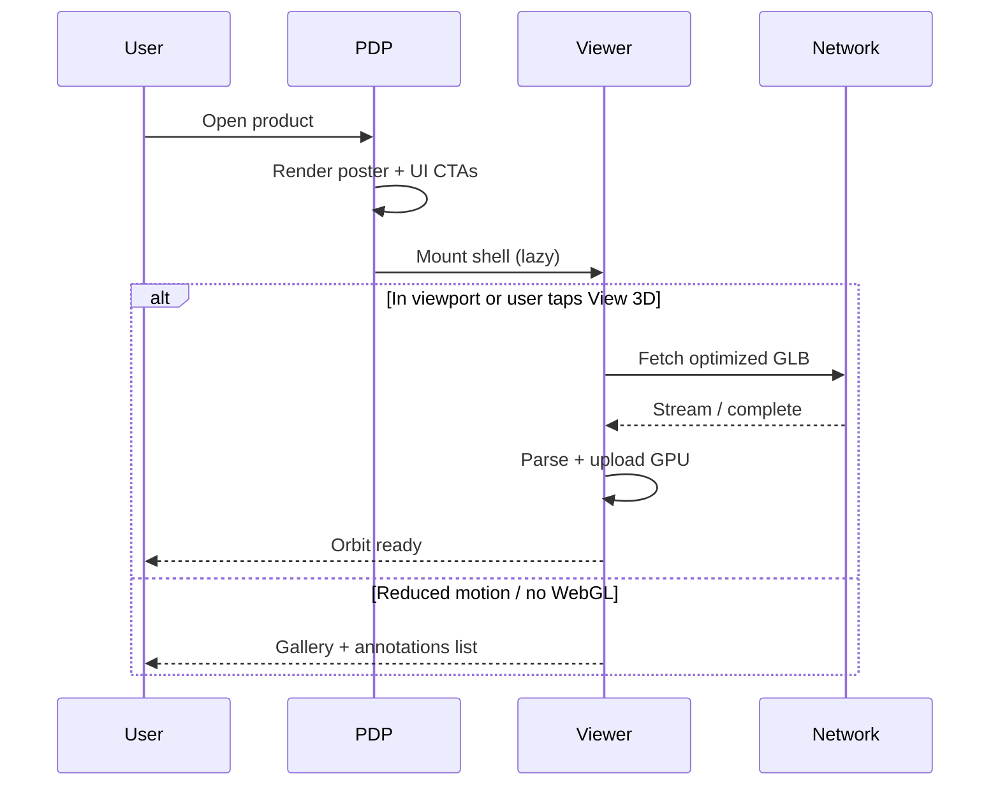

# 84 — 3D Performance

## Purpose

Define performance, loading, LOD, fallback, and accessibility-related performance requirements for Neurolinx 3D experiences.

## Scope

Runtime performance of WebGL viewers on desktop and mobile. Global page budgets: [102_PERFORMANCE_STANDARDS.md](./102_PERFORMANCE_STANDARDS.md). Model authoring budgets: [82_3D_MODEL_GUIDELINES.md](./82_3D_MODEL_GUIDELINES.md).

## Requirements

1. 3D must not destroy Core Web Vitals for the broader PDP where avoidable (defer heavy work).
2. Mobile must use optimized assets or fallbacks.
3. Loading must show progress/skeleton; avoid blank canvases.
4. LODs and quality tiers reduce cost under pressure.
5. Accessibility alternatives must be first-class, not an afterthought.

## Technical Decisions

| Decision | Choice |
|----------|--------|
| Code splitting | Dynamic import viewer chunk only on 3D-capable routes/components |
| Load strategy | Poster first → load GLB when viewer enters viewport (or on user intent) |
| Frameloop | Prefer `demand` when idle — **TBD** finalize |
| DPR cap | ≤ 2 desktop; ≤ 1.5 or 1 on mobile tiers |
| LOD | Support LOD0/1/2 metadata; auto-select by tier |
| Memory | Dispose on route leave; limit concurrent Canvases to 1 on mobile |

## Performance Budgets (3D-specific)

| Metric | Target (guide) | Notes |
|--------|----------------|-------|
| Viewer JS chunk (gzip) | **TBD** (aim ≤ 200–300 KB incremental beyond Three) | Measure after dependency freeze |
| Optimized GLB | See [82](./82_3D_MODEL_GUIDELINES.md); soft ≤ 15 MB | Prefer ≪ for mobile |
| Time to poster | ≤ 1.5 s on 4G mid device (guide) | Poster is LCP candidate, not Canvas |
| Time to interactive orbit | ≤ 5 s on mid mobile after intent (guide) | **TBD** validate |
| Steady FPS (orbit) | ≥ 30 medium tier; ≥ 50 high tier desktop | Degrade quality if below |

Exact numeric SLOs: **TBD** after device lab testing.

## Loading Strategy

### Rules

- Do not prefetch all catalogue GLBs.
- Use HTTP caching / CDN for models.
- Show determinate progress when Content-Length known; otherwise indeterminate + poster.
- Cancel in-flight loads on rapid product navigation when possible.

## LODs

| LOD | When |
|-----|------|
| LOD0 | High tier, close camera |
| LOD1 | Medium tier or mid distance |
| LOD2 | Low tier, slow network, or initial paint |
| Poster only | Offline WebGL / extreme constraints |

Selection inputs: quality tier, `navigator.connection.saveData`, measured FPS, optional admin force flag.

## Fallbacks

| Condition | Fallback |
|-----------|----------|
| No WebGL | Image gallery + hotspot list |
| `prefers-reduced-motion` | Static poster; optional manual stepped views |
| Load error | Poster + retry + support message |
| Context lost | Attempt restore once; then fallback |
| Low battery / save-data **TBD** | Prefer LOD2 or 2D |

## Mobile Optimization

- Lower DPR and disable shadows/env maps ([81_THREE_JS_STANDARDS.md](./81_THREE_JS_STANDARDS.md)).
- Prefer touch-friendly controls; consider disabling pan.
- Pause rendering when tab hidden (`document.visibilityState`).
- Avoid multiple HDRIs; share environment if used.
- Compress textures; avoid 4K maps on mobile paths.

## Accessibility for 3D (Performance-Aware)

| Need | Approach |
|------|----------|
| Screen readers | Text alternative describing product; annotation list in DOM |
| Keyboard | Control buttons outside canvas; focusable hotspot list |
| Motion | Respect reduced motion; no mandatory autoplay |
| Color | Do not convey hotspot state by color alone |
| Seizure risk | No rapid flashing materials |

Full a11y requirements: [101_ACCESSIBILITY.md](./101_ACCESSIBILITY.md).

## Functional Requirements

| ID | Requirement |
|----|-------------|
| FR-PERF3D-01 | Viewer chunk lazy-loaded |
| FR-PERF3D-02 | Poster displayed before model ready |
| FR-PERF3D-03 | Quality/LOD degradation path exists |
| FR-PERF3D-04 | Hidden tab pauses or drops frameloop |
| FR-PERF3D-05 | Fallback path for WebGL failure |

## Non-Functional Requirements

| ID | Requirement |
|----|-------------|
| NFR-PERF3D-01 | 3D must not be required to complete purchase or enquiry |
| NFR-PERF3D-02 | Memory growth bounded across product navigations |
| NFR-PERF3D-03 | Performance regressions caught in CI where automated — **TBD** tooling |

## Dependencies

- CDN/Nginx static caching ([122_NGINX_CONFIGURATION.md](./122_NGINX_CONFIGURATION.md))
- Monitoring of client errors ([125_MONITORING_AND_LOGGING.md](./125_MONITORING_AND_LOGGING.md))
- Model guidelines & security upload limits

## Constraints

- Do not chase cinematic post-processing at the expense of mobile FPS.
- Do not block LCP on GLB parse.

## Acceptance Criteria

- [ ] Lazy-load and poster-first verified on PDP.
- [ ] Mid-tier mobile maintains ≥ 30 FPS during orbit on sample standard model.
- [ ] Fallback gallery works with WebGL disabled.
- [ ] Reduced-motion disables auto-rotate/assembly autoplay.
- [ ] Tab hide pauses rendering.

## Open Items (TBD)

- Final chunk/GLB/time budgets after lab tests
- FPS adaptive scaler algorithm
- Whether “View in 3D” is click-to-load vs intersection auto-load

## Related Documents

- [80_3D_ARCHITECTURE.md](./80_3D_ARCHITECTURE.md)
- [81_THREE_JS_STANDARDS.md](./81_THREE_JS_STANDARDS.md)
- [82_3D_MODEL_GUIDELINES.md](./82_3D_MODEL_GUIDELINES.md)
- [102_PERFORMANCE_STANDARDS.md](./102_PERFORMANCE_STANDARDS.md)
- [101_ACCESSIBILITY.md](./101_ACCESSIBILITY.md)
