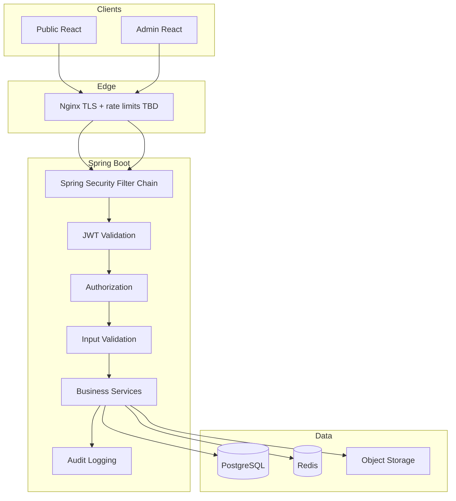

# 90 — Security Architecture

## Purpose

Define the overall Neurolinx security model spanning authentication, authorization, token handling, input validation, common web threats, rate limiting, and audit logging.

## Scope

Platform-wide security principles for public site, customer accounts, admin, and APIs. Deep dives: [91_API_SECURITY.md](./91_API_SECURITY.md), [92_DATA_SECURITY.md](./92_DATA_SECURITY.md), [93_FILE_UPLOAD_SECURITY.md](./93_FILE_UPLOAD_SECURITY.md), [94_PAYMENT_SECURITY.md](./94_PAYMENT_SECURITY.md). Auth details also in [63_AUTHENTICATION.md](./63_AUTHENTICATION.md) and [64_AUTHORIZATION_RBAC.md](./64_AUTHORIZATION_RBAC.md).

## Requirements

1. Protect confidentiality, integrity, and availability of customer, order, and admin data.
2. Use Spring Security as the backend security foundation.
3. Enforce RBAC for admin and privileged operations.
4. Defend against XSS, SQL injection, CSRF (where applicable), and abuse via rate limiting.
5. Maintain audit logs for sensitive admin and security events.

## Technical Decisions

| Area | Decision |
|------|----------|
| AuthN | JWT access tokens (Bearer) + refresh tokens in **HttpOnly Secure SameSite cookies** ([63_AUTHENTICATION.md](./63_AUTHENTICATION.md), [ADR-006](./ADR/ADR-006-AUTHENTICATION.md)) |
| AuthZ | Role- and permission-based (RBAC) via Spring Security |
| Password | Strong hashing (e.g., Argon2/BCrypt) — **TBD** final algorithm params |
| Transport | HTTPS only in staging/prod |
| API style | Stateless REST; CSRF less relevant for pure Bearer APIs; cookie-based flows need CSRF |
| Validation | Bean Validation + explicit service checks |
| Secrets | Env/secret manager — never commit secrets |
| Admin | Hardened routes, stronger session/token policies — **TBD** MFA |

## Security Model Overview



## Authentication

| Topic | Standard |
|-------|----------|
| Customer login | Email/password (and future IdPs — **TBD**) |
| Admin login | Separate admin users/roles; no shared “god” passwords in repo |
| Access token | Short-lived JWT |
| Refresh token | Longer-lived; rotatable; revoke on logout/compromise |
| Storage | Access JWT in memory; refresh in HttpOnly Secure SameSite cookie ([ADR-006](./ADR/ADR-006-AUTHENTICATION.md)) |
| Lockout | Rate-limit + temporary lock after N failures — **TBD** thresholds |

## Authorization (RBAC)

```text
Role examples (illustrative):
CUSTOMER | SALES | CONTENT_EDITOR | CATALOG_MANAGER | ORDER_MANAGER | ADMIN | SUPER_ADMIN
```

- Enforce at API layer (never only in UI).
- Deny by default for admin endpoints.
- Object-level checks for customer resources (own orders, own profile).
- Exact permission matrix: [64_AUTHORIZATION_RBAC.md](./64_AUTHORIZATION_RBAC.md).

## Validation & Injection Defenses

| Threat | Control |
|--------|---------|
| SQL / JPQL injection | Parameterized queries / JPA repositories; no string-concat queries |
| XSS | Contextual output encoding on any server-rendered content; React escapes by default; sanitize rich text CMS HTML — **TBD** sanitizer |
| CSRF | Required if cookie session/auth; use Spring CSRF or SameSite strategies as applicable |
| Mass assignment | Explicit DTOs; never bind entities directly |
| SSRF | Disable arbitrary URL fetch from user input in media features |
| Path traversal | See [93_FILE_UPLOAD_SECURITY.md](./93_FILE_UPLOAD_SECURITY.md) |

## Rate Limiting & Abuse

| Surface | Guidance |
|---------|----------|
| Auth endpoints | Strict limits (login, register, forgot password) |
| Public APIs | Per-IP and/or per-user limits — **TBD** values |
| Enquiry / contact | Anti-spam + rate limit |
| Checkout | Idempotency keys; abuse monitoring |
| Edge | Nginx or API gateway limits + app-level Redis counters |

## Audit Logs

Log at minimum:

- Admin logins / failures
- Permission-denied spikes (sampled)
- Product/price/inventory changes
- Order status overrides
- User role changes
- Payment capture/refund initiation (no PAN)
- Config/security setting changes

Include: actor id, action, entity type/id, timestamp, IP/user-agent (policy-dependent), outcome.

Retention: **TBD**.

## Session & Token Security

- Rotate refresh tokens.
- Invalidate refresh family on reuse detection (**TBD**).
- Short access-token TTL.
- Secure cookie flags when cookies used: `Secure`, `HttpOnly`, `SameSite`.
- Clock skew tolerance documented for JWT validation.

## Functional Requirements

| ID | Requirement |
|----|-------------|
| FR-SEC-01 | All protected API routes enforce AuthN/AuthZ via Spring Security |
| FR-SEC-02 | Passwords stored only as irreversible hashes |
| FR-SEC-03 | Sensitive admin actions write audit records |
| FR-SEC-04 | HTTPS enforced outside local dev |
| FR-SEC-05 | Rate limiting on authentication and high-abuse endpoints |

## Non-Functional Requirements

| ID | Requirement |
|----|-------------|
| NFR-SEC-01 | Security controls fail closed (deny on uncertainty) |
| NFR-SEC-02 | Secrets not logged |
| NFR-SEC-03 | Security patches process for dependencies — **TBD** cadence |

## Dependencies

- Spring Security, JWT library choice **TBD**, Redis (optional rate limit / token denylist)
- [91](./91_API_SECURITY.md)–[94](./94_PAYMENT_SECURITY.md), auth docs 63/64

## Constraints

- Do not store raw card data ([94_PAYMENT_SECURITY.md](./94_PAYMENT_SECURITY.md)).
- Do not disable security for convenience in staging without compensating controls.
- Do not invent GDPR/legal policies; mark privacy legal text **TBD**.

## Acceptance Criteria

- [ ] Security filter chain documented and implemented per environment.
- [ ] RBAC enforced on admin APIs with tests ([114_SECURITY_TESTING.md](./114_SECURITY_TESTING.md)).
- [ ] Audit trail for privileged actions verified.
- [ ] Rate limits active on auth endpoints.
- [ ] XSS/SQLi controls reviewed in security testing.

## Open Items (TBD)

- MFA for admin
- Exact JWT storage model
- Password hash parameters
- Rate-limit numbers
- Audit retention & SIEM

## Related Documents

- [91_API_SECURITY.md](./91_API_SECURITY.md)
- [92_DATA_SECURITY.md](./92_DATA_SECURITY.md)
- [93_FILE_UPLOAD_SECURITY.md](./93_FILE_UPLOAD_SECURITY.md)
- [94_PAYMENT_SECURITY.md](./94_PAYMENT_SECURITY.md)
- [114_SECURITY_TESTING.md](./114_SECURITY_TESTING.md)
- [125_MONITORING_AND_LOGGING.md](./125_MONITORING_AND_LOGGING.md)
