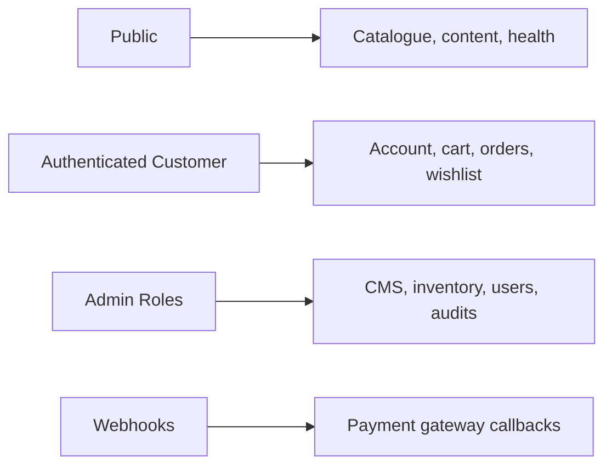

# 91 — API Security

## Purpose

Define security controls specific to Neurolinx REST APIs (Spring Boot), including authentication to APIs, authorization, request validation, CORS, headers, and abuse protection.

## Scope

HTTP API surface for public, customer, and admin clients. Complements [90_SECURITY_ARCHITECTURE.md](./90_SECURITY_ARCHITECTURE.md) and [62_API_ARCHITECTURE.md](./62_API_ARCHITECTURE.md).

## Requirements

1. Every endpoint has a clear authn/authz policy (public, authenticated, role-restricted).
2. Inputs validated; errors do not leak sensitive internals.
3. CORS is explicitly configured for known frontends.
4. Security headers applied at Nginx and/or app.
5. Idempotency and replay considerations for payment/order mutations.

## Technical Decisions

| Topic | Decision |
|-------|----------|
| Style | REST + JSON |
| Auth | Access: `Authorization: Bearer <accessToken>`; Refresh: HttpOnly cookie ([63_AUTHENTICATION.md](./63_AUTHENTICATION.md)) |
| Versioning | **TBD** (`/api/v1`) |
| OpenAPI | Document security schemes; do not expose admin-only ops publicly without auth |
| Error body | Stable error code + message; no stack traces in prod |
| CORS | Allowlist Neurolinx web origins only |

## Endpoint Classification

| Class | AuthN | AuthZ | Notes |
|-------|-------|-------|-------|
| Public read | None | N/A | Cache carefully; no private fields |
| Public write (enquiry, register) | None / captcha **TBD** | Rate limit | Validate aggressively |
| Customer | Required | Ownership checks | |
| Admin | Required | RBAC permissions | |
| Webhooks | Signature verification | N/A | No JWT; verify gateway HMAC/secret |

## Controls Checklist

### Authentication

- Reject missing/invalid/expired tokens with `401`.
- Use `403` for authenticated but unauthorized.
- Support token revocation/denylist for logout — **TBD** Redis denylist.

### Authorization

- Method security or filter-based checks per route group.
- Never trust client-sent roles.
- Enforce tenant/ownership: `customerId` from token, not request body.

### Validation

- `@Valid` DTOs for bodies/params.
- Max lengths on strings; bounded collections.
- Reject unknown JSON properties where safe (`FAIL_ON_UNKNOWN_PROPERTIES` — **TBD**).

### HTTP / Transport

| Control | Guidance |
|---------|----------|
| TLS | Terminated at Nginx; app may run HTTP internally on Docker network |
| HSTS | At edge in prod |
| CORS | Explicit origins, methods, headers; credentials only if cookie auth |
| Security headers | `X-Content-Type-Options`, `Referrer-Policy`, `Frame-Options`/`CSP` — CSP **TBD** |
| HTTP methods | Only documented methods; disable TRACE |

### Abuse & Integrity

- Rate limit by IP/user/API key.
- Idempotency-Key header for payment/order create — **TBD**.
- Request size limits (JSON body max) at Nginx + app.
- Pagination caps on list endpoints.

## Sensitive Data in APIs

- Never return password hashes, refresh tokens, or full payment PANs.
- Mask PII in logs ([92_DATA_SECURITY.md](./92_DATA_SECURITY.md)).
- Admin exports require permission + audit.

## Functional Requirements

| ID | Requirement |
|----|-------------|
| FR-APIS-01 | Security scheme documented in OpenAPI |
| FR-APIS-02 | Public vs protected routes explicitly configured |
| FR-APIS-03 | Validation errors return structured 400 responses |
| FR-APIS-04 | Webhooks verify signatures before processing |
| FR-APIS-05 | Admin APIs require appropriate roles |

## Non-Functional Requirements

| ID | Requirement |
|----|-------------|
| NFR-APIS-01 | Prod responses omit exception traces |
| NFR-APIS-02 | Auth endpoints rate-limited |
| NFR-APIS-03 | CORS deny-by-default |

## Dependencies

- Spring Security, Spring Web, Bean Validation
- Nginx ([122_NGINX_CONFIGURATION.md](./122_NGINX_CONFIGURATION.md))
- Payment webhook provider ([94_PAYMENT_SECURITY.md](./94_PAYMENT_SECURITY.md))

## Constraints

- Do not expose Actuator sensitive endpoints publicly without auth ([125_MONITORING_AND_LOGGING.md](./125_MONITORING_AND_LOGGING.md)).
- Do not use permissive `*` CORS with credentials.

## Acceptance Criteria

- [ ] Route security matrix implemented and tested.
- [ ] Invalid token / forbidden cases covered in API tests ([112_BACKEND_TESTING.md](./112_BACKEND_TESTING.md)).
- [ ] Webhook signature failure path tested.
- [ ] CORS allowlist verified for web and admin origins.
- [ ] Body size limits confirmed.

## Open Items (TBD)

- Captcha/bot protection vendor
- Idempotency-Key adoption
- Final CSP policy
- API versioning scheme

## Related Documents

- [90_SECURITY_ARCHITECTURE.md](./90_SECURITY_ARCHITECTURE.md)
- [62_API_ARCHITECTURE.md](./62_API_ARCHITECTURE.md)
- [63_AUTHENTICATION.md](./63_AUTHENTICATION.md)
- [64_AUTHORIZATION_RBAC.md](./64_AUTHORIZATION_RBAC.md)
- [114_SECURITY_TESTING.md](./114_SECURITY_TESTING.md)
