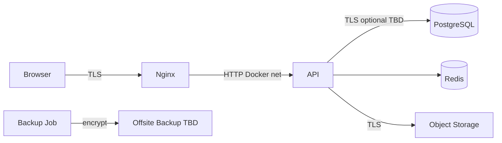

# 92 — Data Security

## Purpose

Define how Neurolinx protects data at rest and in transit, handles PII, and links to backup/recovery practices.

## Scope

PostgreSQL, Redis, file storage, application secrets, logs, and backups. Payment card data is intentionally excluded from storage — see [94_PAYMENT_SECURITY.md](./94_PAYMENT_SECURITY.md).

## Requirements

1. Encrypt data in transit (TLS) for staging/production.
2. Protect data at rest with appropriate disk/volume and/or DB encryption — **TBD** exact hosting controls.
3. Minimize PII collection; restrict access by role.
4. Backups are encrypted and access-controlled; recovery tested ([124_BACKUP_AND_RECOVERY.md](./124_BACKUP_AND_RECOVERY.md)).
5. Logs must not contain secrets or full sensitive payloads.

## Technical Decisions

| Area | Decision |
|------|----------|
| In transit | TLS 1.2+ via Nginx; internal Docker network trusted but not exposed |
| At rest | Rely on VPS/volume encryption + DB controls — **TBD** provider specifics |
| PII fields | Classify and restrict in API projections |
| Redis | No long-term PII store; use TTLs; auth to Redis in prod |
| Secrets | Environment variables / secret files; rotate on compromise |
| Backups | Automated DB dumps; encrypted storage — **TBD** tool |

## Data Classification (Guide)

| Class | Examples | Handling |
|-------|----------|----------|
| Public | Product names, public specs, blog | Cacheable |
| Internal | Inventory strategy, admin notes | Authenticated staff |
| PII | Name, email, phone, addresses | Need-to-know; audit access for exports |
| Sensitive auth | Password hashes, refresh tokens | Hash/encrypt; never log |
| Financial refs | Order totals, gateway payment IDs | No PAN/CVV storage |
| Secrets | API keys, DB passwords | Secret manager / env only |

## Encryption

### At rest

- Database volumes encrypted at host level where available.
- Backup artifacts encrypted before offsite copy.
- Application-level field encryption for highly sensitive fields — **TBD** if needed beyond hashes.

### In transit

- Public endpoints: HTTPS only (HSTS in prod).
- Redirect HTTP → HTTPS at Nginx.
- Admin access over HTTPS only.

## PII Handling

| Practice | Detail |
|----------|--------|
| Collection | Only fields required for account, shipping, enquiry, invoicing |
| Access | RBAC; customer can access own data |
| Display | Mask where appropriate (e.g., partial phone) — **TBD** rules |
| Export | Admin export permission + audit |
| Deletion / anonymization | Process **TBD** (legal retention requirements unknown) |
| Third parties | Payment gateway, email provider — DPA **TBD** |

Do not invent GDPR/CCPA legal commitments here; legal basis and retention schedules are **TBD**.

## Redis & Cache

- Do not cache raw refresh tokens in multi-tenant shared logs.
- Prefer opaque IDs in cache keys, not emails, where practical.
- Require Redis AUTH/ACL in non-local environments.
- Flush policies documented for PII-bearing keys.

## Logging & Monitoring Linkage

- Redact Authorization headers, cookies, passwords, card fields.
- Correlate security incidents via audit + app logs ([125_MONITORING_AND_LOGGING.md](./125_MONITORING_AND_LOGGING.md)).

## Backups Linkage

| Item | Requirement |
|------|-------------|
| Scope | PostgreSQL primary; media backup strategy **TBD** |
| Encryption | Required for offsite |
| Access | Limited ops roles |
| Test restore | Periodic — frequency **TBD** |
| RPO/RTO | **TBD** — see [124_BACKUP_AND_RECOVERY.md](./124_BACKUP_AND_RECOVERY.md) |

## Functional Requirements

| ID | Requirement |
|----|-------------|
| FR-DATA-01 | TLS enforced for public staging/prod endpoints |
| FR-DATA-02 | PII access restricted by RBAC and ownership |
| FR-DATA-03 | Secrets excluded from git and logs |
| FR-DATA-04 | Backup encryption and access controls documented and applied |

## Non-Functional Requirements

| ID | Requirement |
|----|-------------|
| NFR-DATA-01 | Data protection controls fail closed on misconfiguration where feasible |
| NFR-DATA-02 | Key/secret rotation procedure exists — **TBD** runbook detail |

## Dependencies

- Hosting/VPS encryption capabilities
- Backup tooling ([124_BACKUP_AND_RECOVERY.md](./124_BACKUP_AND_RECOVERY.md))
- Spring Security / RBAC

## Constraints

- Never store CVV/PAN.
- Never commit `.env` production secrets.
- Do not use production dumps in local dev without anonymization.

## Acceptance Criteria

- [ ] HTTPS verified on staging/prod.
- [ ] Redis authenticated in prod compose/deploy.
- [ ] Log redaction verified in sample auth failure logs.
- [ ] Backup encryption and restricted access verified.
- [ ] Restore drill scheduled or documented as TBD with owner.

## Open Items (TBD)

- Field-level encryption needs
- Legal retention / erasure process
- Offsite backup vendor
- RPO/RTO targets
- Media/file backup cadence

## Related Documents

- [90_SECURITY_ARCHITECTURE.md](./90_SECURITY_ARCHITECTURE.md)
- [94_PAYMENT_SECURITY.md](./94_PAYMENT_SECURITY.md)
- [124_BACKUP_AND_RECOVERY.md](./124_BACKUP_AND_RECOVERY.md)
- [68_FILE_STORAGE.md](./68_FILE_STORAGE.md)
