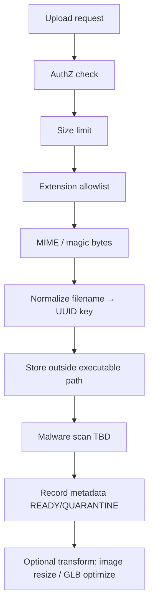

# 93 — File Upload Security

## Purpose

Define secure handling of user- and admin-uploaded files including images, documents, and 3D models (GLB/GLTF), covering type validation, size limits, malware scanning (**TBD**), and path traversal prevention.

## Scope

All upload endpoints: product media, datasheets, enquiry attachments, CMS assets, 3D models. Storage architecture: [68_FILE_STORAGE.md](./68_FILE_STORAGE.md). 3D pipeline: [80_3D_ARCHITECTURE.md](./80_3D_ARCHITECTURE.md).

## Requirements

1. Only allowlisted file types may be stored and served.
2. Enforce size limits per category.
3. Prevent path traversal and arbitrary file overwrite.
4. Serve user content with safe `Content-Type` and disposition where needed.
5. Malware scanning is desired; implementation **TBD**.

## Technical Decisions

| Topic | Decision |
|-------|----------|
| Validation | Extension allowlist + MIME + magic-byte sniffing |
| Storage keys | Server-generated UUIDs; never use raw user filenames as paths |
| Location | Object storage or controlled volume outside web root execution |
| Execution | Uploaded files never executed by backend |
| 3D | GLB preferred; GLTF packages carefully validated |
| Images | Re-encode/strip metadata where feasible — **TBD** |
| Docs | Prefer PDF; block Office macros sources if not required — **TBD** |

## Allowed Categories (Guide)

| Category | Extensions (guide) | Max size (guide) | Notes |
|----------|--------------------|------------------|-------|
| Images | `.jpg`, `.jpeg`, `.png`, `.webp`, `.avif` (gif **TBD**) | **TBD** (e.g., 5–10 MB) | Reprocess recommended |
| Documents | `.pdf` (+ others **TBD**) | **TBD** (e.g., 20 MB) | Datasheets/manuals |
| 3D | `.glb`, `.gltf` (+ `.bin` only as part of controlled package **TBD**) | **TBD** (e.g., 30–50 MB raw) | Optimize before public |
| Video | **TBD** | **TBD** | May use external hosting |

Exact limits finalized with product/ops — mark unknown as **TBD** in config, not code comments only.

## Validation Pipeline

### Path traversal prevention

- Reject names containing `..`, `/`, `\`, null bytes.
- Do not concatenate user filename into filesystem paths.
- Storage key format: `{tenant?}/{yyyy}/{mm}/{uuid}.{ext}`.
- Download/serve by id lookup, not by free-form path param.

### GLTF-specific risks

- External buffer/URI references can cause SSRF or broken trust — prefer GLB or rewrite URIs to stored objects.
- Disallow `javascript:` or unexpected schemes in any embedded extras.
- Cap uncompressed expansion ratio if unzipping packages — **TBD**.

## Serving Uploaded Content

| Control | Guidance |
|---------|----------|
| Content-Type | From server allowlist map, not client alone |
| Content-Disposition | `attachment` for untrusted docs; inline for trusted images |
| CSP / framing | Avoid hosting executable HTML uploads |
| AuthZ | Private docs (invoices) require auth; public product media OK |
| Cache | Public assets cacheable; private not shared-cache |

## Malware Scanning (TBD)

| Option | Status |
|--------|--------|
| ClamAV in processing worker | **TBD** |
| Cloud scanner API | **TBD** |
| None initially + manual review for admin-only | Acceptable interim only if risk accepted |

Until scanning exists: restrict upload roles (prefer admin-authenticated uploads for 3D/docs), rate-limit, and quarantine large unusual files.

## Functional Requirements

| ID | Requirement |
|----|-------------|
| FR-UPL-01 | Uploads require appropriate authentication/authorization |
| FR-UPL-02 | Non-allowlisted types rejected with 4xx |
| FR-UPL-03 | Size limits enforced before full accept |
| FR-UPL-04 | Stored object keys are server-generated |
| FR-UPL-05 | Fetch by id enforces visibility rules |

## Non-Functional Requirements

| ID | Requirement |
|----|-------------|
| NFR-UPL-01 | Upload endpoints rate-limited |
| NFR-UPL-02 | Failures do not leave orphaned executable content in web root |
| NFR-UPL-03 | Processing errors surfaced as asset `FAILED` status for 3D/media |

## Dependencies

- Media module, storage driver, optional async worker
- Nginx client max body size alignment ([122_NGINX_CONFIGURATION.md](./122_NGINX_CONFIGURATION.md))

## Constraints

- Never trust `Content-Type` header alone.
- Never store uploads under classpath or SPA `index.html` directory as executable.
- Do not allow SVG as unconstrained HTML-equivalent without sanitization — SVG **TBD**/likely disallowed initially.

## Acceptance Criteria

- [ ] Path traversal payloads rejected in tests.
- [ ] Double extension / mismatched magic-byte files rejected.
- [ ] 3D upload accepts GLB and rejects `.exe`/`.html`.
- [ ] Nginx and app size limits aligned.
- [ ] Malware scanning marked TBD with interim compensating controls documented.

## Open Items (TBD)

- Final size limits per category
- AV product choice
- Image re-encoding pipeline
- Whether customers may upload enquiry attachments vs admin-only
- Video strategy

## Related Documents

- [90_SECURITY_ARCHITECTURE.md](./90_SECURITY_ARCHITECTURE.md)
- [80_3D_ARCHITECTURE.md](./80_3D_ARCHITECTURE.md)
- [82_3D_MODEL_GUIDELINES.md](./82_3D_MODEL_GUIDELINES.md)
- [68_FILE_STORAGE.md](./68_FILE_STORAGE.md)
- [114_SECURITY_TESTING.md](./114_SECURITY_TESTING.md)
