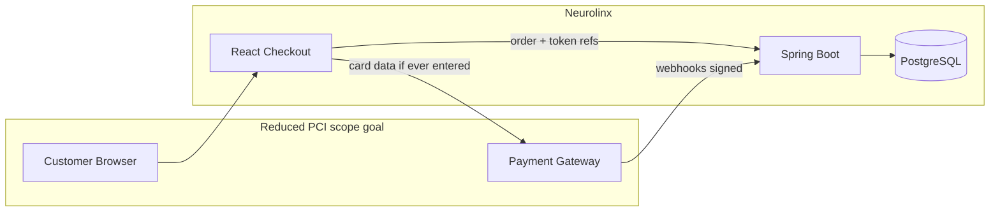

# 94 — Payment Security

## Purpose

Define payment security requirements for Neurolinx e-commerce, including PCI-DSS considerations, prohibition of raw card storage, and tokenization via a payment gateway.

## Scope

Checkout payment capture, refunds, webhooks, and storage of payment references. Business checkout flows: [43_PAYMENT.md](./43_PAYMENT.md). API webhook security: [91_API_SECURITY.md](./91_API_SECURITY.md).

## Requirements

1. **Do not store raw card numbers (PAN), CVV, or full track data** in Neurolinx databases, logs, or files.
2. Use a reputable payment gateway with tokenization / hosted fields / redirect — exact vendor **TBD**.
3. Protect payment-related APIs with authn, idempotency, and webhook signature verification.
4. Log payment events without sensitive card data.
5. Align practices with PCI-DSS SAQ-appropriate scope reduction (aim: outsource card data handling).

## Technical Decisions

| Topic | Decision |
|-------|----------|
| Card UI | Hosted checkout or gateway.js / Elements-style — **TBD** by vendor |
| Stored payment refs | Gateway customer/payment method tokens only |
| Server responsibility | Create payment intents/orders; verify webhooks; update order status |
| Currency / tax | Business rules in commerce docs — not redefined here |
| 3-D Secure | Enable when supported/required — **TBD** regional rules |

## PCI-DSS Considerations



### Scope reduction principles

- Prefer redirect or gateway-hosted fields so PAN never touches Neurolinx servers.
- If using gateway JS tokenization, ensure PAN is sent only to gateway endpoints.
- Complete SAQ type appropriate to integration — **TBD** with compliance advisor.
- Maintain inventory of systems in scope.

**Neurolinx must not become a card-data storage environment.**

## Tokenization Flow (Logical)

```mermaid
sequenceDiagram
  participant U as Customer
  participant FE as Checkout UI
  participant API as Neurolinx API
  participant GW as Payment Gateway

  U->>FE: Review order
  FE->>API: Create order / payment session
  API->>GW: Create payment intent/session
  GW-->>API: session id / client secret
  API-->>FE: client session data
  U->>GW: Submit card via hosted/tokenized UI
  GW-->>FE: success / token result
  GW->>API: Webhook payment confirmed
  API->>API: Verify signature; mark order paid
  API-->>U: Confirmation
```

## Data Allowed vs Forbidden

| Allowed to store | Forbidden |
|------------------|-----------|
| Order id, amount, currency | PAN (full card number) |
| Gateway payment id / charge id | CVV/CVC |
| Token / payment method id from gateway | Magnetic stripe / chip cryptograms |
| Last4 + brand if provided by gateway | Full track2 |
| Payment status, failure codes | Unencrypted bank secrets |

## Application Controls

| Control | Detail |
|---------|--------|
| AuthZ | Only order owner or admin finance roles |
| Idempotency | Prevent double-charge on retries |
| Webhooks | Verify signature/secret; treat as source of truth for settlement when designed so |
| Replay | Reject duplicate event ids |
| Admin refunds | Permission + audit log |
| Amount integrity | Server recalculates payable amount; never trust client totals |

## Logging

- Log: orderId, paymentId, status, amount, error codes.
- Never log: card numbers, CVV, raw gateway payloads if they embed PAN (strip/redact).

## Functional Requirements

| ID | Requirement |
|----|-------------|
| FR-PAYSEC-01 | No PAN/CVV columns or fields in Neurolinx schema |
| FR-PAYSEC-02 | Payments processed via gateway tokenization/hosted flow |
| FR-PAYSEC-03 | Webhooks signature-verified |
| FR-PAYSEC-04 | Refunds and captures audited |
| FR-PAYSEC-05 | Client-supplied totals not trusted for charge amount |

## Non-Functional Requirements

| ID | Requirement |
|----|-------------|
| NFR-PAYSEC-01 | Payment endpoints rate-limited and monitored |
| NFR-PAYSEC-02 | Secrets (gateway keys) rotated per ops runbook — **TBD** |
| NFR-PAYSEC-03 | Staging uses gateway test mode only |

## Dependencies

- Payment gateway vendor (**TBD**)
- Order module ([44_ORDER_MANAGEMENT.md](./44_ORDER_MANAGEMENT.md))
- [90_SECURITY_ARCHITECTURE.md](./90_SECURITY_ARCHITECTURE.md), [92_DATA_SECURITY.md](./92_DATA_SECURITY.md)

## Constraints

- Do not build a custom card vault.
- Do not process production payments against test keys or vice versa.
- Do not invent settlement/legal invoice rules here.

## Acceptance Criteria

- [ ] Architecture review confirms PAN never touches Neurolinx servers (or documents residual scope if unavoidable).
- [ ] Schema review: no card secret fields.
- [ ] Webhook verification tests pass ([114_SECURITY_TESTING.md](./114_SECURITY_TESTING.md)).
- [ ] Refund permission + audit verified.
- [ ] Gateway vendor and SAQ path recorded when chosen.

## Open Items (TBD)

- Payment gateway selection
- Hosted fields vs redirect
- 3-D Secure policy
- SAQ type and QSA involvement
- Multi-currency acquiring

## Related Documents

- [43_PAYMENT.md](./43_PAYMENT.md)
- [42_CHECKOUT.md](./42_CHECKOUT.md)
- [91_API_SECURITY.md](./91_API_SECURITY.md)
- [114_SECURITY_TESTING.md](./114_SECURITY_TESTING.md)
- [90_SECURITY_ARCHITECTURE.md](./90_SECURITY_ARCHITECTURE.md)
